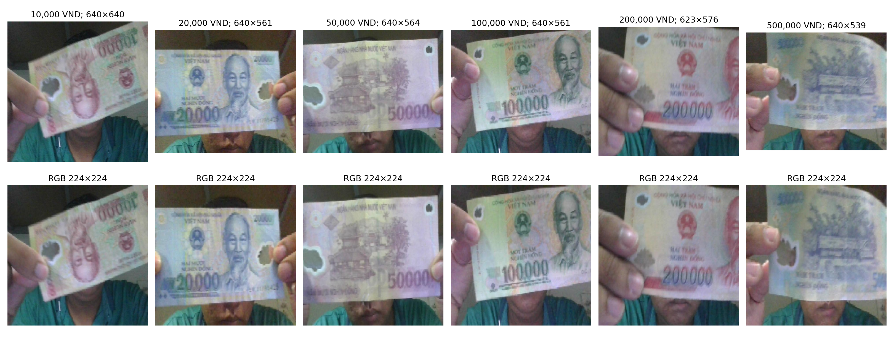
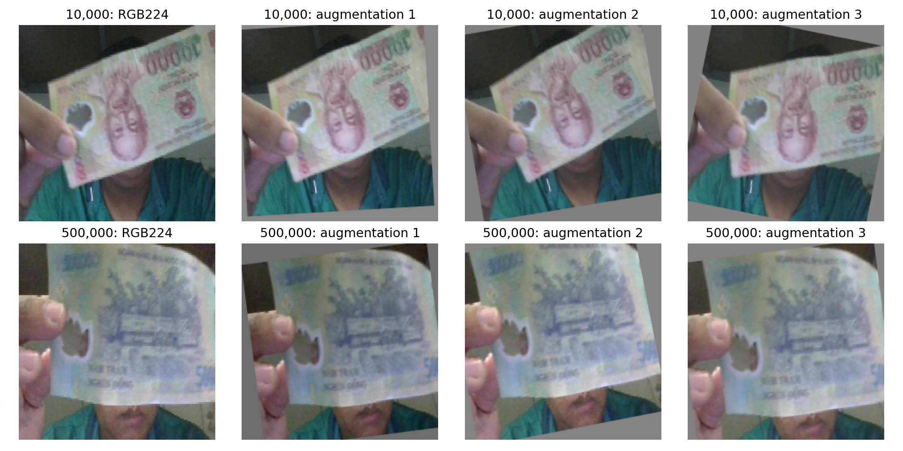
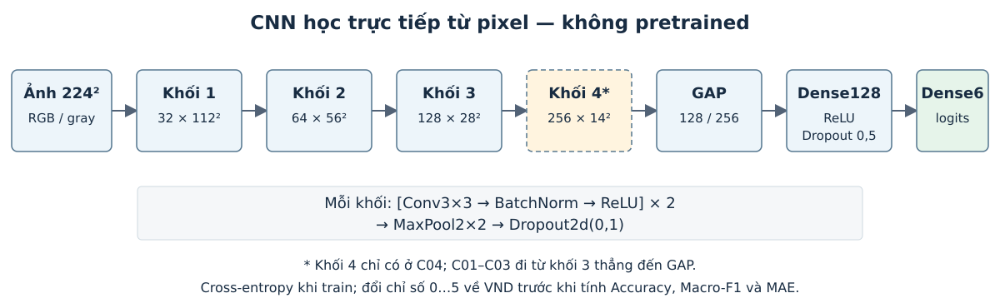
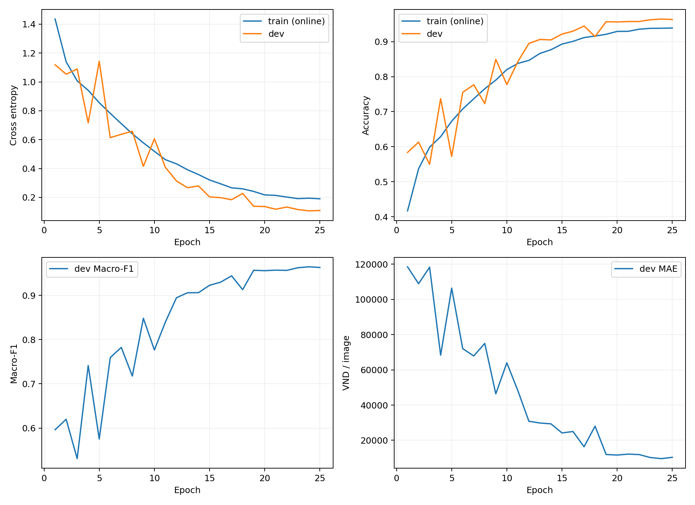
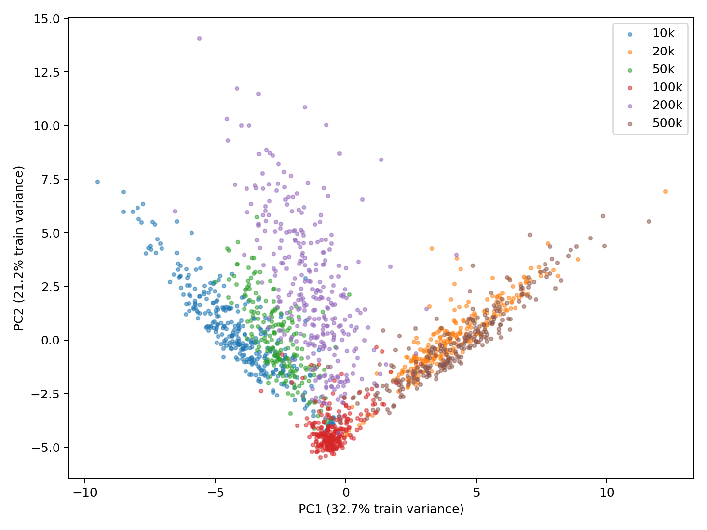
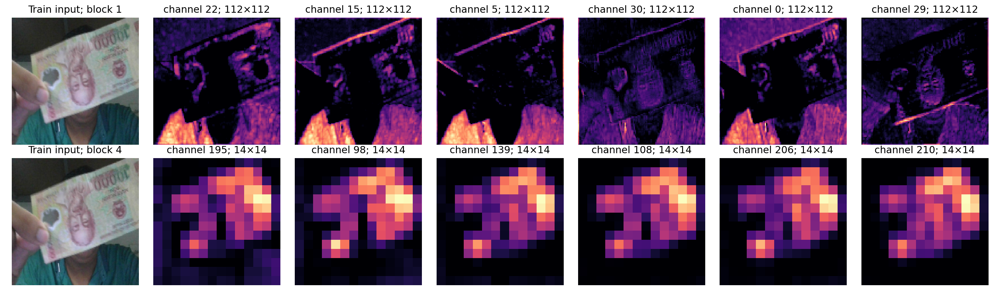
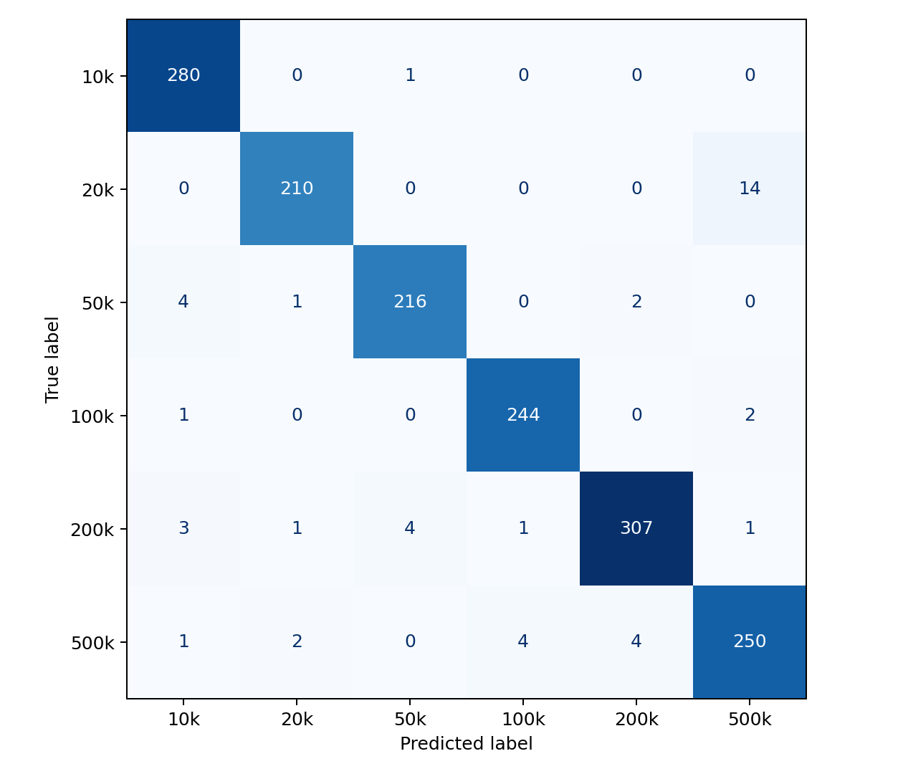
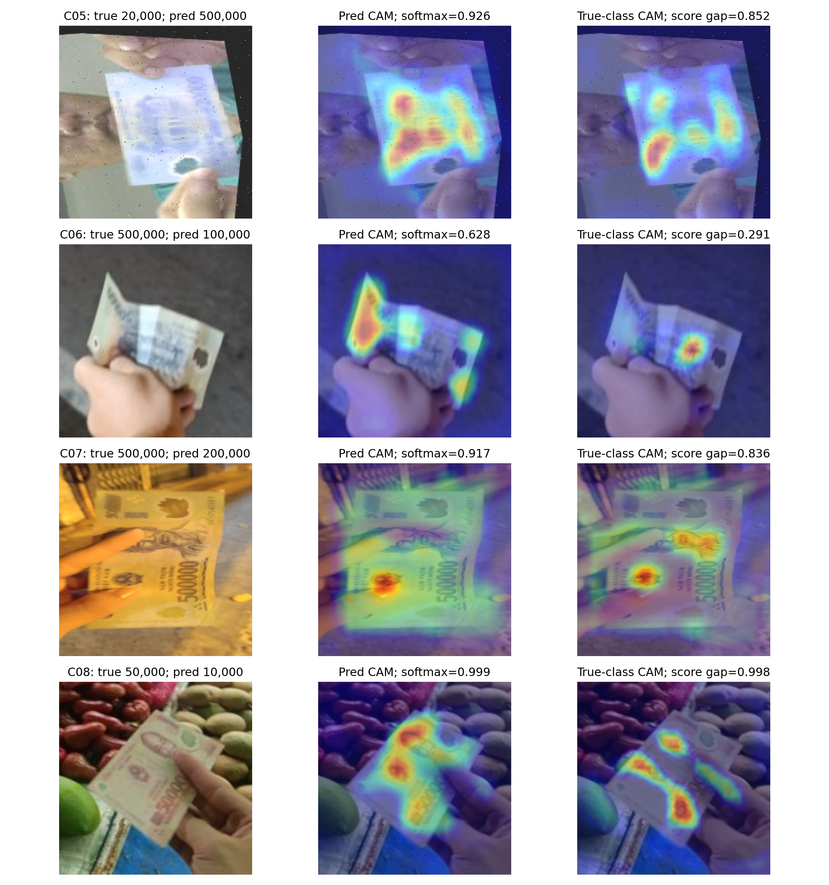
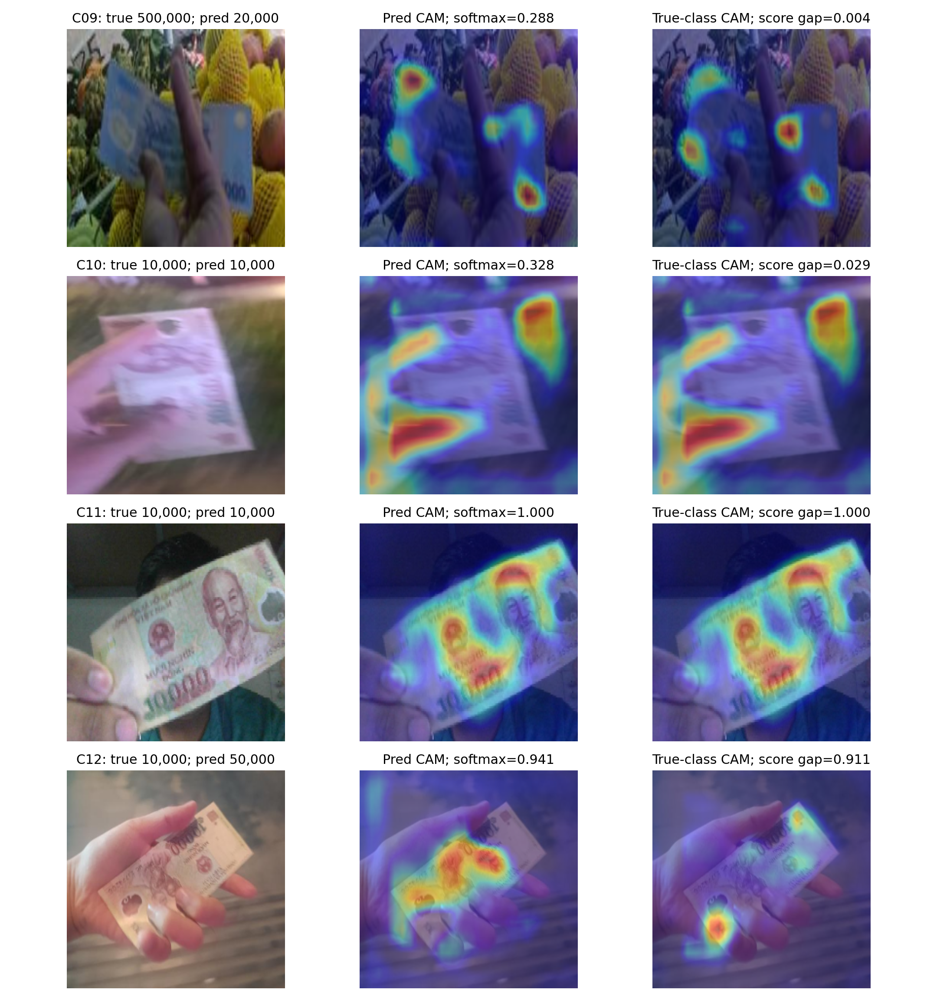

# Thực nghiệm phân loại tiền polymer Việt Nam bằng CNN

**Trạng thái: báo cáo kết quả đã đo.** Các bảng CNN dưới đây được tạo từ output đã kiểm tra.

CNN được chọn là **C04_DEEP_AUG, epoch 24**, đúng **1.507/1.553 ảnh test**: Accuracy **97,04%**, Macro-F1 **0,969963**, MAE **9.104,96đ/ảnh**. Các kết quả và so sánh dưới đây thuộc cùng split của dự án.

## 1. Mục tiêu và thiết lập thực nghiệm

Phần này đánh giá một CNN huấn luyện từ đầu trên cùng bộ dữ liệu đã dùng cho KNN và SVM. Mạng nhận pixel ảnh và tự học bộ lọc cùng bộ phân loại; không nhận histogram HSV12 hoặc HOG làm đầu vào. Bốn thí nghiệm khảo sát thông tin màu, augmentation và việc thêm một khối tích chập. Mục tiêu là chọn cấu hình và checkpoint trên dev, khóa trọng số, đánh giá test và phân tích các cặp nhầm mệnh giá.

Dữ liệu gồm sáu mệnh giá 10.000đ, 20.000đ, 50.000đ, 100.000đ, 200.000đ và 500.000đ, tổ chức theo `DATA/{train,dev,test}/{mệnh_giá}/*.png`. Train có **12.494 ảnh**, dev có **1.564 ảnh**, test có **1.553 ảnh**. Nguồn và quy trình M0 được mô tả tại README dự án: crop theo nhãn, loại trùng pixel hoàn toàn trong cùng lớp và chia tập theo nhóm ảnh gốc. Quy trình này chưa chứng minh đã loại hết ảnh gần trùng hoặc cùng tờ tiền vật lý xuyên split.

| Mệnh giá | Train | Dev | Test | Tổng |
|---|---:|---:|---:|---:|
| 10.000đ | 2.299 | 315 | 281 | 2.895 |
| 20.000đ | 1.916 | 238 | 224 | 2.378 |
| 50.000đ | 1.646 | 195 | 223 | 2.064 |
| 100.000đ | 1.918 | 250 | 247 | 2.415 |
| 200.000đ | 2.525 | 309 | 317 | 3.151 |
| 500.000đ | 2.190 | 257 | 261 | 2.708 |
| **Tổng** | 12.494 | 1.564 | 1.553 | 15.611 |

Train dùng cập nhật trọng số; dev dùng chọn checkpoint và một trong bốn cấu hình; test dùng đánh giá cấu hình đã khóa. Không gộp train+dev. Test đã từng được xem trong các thực nghiệm trước của dự án, nên không gọi đây là holdout hoàn toàn mới. Mỗi cấu hình dùng một seed; chưa có ước lượng độ bất định qua nhiều lần chạy.

## 2. Tiền xử lý ảnh đầu vào

Ảnh được đọc bằng `src.preprocessing.read_rgb224`: OpenCV đổi BGR thành RGB và resize trực tiếp 224×224 bằng `INTER_LINEAR`. Đây là cùng quy tắc hình học của KNN/SVM RGB224. Resize trực tiếp giữ nội dung crop nhưng có thể đổi tỷ lệ hình học. Ảnh nguồn không bị ghi đè. CNN chuyển ảnh thành tensor CHW float32 và chia 255 để đưa pixel về [0,1]; không áp chuẩn hóa ImageNet vì không dùng trọng số pretrained, không fit scaler và không L2 descriptor như KNN/SVM.

Biến thể ảnh xám chuyển RGB224 thành một kênh bằng OpenCV. Hai nhánh có augmentation chỉ biến đổi train: xoay trong ±12°, dịch chuyển tối đa 5% mỗi chiều, scale 0,95–1,05; thay đổi độ tương phản 0,9–1,1 quanh 127,5 và cộng độ sáng trong ±10% thang 255. Phần biên phát sinh được điền xám RGB(127,127,127). Không lật ảnh, không đổi hue/saturation. Đây là một gói biến đổi được khai báo trước, không phải kiểm định riêng từng phép biến đổi. Dev/test chỉ dùng resize và chia 255.

Label encoding dùng thứ tự mệnh giá theo số `[10000,20000,50000,100000,200000,500000]`, ánh xạ sang chỉ số 0…5 khi tính loss. Trước khi gọi hàm đánh giá chung, cả nhãn thật và dự đoán được đổi về VND. Không lấy thứ tự tên thư mục theo chuỗi làm thứ tự mệnh giá.

## 3. Kiến trúc và cách CNN học đặc trưng

Mạng cơ sở có ba khối với 32, 64 và 128 kênh. Mỗi khối gồm hai lần `Conv3×3 → BatchNorm → ReLU`, sau đó `MaxPool2×2 → Dropout2d(0,1)`. Conv dùng stride 1, padding 1, không bias vì đã có BatchNorm. Biến thể sâu thêm khối 256 kênh. Sau các khối là global average pooling (GAP), Dense128, ReLU, Dropout(0,5) và Dense6 trả về logits.

**Bảng CNN-1. Kích thước không gian của các khối.**

| Thành phần | CNN ba khối | CNN bốn khối |
|---|---|---|
| Đầu vào | 3×224×224; nhánh xám 1×224×224 | 3×224×224 |
| Khối 1 | 32×112×112 | 32×112×112 |
| Khối 2 | 64×56×56 | 64×56×56 |
| Khối 3 | 128×28×28 | 128×28×28 |
| Khối 4 | — | 256×14×14 |
| GAP | 128 chiều | 256 chiều |
| Bộ phân loại | Dense128 → Dropout0,5 → Dense6 | Dense128 → Dropout0,5 → Dense6 |
| Tổng tham số (RGB) | 304.742 | 1.206.886 |

Nhánh ảnh xám có 304.166 tham số; chênh 576 trọng số ở Conv đầu do số kênh đầu vào giảm từ ba xuống một. Đây là số tham số tính từ kiến trúc, không phải kết quả huấn luyện.

Conv học các phép đáp ứng cục bộ; ReLU tạo phi tuyến; pooling giảm kích thước feature map; GAP lấy trung bình không gian của mỗi kênh để tạo vector. BatchNorm dùng thống kê mini-batch khi train và thống kê đã tích lũy khi eval. Dropout tắt ngẫu nhiên kích hoạt trong train và được tắt khi đánh giá. Không có bảo đảm rằng một kênh cụ thể chỉ mã hóa màu, cạnh hay chữ số; việc gán ý nghĩa cần bằng chứng từ trực quan và đối chứng.

Trọng số Conv khởi tạo Kaiming normal (`fan_out`, ReLU); Dense dùng Xavier uniform, bias bằng 0; BatchNorm có scale 1 và bias 0. Các lựa chọn này là khởi tạo, không phải trọng số học từ ảnh ngoài dự án. Tổng tham số và shape thực tế được notebook 01 tính từ module và lưu trong `inputs/architecture.csv`.

**Bảng CNN-2. Thiết lập huấn luyện cố định.**

| Thành phần | Cấu hình |
|---|---|
| Seed | 42 cho mỗi thí nghiệm; seed theo epoch để hỗ trợ resume |
| Optimizer | AdamW, lr=0,001; betas=(0,9; 0,999); weight decay=0,0001 |
| Loss | CrossEntropyLoss trên logits; không class weight, không label smoothing |
| Batch / số epoch tối đa | 64 / 25 |
| Learning rate | CosineAnnealingLR theo epoch, eta_min=0,00001 |
| Dừng sớm | 6 epoch liên tiếp không cải thiện cặp (Macro-F1 dev, MAE dev) |
| Gradient / số học | Clip norm=5; CUDA dùng AMP; CPU dùng float32 |
| DataLoader | 2 workers; shuffle train, giữ thứ tự dev/test |
| Pretrained / refit | Không pretrained; không refit train+dev |

Cross-entropy học phân loại sáu lớp, không tối ưu trực tiếp MAE VND. MAE được dùng khi đánh giá và phá hòa trên dev. CuDNN benchmark và TF32 được tắt; thuật toán deterministic được yêu cầu ở chế độ cảnh báo. Seed không bảo đảm kết quả giống từng bit giữa phiên bản thư viện, loại GPU hoặc thiết bị khác nhau. Notebook dùng một GPU nếu có; không cộng hai GPU T4 thành một GPU lớn.

Batch 64 là điểm khởi đầu để cân bằng bộ nhớ GPU và thống kê BatchNorm. Learning rate 0,001 phù hợp làm mốc khảo sát AdamW; weight decay 0,0001 và dropout tạo regularization ở mức khai báo cố định. GAP giữ đầu phân loại gọn hơn việc Flatten toàn bộ lưới 28×28×128. Cosine schedule không cần chọn tốc độ giảm từ test; giới hạn 25 epoch và patience 6 khống chế ngân sách mỗi lượt. Các giá trị này dễ đối chiếu giữa bốn cấu hình, chưa được coi là bộ tham số tối ưu hoặc bảo đảm đã hội tụ.

## 4. Thí nghiệm từng biểu diễn và nhận xét

**Bảng CNN-3. Bốn cấu hình được khai báo trước khi khảo sát dev.**

| Thứ tự | Mã | Đầu vào | Khối | Augmentation train | Câu hỏi |
|---:|---|---|---|---|---|
| 1 | C01_RGB | RGB | 32–64–128 | Không | Mốc CNN học trực tiếp từ pixel |
| 2 | C02_GRAY | Ảnh xám | 32–64–128 | Không | Ảnh hưởng của việc bỏ thông tin màu |
| 3 | C03_RGB_AUG | RGB | 32–64–128 | Có | Ảnh hưởng của gói augmentation |
| 4 | C04_DEEP_AUG | RGB | 32–64–128–256 | Có | Ảnh hưởng của thêm một khối và dung lượng mạng |

C02 đổi cả biểu diễn đầu vào và số trọng số ở Conv đầu, nên không cô lập hoàn toàn màu sắc. C03 thay đổi nhiều phép augmentation cùng lúc. C04 đồng thời tăng tham số và giảm kích thước không gian sâu nhất. Cùng seed không đồng nghĩa mọi trọng số khởi tạo của các kiến trúc là bản sao của nhau. Chỉ báo cáo tác động của các cấu hình cụ thể trong phạm vi khảo sát.

### 4.1. RGB: mốc CNN cơ sở

C01_RGB đúng **1.463/1.564 ảnh dev**, đạt Accuracy **93,54%**, Macro-F1 **0,935554**, MAE **17.794,12đ/ảnh** ở epoch **25**. Đây là mốc mạng ba khối nhận RGB và không augmentation. Kết quả thể hiện khả năng học trực tiếp từ pixel, chưa tách được tác dụng của màu tờ tiền khỏi nền, ánh sáng và bố cục.

### 4.2. Ảnh xám: bỏ thông tin màu

C02_GRAY đúng **625/1.564 ảnh dev**, đạt Accuracy **39,96%**, Macro-F1 **0,352394**, MAE **141.585,68đ/ảnh** ở epoch **25**. Macro-F1 chênh **-0,583160** so với C01. Tại checkpoint này, train Accuracy online là **36,71%**, dev loss là **1,5336**. Nhánh xám chưa học tốt trong cấu hình/ngân sách này. Việc bỏ màu của toàn ảnh có liên quan đến khác biệt biểu diễn, nhưng cũng đổi Conv đầu và quá trình tối ưu; chưa chứng minh mọi CNN xám đều kém hoặc màu nền không góp phần. Checkpoint tốt nhất ở đúng cuối lượt chạy; chưa có bằng chứng cấu hình đã hội tụ hoàn toàn.

### 4.3. RGB có augmentation

C03_RGB_AUG đúng **1.463/1.564 ảnh dev**, đạt Accuracy **93,54%**, Macro-F1 **0,935862**, MAE **18.478,26đ/ảnh** ở epoch **24**. So với C01, Macro-F1 chênh **+0,000308**, còn MAE chênh **+684,14đ/ảnh**. Hai cấu hình có cùng số ảnh đúng nhưng phân bố dự đoán theo lớp và mức chênh mệnh giá khác nhau. Đây là đánh đổi: Macro-F1 tăng nhưng MAE xấu hơn; không kết luận augmentation cải thiện mọi tiêu chí. Quy tắc ưu tiên Macro-F1 trước MAE được giữ nguyên; gói augmentation chưa được tách từng phép để kiểm định nguyên nhân.

### 4.4. Thêm khối tích chập 256 kênh

C04_DEEP_AUG đúng **1.508/1.564 ảnh dev**, đạt Accuracy **96,42%**, Macro-F1 **0,964559**, MAE **9.584,40đ/ảnh** ở epoch **24**. So với C03 có cùng augmentation, số ảnh đúng chênh **+45**, Macro-F1 chênh **+0,028697**, MAE chênh **-8.893,86đ/ảnh**. Thêm khối đồng thời tăng số tham số, số chiều GAP và đổi độ phân giải feature map cuối, nên kết quả đánh giá cả cấu hình mở rộng; chưa cô lập riêng hiệu quả độ sâu.

Learning curve ghi train loss/Accuracy trong các mini-batch đang cập nhật trọng số, với dropout và augmentation nếu có; dev được chấm bằng model.eval() sau mỗi epoch. Vì cách tính khác nhau, khoảng cách hai đường không phải phép đo thuần túy duy nhất của overfitting. Mỗi epoch chấm toàn bộ dev một lần, không lấy trung bình Macro-F1 theo batch.

Sau khi khóa mô hình, notebook 06 lưu vector GAP của train/dev ở chế độ eval. PCA hai chiều được fit trên toàn train, rồi transform dev để trực quan. PCA này không được đưa vào bộ phân loại, không tham gia chọn checkpoint và không giống thí nghiệm HOG-PCA của KNN/SVM. Khoảng chồng lấn hay phân cụm trong hai trục không thay thế metric ở toàn bộ không gian đặc trưng.

Biểu diễn của cấu hình đã chọn có **256 chiều**. Hai trục PCA giữ lần lượt **32,67%** và **21,21%**, tổng **53,88% phương sai train**. Phần phương sai còn lại không xuất hiện trên hình, nên việc hai lớp chồng lấn ở PCA2 chưa chứng minh chúng không thể phân biệt trong không gian GAP đầy đủ.

Feature map được minh họa ở khối đầu và khối cuối trên một ảnh train cố định; mỗi khối chọn sáu kênh có đáp ứng trung bình lớn nhất, không chọn theo độ đẹp. Thang màu từng kênh được tự co giãn nên không dùng để so độ lớn tuyệt đối giữa kênh.

## 5. Tổng hợp dev và khóa phương án cuối

Chọn checkpoint mỗi cấu hình bằng Macro-F1 dev chưa làm tròn cao nhất, hòa chính xác thì MAE thấp hơn, vẫn hòa giữ epoch sớm hơn. Dừng sớm dùng cùng cặp tiêu chí. Khi so bốn cấu hình, ưu tiên Macro-F1 rồi MAE, sau đó thứ tự C01…C04 và epoch. Đây là một split dev và tối đa 100 lượt epoch được quan sát, không phải cross-validation hay 100 cấu hình độc lập.

**Bảng CNN-4. Checkpoint tốt nhất trên dev của mỗi cấu hình.**

| Cấu hình | Epoch chọn | Epoch chạy | Tham số | Accuracy | Macro-F1 | MAE (đ/ảnh) |
|---|---:|---:|---:|---:|---:|---:|
| C01_RGB | 25 | 25 | 304.742 | 93,54% | 0,935554 | 17.794,12 |
| C02_GRAY | 25 | 25 | 304.166 | 39,96% | 0,352394 | 141.585,68 |
| C03_RGB_AUG | 24 | 25 | 304.742 | 93,54% | 0,935862 | 18.478,26 |
| C04_DEEP_AUG | 24 | 25 | 1.206.886 | 96,42% | 0,964559 | 9.584,40 |

Phương án đã khóa là **C04_DEEP_AUG**, checkpoint epoch **24**; biểu diễn GAP có **256 chiều**. Trọng số được giữ nguyên khi chuyển sang test. Epoch cuối 25 có Macro-F1 **0,963115**, MAE **10.326,09đ/ảnh**; không thay checkpoint đã chọn bằng trọng số của epoch cuối.

Notebook 06 ghi hash cho protocol, manifest, lịch sử, dự đoán dev, bảng tổng hợp, checkpoint và mã xử lý. Notebook 07 kiểm tra khóa và nạp chính trọng số đã chọn; không khởi tạo lại để huấn luyện một lượt mới. `last.pt` phục vụ tiếp tục một lượt bị ngắt ở ranh giới epoch; `best.pt` là checkpoint được chọn. Một lượt đã hoàn tất sẽ được kiểm tra hash và đọc lại thay vì train lại khi Run All.

**Bảng CNN-5. Thời gian train/dev cộng từ lịch sử epoch.**

| Cấu hình | Epoch chạy | Train (phút) | Dev (phút) | Tổng (phút) |
|---|---:|---:|---:|---:|
| C01_RGB | 25 | 37,71 | 4,75 | 42,47 |
| C02_GRAY | 25 | 34,56 | 4,41 | 38,98 |
| C03_RGB_AUG | 25 | 39,17 | 4,72 | 43,89 |
| C04_DEEP_AUG | 25 | 38,67 | 4,72 | 43,39 |

Tổng thời gian train và chấm dev của bốn cấu hình là **168,72 phút**. Môi trường được ghi: Python 3.13.16, PyTorch 2.11.0+cu130, NumPy 2.1.3, OpenCV 4.14.0, scikit-learn 1.6.1, thiết bị cuda:0 (Tesla T4). Tổng tính từ giây gốc trước khi làm tròn từng hàng. Thời gian cộng từ log epoch, chưa gồm sao chép output, vẽ hình, phân tích đặc trưng và các bước khác; không dùng làm benchmark tốc độ với KNN/SVM. Cả bốn cấu hình chạy đủ 25 epoch; không lượt nào dừng sớm.

[Phụ lục lịch sử epoch](PHU_LUC_LICH_SU_EPOCH_CNN.csv) giữ đủ **100 dòng** với loss, Accuracy, Macro-F1, MAE, learning rate và thời gian gốc; không làm tròn trước khi chọn checkpoint.

## 6. Đánh giá phương án đã khóa trên test

**Bảng CNN-6. Kết quả dev và test của cấu hình đã khóa.**

| Tập | Số ảnh | Số đúng | Accuracy | Macro-F1 | MAE (đ/ảnh) |
|---|---:|---:|---:|---:|---:|
| Dev | 1.564 | 1.508 | 96,42% | 0,964559 | 9.584,40 |
| Test | 1.553 | 1.507 | 97,04% | 0,969963 | 9.104,96 |

CNN dự đoán đúng **1.507/1.553 ảnh test**, còn **46 lỗi**. Tổng chênh lệch danh nghĩa là **14.140.000đ**; chia cho toàn bộ 1.553 ảnh thu được MAE đã báo cáo. So với dev, Accuracy chênh **+0,62 điểm phần trăm**, Macro-F1 **+0,005404**, MAE **-479,44đ/ảnh**. Khác biệt giữa hai split không chứng minh mô hình tốt hơn trên mọi dữ liệu mới. Suy luận kèm đọc ảnh mất **83,19 giây** ở lượt này; không có bước fit lại trong notebook test.

**Bảng CNN-7. Precision, Recall và F1 theo mệnh giá trên test.**

| Mệnh giá | Support | Precision | Recall | F1 |
|---:|---:|---:|---:|---:|
| 10.000đ | 281 | 0,9689 | 0,9964 | 0,9825 |
| 20.000đ | 224 | 0,9813 | 0,9375 | 0,9589 |
| 50.000đ | 223 | 0,9774 | 0,9686 | 0,9730 |
| 100.000đ | 247 | 0,9799 | 0,9879 | 0,9839 |
| 200.000đ | 317 | 0,9808 | 0,9685 | 0,9746 |
| 500.000đ | 261 | 0,9363 | 0,9579 | 0,9470 |

Lớp 100.000đ có F1 cao nhất (**0,9839**), còn 500.000đ thấp nhất (**0,9470**). Recall thấp nhất thuộc lớp 20.000đ (**93,75%**). Số ảnh mỗi lớp không đều; bảng này bổ sung cho Accuracy và Macro-F1 tổng thể.

Độ đo dùng cùng `src.evaluation.value_metrics.evaluate_classification` với KNN/SVM. Macro-F1 là trung bình F1 của sáu lớp. MAE = `Σ |mệnh_giá_thật − mệnh_giá_dự_đoán| / N`, tính trên toàn bộ ảnh; ảnh đúng góp 0. MAE có đơn vị đồng/ảnh và mô tả chênh lệch danh nghĩa. Softmax chỉ dùng mô tả điểm của mô hình, chưa được hiệu chỉnh thành xác suất đúng; không dùng ngưỡng để bỏ ảnh khó trong bảng test chính.

## 7. Phân tích lỗi và chênh lệch mệnh giá

**Bảng CNN-8. Các cặp nhầm đóng góp tổng chênh lệch lớn nhất, giữ hai chiều riêng.**

| Thật → dự đoán | Số lỗi | Chênh/lỗi | Tổng chênh |
|---|---:|---:|---:|
| 20.000 → 500.000 | 14 | 480.000 | 6.720.000 |
| 500.000 → 100.000 | 4 | 400.000 | 1.600.000 |
| 500.000 → 200.000 | 4 | 300.000 | 1.200.000 |
| 500.000 → 20.000 | 2 | 480.000 | 960.000 |
| 100.000 → 500.000 | 2 | 400.000 | 800.000 |

Gộp hai chiều, cặp **20.000đ ↔ 500.000đ** có **16 lỗi**, tổng chênh **7.680.000đ**, chiếm **54,31%** tổng chênh của CNN. Dù tỷ lệ đúng tổng cao, các cặp mệnh giá cách xa nhau vẫn có thể chi phối MAE; cần đọc cả số lỗi và độ lớn chênh lệch.

Notebook 08 chọn tối đa 12 ảnh không trùng: từ các chiều nhầm phổ biến, các chiều gây tổng chênh lệch lớn, ảnh sai có softmax cao hoặc hai điểm đầu sát nhau, và ảnh đúng đối chứng. Quy tắc chọn có thể kiểm tra trong `selected_cases.csv`; không dùng vài ví dụ thay số liệu toàn test. File `visual_review_notes.csv` dành cho quan sát, giả thuyết và điều chưa xác minh, được để trống đến khi người đọc thực sự xem ảnh.

Grad-CAM lấy gradient logit của lớp mục tiêu theo feature map ở ReLU thứ hai của khối cuối, trước MaxPool. Trọng số kênh là gradient trung bình theo không gian; tổng có trọng số được ReLU và co giãn về [0,1] riêng cho từng ảnh và lớp. Các map bằng 0 được giữ và ghi vào `gradcam_checks.csv`. So sánh cả lớp dự đoán và lớp thật để quan sát sự khác biệt, không coi heatmap là chứng minh mô hình đọc đúng chữ số hoặc nền là nguyên nhân gây lỗi. Màu nóng của hai map đã chuẩn hóa riêng không so sánh được độ lớn tuyệt đối.

**C08**: ảnh thật 50.000đ, dự đoán 10.000đ; softmax lớp thắng **0,998898**. Điểm cao vẫn đi kèm nhãn sai, nên không xem softmax là xác suất đúng được bảo đảm.

**C09**: ảnh thật 500.000đ, dự đoán 20.000đ; softmax lớp thắng **0,288079**, chênh hai điểm đầu **0,004080**. Lớp đứng thứ hai là 100.000đ; điểm lớp thật là **0,042403**. Hai điểm đầu sát nhau không có nghĩa lớp thật gần được chọn.

**C10**: ảnh thật 10.000đ, dự đoán 10.000đ; softmax lớp thắng **0,328291**, chênh hai điểm đầu **0,028763**. Đây là ảnh đúng có điểm thấp/sát nhau dùng làm đối chứng; chưa triển khai hoặc chọn ngưỡng từ chối trên test.

## 8. So sánh với KNN và SVM trên cùng dữ liệu

KNN RGB224 đã khóa dùng HSV12, k=1, uniform, Euclidean. SVM RGB224 đã khóa dùng HSV12+HOG, RBF C=10, gamma=scale. Bản sao CSV/JSON tham chiếu và SHA-256 nằm tại `src/CNN/reference_results`; nguồn commit được ghi riêng, không lấy số từ báo cáo trái cây. Trước khi so sánh, chương trình đối chiếu đường dẫn, nhãn và thứ tự ảnh trên cả ba manifest.

**Bảng CNN-9. Kết quả toàn bộ test của các phương án đã chọn bằng dev.**

| Phương pháp | Biểu diễn/cấu hình | Số đúng | Accuracy | Macro-F1 | MAE (đ/ảnh) |
|---|---|---:|---:|---:|---:|
| KNN | HSV12; k=1, uniform, Euclidean | 1.187 | 76,43% | 0,768710 | 53.947,20 |
| SVM | HSV12+HOG; RBF C=10, gamma=scale | 1.362 | 87,70% | 0,881102 | 32.891,18 |
| CNN | C04_DEEP_AUG; epoch 24 | 1.507 | 97,04% | 0,969963 | 9.104,96 |

CNN − KNN: số đúng **+320 ảnh**, Accuracy **+20,61 điểm phần trăm**, Macro-F1 **+0,201253**, MAE **-44.842,24đ/ảnh**. Tổng chênh lệch VND thay đổi **-69.640.000đ**. MAE giảm **83,12%** so với KNN.

CNN − SVM: số đúng **+145 ảnh**, Accuracy **+9,34 điểm phần trăm**, Macro-F1 **+0,088861**, MAE **-23.786,22đ/ảnh**. Tổng chênh lệch VND thay đổi **-36.940.000đ**. MAE giảm **72,32%** so với SVM.

**Bảng CNN-10. So sánh đúng/sai ghép cặp từng ảnh.**

| So với | Cả hai đúng | Chỉ CNN đúng | Chỉ đối chứng đúng | Cả hai sai |
|---|---:|---:|---:|---:|
| KNN | 1168 | 339 | 19 | 27 |
| SVM | 1339 | 168 | 23 | 23 |

So với KNN, CNN đúng **339** ảnh đối chứng sai, nhưng cũng sai **19** ảnh đối chứng đúng; chênh ròng **+320 ảnh**. So với SVM, CNN đúng **168** ảnh đối chứng sai, nhưng cũng sai **23** ảnh đối chứng đúng; chênh ròng **+145 ảnh**. Có **18 ảnh cả ba mô hình cùng sai**. Kết quả tổng tốt hơn chưa có nghĩa CNN luôn đúng ở từng ảnh.

**Bảng CNN-11. F1 test theo mệnh giá của ba phương án đã khóa.**

| Mệnh giá | KNN | SVM | CNN |
|---:|---:|---:|---:|
| 10.000đ | 0,7266 | 0,8525 | 0,9825 |
| 20.000đ | 0,8153 | 0,8826 | 0,9589 |
| 50.000đ | 0,7763 | 0,9309 | 0,9730 |
| 100.000đ | 0,8176 | 0,9300 | 0,9839 |
| 200.000đ | 0,7293 | 0,8477 | 0,9746 |
| 500.000đ | 0,7472 | 0,8429 | 0,9470 |

CNN học cả đặc trưng lẫn bộ phân loại; hai cấu hình có thể dùng augmentation. KNN/SVM dùng đặc trưng thủ công và không augmentation. Vì vậy, bảng so sánh đánh giá các pipeline hoàn chỉnh, chưa tách riêng hiệu quả của thuật toán, biểu diễn hay augmentation. Khác biệt phần cứng/thư viện và cách đo không cho phép suy luận tốc độ chung từ thời gian một lượt chạy.

## 9. Kết luận và giới hạn

Trong bốn cấu hình đã thử, **C04_DEEP_AUG** được chọn bằng dev và đạt trên test **Accuracy 97,04%, Macro-F1 0,969963, MAE 9.104,96đ/ảnh**. Kết luận chỉ áp dụng cho lượt chạy và bộ dữ liệu này.

Phạm vi hiện tại gồm một split, một seed, bốn cấu hình CNN gọn và tối đa 25 epoch mỗi cấu hình. Không có bảo đảm đây là kiến trúc hay learning rate tối ưu. Test đã có lịch sử được xem; metadata chưa bảo đảm độc lập theo mọi tờ tiền hoặc phiên chụp. Bài toán chỉ phân loại crop của sáu mệnh giá đã biết, chưa kiểm tra phát hiện tiền trong ảnh toàn cảnh, ảnh ngoài tập hoặc cơ chế từ chối dự đoán. Phân tích trực quan nêu dấu hiệu có thể quan sát, chưa định lượng nguyên nhân nếu chưa có nhãn điều kiện hoặc ablation riêng.

Một hướng mở rộng là chạy nhiều seed, tạo test độc lập theo nguồn hoặc phiên chụp và đánh dấu điều kiện ảnh để kiểm tra các giả thuyết về lỗi. Nếu tăng ngân sách epoch hoặc khảo sát augmentation khác, cần lưu thành lần thực nghiệm mới và chọn lại trên dev; giữ nguyên bản kết quả đã khóa ở đây.

**Kiểm tra số liệu.** Dự đoán test tính lại khớp Accuracy, Macro-F1, MAE, tổng chênh lệch và ma trận nhầm lẫn; ba manifest CNN/KNN/SVM khớp từng hàng. Có 41 file khóa được kiểm tra tại thời điểm dựng báo cáo. Bốn file best.pt đều có mặt và khớp hash đã khóa. Hash của khóa dùng trên test khớp khóa đã chọn. Kiểm tra xác nhận file và thứ tự ảnh, không chứng minh đã so sánh byte ảnh nguồn của mọi phiên huấn luyện. Hồ sơ và nguồn hình nằm trong `report_manifest.json`.

## Tài liệu kỹ thuật tham khảo

1. Dữ liệu, chuẩn metric và quy trình nhóm: `README.md`, `docs/EXPERIMENT_PLAN.md`, `docs/METRICS_STANDARD.md`, `src/evaluation/value_metrics.py`.
2. Ý tưởng CNN ba khối, BatchNorm, dropout và GAP từ tài liệu tham khảo “Hệ thống Phân loại Trái cây Tại Quầy Thu Ngân”, trang 27–30. Phần kế thừa và điều chỉnh được ghi trong `REFERENCE_NOTES.md`; không kế thừa kết quả, split hoặc nhãn trái cây.
3. [PyTorch Conv2d](https://docs.pytorch.org/docs/stable/generated/torch.nn.Conv2d.html), [CrossEntropyLoss](https://docs.pytorch.org/docs/stable/generated/torch.nn.CrossEntropyLoss.html), [AdamW](https://docs.pytorch.org/docs/stable/generated/torch.optim.AdamW.html), [AMP](https://docs.pytorch.org/docs/stable/amp.html).
4. Selvaraju và cộng sự, ICCV 2017. [Grad-CAM: Visual Explanations From Deep Networks via Gradient-Based Localization](https://openaccess.thecvf.com/content_ICCV_2017/html/Selvaraju_Grad-CAM_Visual_Explanations_ICCV_2017_paper.html).
5. Kết quả của dự án: `src/KNN/results_224`, nhánh SVM commit `6d87bc4`, và `src/CNN/results_224`. File CSV/JSON giữ số chưa làm tròn; Markdown dùng dấu phẩy thập phân và dấu chấm phân cách hàng nghìn.
