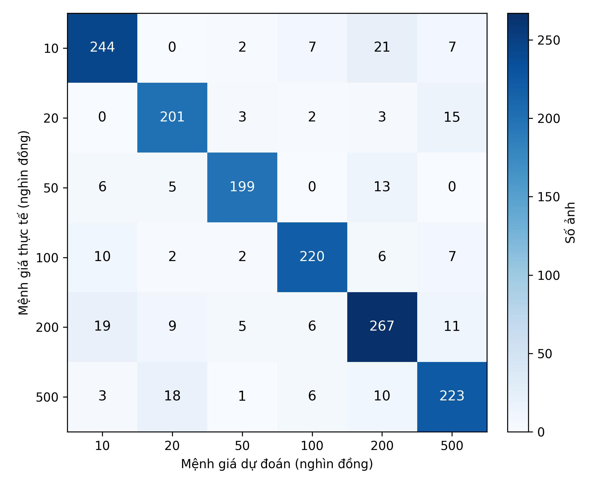
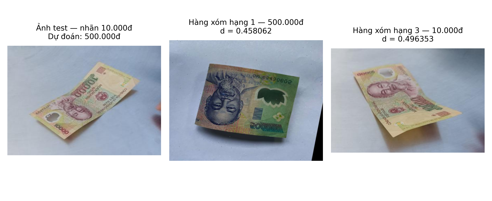
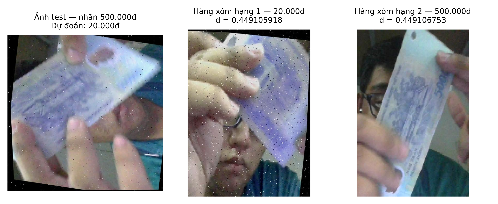

# Thực nghiệm và đánh giá phương pháp KNN

## 1. Mục tiêu và thiết lập thực nghiệm

Thực nghiệm KNN nhằm đánh giá mức độ phù hợp của các đặc trưng màu sắc và đường nét đối với bài toán phân loại sáu mệnh giá tiền polymer Việt Nam. Phần này trình bày năm cấu hình: Histogram RGB, Histogram HSV với 8 và 12 bin mỗi kênh, Color Moments và HOG. Với mỗi cấu hình, nhóm khảo sát các tham số KNN trên tập dev, chọn tổ hợp có kết quả tốt nhất rồi đánh giá trên test.

Bộ dữ liệu gồm 12.494 ảnh train, 1.564 ảnh dev và 1.553 ảnh test. Mỗi ảnh crop tương ứng với một nhãn thuộc sáu mệnh giá từ 10.000đ đến 500.000đ. Train được dùng để fit mô hình; dev dùng chọn đặc trưng và tham số. Sau khi khóa cấu hình, mô hình được fit trên train và đánh giá toàn bộ test, không gộp train với dev và không điều chỉnh cấu hình theo kết quả test.

Macro-F1 là tiêu chí lựa chọn chính để sáu lớp có vai trò ngang nhau khi tổng hợp kết quả. Nếu Macro-F1 bằng nhau, nhóm ưu tiên MAE_VND thấp hơn; nếu vẫn hòa, giữ cấu hình xuất hiện trước trong thứ tự khảo sát đã xác định. Accuracy, Precision, Recall, F1 từng lớp và ma trận nhầm lẫn được dùng để phân tích bổ sung. MAE_VND tính chênh lệch tuyệt đối giữa mệnh giá thật và dự đoán, lấy trung bình trên mọi ảnh, kể cả ảnh đúng với chênh lệch bằng 0. Công thức các độ đo đã được trình bày trong phần thiết kế đánh giá.

## 2. Biểu diễn ảnh và lựa chọn tham số

### 2.1. Các đặc trưng được sử dụng

KNN tìm các mẫu train gần ảnh cần phân loại trong không gian đặc trưng [1]. Vì vậy, cùng một thuật toán nhưng cách chuyển ảnh thành vector khác nhau có thể cho kết quả khác nhau. Bảng KNN-1 tóm tắt các biểu diễn trong phần thực nghiệm này.

**Bảng KNN-1. Cấu hình trích xuất đặc trưng.**

| Đặc trưng | Cách biểu diễn và xử lý | Số chiều |
| --- | --- | ---: |
| Histogram RGB | 256 bin trên từng kênh R, G, B; chuẩn hóa L2 riêng từng histogram rồi nối | 768 |
| Histogram HSV8 | Histogram kết hợp H, S, V, mỗi trục 8 bin; chuẩn hóa L2 toàn vector | 512 |
| Histogram HSV12 | Giữ cách tính của HSV8, tăng lên 12 bin mỗi trục | 1.728 |
| Color Moments | Mean, độ lệch chuẩn và skewness trên từng kênh RGB; nối thành vector | 9 |
| HOG | Ảnh xám 128×128; 9 hướng, cell 16×16, block 2×2 cell, chuẩn hóa L2-Hys | 1.764 |

Với các đặc trưng màu, ảnh được giữ nguyên kích thước. Histogram có số chiều cố định theo số bin nên không yêu cầu mọi ảnh có cùng chiều cao và chiều rộng. Nhóm dùng OpenCV để tính histogram [2]; với HSV 8-bit, miền giá trị là H từ 0 đến 179, S và V từ 0 đến 255. Số chiều của histogram kết hợp là tích số bin ba trục: HSV8 có \(8^3=512\) chiều, HSV12 có \(12^3=1.728\) chiều.

Color Moments giữ chín thống kê thay vì toàn bộ phân bố màu. Skewness được tính bằng trung bình của \(((I-\mu)/(\sigma+10^{-6}))^3\) trên từng kênh. Cấu hình này không thêm bước chuẩn hóa thang đo sau khi nối, nên mean, độ lệch chuẩn và skewness có thể đóng góp không đồng đều vào khoảng cách. Kết quả được hiểu trong phạm vi cách triển khai đó.

HOG mô tả hướng biến thiên độ sáng theo từng vùng [3]. Nhóm chuyển ảnh sang xám, resize trực tiếp về 128×128 trong bộ nhớ và trích xuất HOG. Cấu hình tạo lưới 8×8 cell, tương ứng 7×7 block; số chiều là \(7\times7\times2\times2\times9=1.764\). Kích thước này là một lựa chọn thực nghiệm, chưa được xem là tối ưu cho HOG. Resize vuông có thể làm thay đổi tỷ lệ tờ tiền. HOG cũng không đọc và diễn giải chữ số như một hệ thống OCR.

Các thí nghiệm không dùng augmentation, PCA hoặc phép chuẩn hóa học tham số từ dữ liệu. Những phép xử lý khi trích xuất chỉ tác động lên ảnh trong bộ nhớ, không sửa ảnh gốc hoặc cách chia tập.

### 2.2. Không gian tham số KNN

**Bảng KNN-2. Các tham số được khảo sát độc lập cho mỗi biểu diễn.**

| Tham số | Giá trị |
| --- | --- |
| Số hàng xóm `n_neighbors` | 1, 2, …, 10 |
| Cách bỏ phiếu `weights` | `uniform`, `distance` |
| Khoảng cách `metric` | Bray–Curtis, Canberra, correlation, cosine, Euclidean, Minkowski |
| Cách tìm hàng xóm `algorithm` | `brute` |

Mỗi cấu hình đặc trưng có \(10\times2\times6=120\) tổ hợp được fit trên train và chấm trên dev. Đây là tìm kiếm trên một tập dev cố định, không phải k-fold cross-validation. Thứ tự duyệt là số hàng xóm tăng dần, `uniform` trước `distance`, sau đó các khoảng cách theo thứ tự trong Bảng KNN-2. Minkowski dùng mặc định \(p=2\), tương đương Euclidean; hai mục này được giữ theo lưới đã triển khai và không được xem là hai cách đo độc lập.

Với `uniform`, các hàng xóm bỏ phiếu như nhau; với `distance`, ảnh gần hơn có trọng số lớn hơn. Mỗi đặc trưng được chọn tham số riêng, thay vì áp cùng một cấu hình KNN cho mọi vector. Do đó, các kết quả sau so sánh tổ hợp **đặc trưng và KNN đã chọn trên dev**, không đo riêng tác động của đặc trưng khi cố định toàn bộ tham số còn lại.

## 3. Kết quả khảo sát trên dev

**Bảng KNN-3. Cấu hình KNN tốt nhất của từng biểu diễn trên 1.564 ảnh dev.**

| Đặc trưng | k | Bỏ phiếu | Khoảng cách | Accuracy (%) ↑ | Macro-F1 ↑ | MAE_VND (đ/ảnh) ↓ |
| --- | ---: | --- | --- | ---: | ---: | ---: |
| Histogram RGB | 7 | distance | Canberra | 67,20 | 0,673358 | 71.815,86 |
| Histogram HSV8 | 5 | distance | Bray–Curtis | 86,32 | 0,866711 | 31.496,16 |
| **Histogram HSV12** | **1** | **uniform** | **Bray–Curtis** | **89,39** | **0,898057** | **23.554,99** |
| Color Moments | 8 | distance | cosine | 60,10 | 0,603584 | 93.331,20 |
| HOG | 1 | uniform | Bray–Curtis | 47,38 | 0,467904 | 99.578,01 |

**Các đặc trưng màu.** Histogram RGB đạt Macro-F1 0,673358, cao hơn Color Moments 0,603584. Chín thống kê của Color Moments cho một vector gọn, nhưng không mô tả chi tiết hình dạng phân bố màu. Mặt khác, cấu hình chưa chuẩn hóa thang đo cũng là giới hạn cần lưu ý; chưa thể kết luận mọi biến thể Color Moments đều cho kết quả thấp.

Histogram HSV8 đạt kết quả cao hơn RGB ở cả ba độ đo. Tuy nhiên, thí nghiệm đồng thời thay đổi không gian màu, cách ghép histogram và cách chuẩn hóa: RGB dùng ba histogram riêng, còn HSV dùng histogram kết hợp. Vì vậy, mức cải thiện chưa thể quy hoàn toàn cho việc chuyển từ RGB sang HSV.

Từ HSV8 sang HSV12, số ảnh đúng tăng từ 1.350 lên 1.398, tương ứng Accuracy tăng khoảng 3,07 điểm phần trăm. Macro-F1 tăng 0,031347 và MAE giảm 7.941,18đ/ảnh. Trong so sánh này, cách tạo histogram và chuẩn hóa được giữ nguyên, chỉ tăng số bin; tham số KNN vẫn được chọn riêng cho từng cấu hình. Kết quả cho thấy biểu diễn màu chi tiết hơn mang lại lợi ích trên dev hiện tại, nhưng không đồng nghĩa tăng số bin luôn cải thiện kết quả.

**Đặc trưng đường nét.** HOG phân loại đúng 741/1.564 ảnh, thấp hơn các biểu diễn màu trong bảng. Cách triển khai HOG bỏ thông tin màu, thu nhỏ ảnh và giữ đường nét theo lưới cố định. Ảnh tiền thay đổi về góc chụp và bố cục có thể khiến cùng một họa tiết rơi vào các vùng khác nhau. Đây là những khả năng giải thích kết quả, chưa được tách riêng bằng thí nghiệm kiểm chứng. Kết quả chỉ phản ánh cấu hình HOG đã nêu, không đủ để kết luận HOG nói chung không phù hợp với nhận diện tiền.

**Lựa chọn cuối.** Nhóm chọn Histogram HSV12 với KNN `k=1`, `uniform`, Bray–Curtis vì có Macro-F1 cao nhất trong các cấu hình trình bày. Đó là phương án mạnh nhất trong phạm vi khảo sát này, không phải tuyên bố tối ưu tuyệt đối hoặc tốt hơn các mô hình SVM, CNN, ResNet chưa được so sánh ở đây.

Với hai histogram không âm \(u,v\), khoảng cách Bray–Curtis được tính theo [4]:

\[
d_{BC}(u,v)=\frac{\sum_j |u_j-v_j|}{\sum_j |u_j+v_j|}.
\]

Khoảng cách càng nhỏ thì hai vector càng gần theo phép đo này. Với \(k=1\), ảnh đầu vào nhận nhãn của một ảnh train gần nhất; mô hình không trực tiếp suy luận giá trị tiền từ chữ số.

## 4. Đánh giá cấu hình đã chọn trên test

Sau khi khóa cấu hình HSV12, nhóm fit KNN trên train và dự đoán toàn bộ 1.553 ảnh test. Mỗi dự đoán được lưu cùng tên ảnh, nhãn thật và chênh lệch mệnh giá để truy vết lỗi.

**Bảng KNN-4. Kết quả HSV12 + KNN trên dev và test.**

| Tập | Số ảnh | Số đúng | Accuracy (%) ↑ | Macro-F1 ↑ | MAE_VND (đ/ảnh) ↓ |
| --- | ---: | ---: | ---: | ---: | ---: |
| Dev | 1.564 | 1.398 | 89,39 | 0,898057 | 23.554,99 |
| Test | 1.553 | 1.354 | 87,19 | 0,874772 | 31.461,69 |

Test có 199 ảnh sai, tương ứng 12,81%. So với dev, Accuracy giảm 2,20 điểm phần trăm, Macro-F1 giảm 0,023285 và MAE tăng 7.906,70đ/ảnh, khoảng 33,57%. Chênh lệch này cho thấy điểm dev chưa phản ánh đầy đủ kết quả trên tập chưa dùng để chọn cấu hình. Tuy nhiên, chưa thể từ đó xác định overfitting là nguyên nhân duy nhất, vì hai tập có thành phần ảnh khác nhau và dev đã được dùng nhiều lần trong quá trình khảo sát.

**Bảng KNN-5. Kết quả từng mệnh giá trên test.**

| Mệnh giá | Số đúng / tổng | Precision | Recall | F1-score |
| --- | ---: | ---: | ---: | ---: |
| 10.000đ | 244 / 281 | 0,8652 | 0,8683 | 0,8668 |
| 20.000đ | 201 / 224 | 0,8553 | **0,8973** | 0,8758 |
| 50.000đ | 199 / 223 | **0,9387** | 0,8924 | **0,9149** |
| 100.000đ | 220 / 247 | 0,9129 | 0,8907 | 0,9016 |
| 200.000đ | 267 / 317 | 0,8344 | 0,8423 | **0,8383** |
| 500.000đ | 223 / 261 | 0,8479 | 0,8544 | 0,8511 |

Lớp 50.000đ có F1 cao nhất, còn 200.000đ thấp nhất. Riêng 20.000đ có Recall cao nhất nhưng Precision thấp hơn: mô hình nhận đúng 201/224 ảnh thuộc lớp này, đồng thời gán nhầm 34 ảnh của lớp khác thành 20.000đ. Nhận xét theo lớp vì thế cần xem cả Precision và Recall, thay vì chỉ số ảnh đúng.

*Hình KNN-1. Ma trận nhầm lẫn trên 1.553 ảnh test; hàng là mệnh giá thực tế, cột là dự đoán. Các ô ghi số ảnh, nhãn trục tính theo nghìn đồng.*

Cặp 10.000đ và 200.000đ có 40 lỗi theo hai hướng, là cặp nhầm nhiều nhất nếu gộp chiều. Trong khi đó, cặp 20.000đ và 500.000đ có 33 lỗi nhưng mức chênh lệch mỗi lỗi lớn hơn. Phần tiếp theo xét thêm góc nhìn này.

## 5. Phân tích sai lệch mệnh giá và nguyên nhân dự đoán sai

### 5.1. Số lỗi và mức chênh lệch là hai góc nhìn khác nhau

**Bảng KNN-6. Các cặp lỗi đóng góp tổng chênh lệch VND lớn nhất trên test, gộp hai hướng.**

| Cặp mệnh giá | Số lỗi | Chênh lệch mỗi lỗi (đ) | Tổng chênh lệch (đ) |
| --- | ---: | ---: | ---: |
| 20.000đ ↔ 500.000đ | 33 | 480.000 | 15.840.000 |
| 10.000đ ↔ 200.000đ | 40 | 190.000 | 7.600.000 |
| 200.000đ ↔ 500.000đ | 21 | 300.000 | 6.300.000 |
| 100.000đ ↔ 500.000đ | 13 | 400.000 | 5.200.000 |
| 10.000đ ↔ 500.000đ | 10 | 490.000 | 4.900.000 |

Cặp 20.000đ ↔ 500.000đ chiếm 16,58% số ảnh sai nhưng đóng góp 32,42% tổng chênh lệch VND. Như vậy, đếm số lỗi chưa thể hiện đầy đủ mức sai lệch mệnh giá. Đây là lý do nhóm báo cáo MAE_VND bên cạnh Accuracy và Macro-F1.

Tổng chênh lệch tuyệt đối trên test là 48.860.000đ; chia cho 1.553 ảnh được MAE 31.461,69đ/ảnh. Nếu chỉ tính 199 ảnh sai, chênh lệch trung bình là 245.527,64đ/ảnh sai. Hai số này dùng mẫu số khác nhau và không được thay thế cho nhau. Chênh lệch danh nghĩa cũng không đồng nghĩa thiệt hại tài chính thực tế, vì thí nghiệm không mô phỏng một quy trình thanh toán.

### 5.2. Ảnh rõ vẫn có thể bị dự đoán sai

Để truy vết quyết định, nhóm dùng đúng feature HSV12 và cấu hình đã khóa, tìm năm hàng xóm train cho ba ảnh test sai. Việc lấy năm ảnh chỉ phục vụ phân tích; dự đoán chính thức vẫn dùng một hàng xóm. Cả ba dự đoán tính lại đều khớp kết quả test đã lưu.

*Hình KNN-2. Ảnh test `10000_002541.png` và các ảnh train hạng 1, hạng 3 theo khoảng cách Bray–Curtis. Hàng xóm sai lớp gần hơn hàng xóm cùng mệnh giá.*

Ảnh 10.000đ trong Hình KNN-2 nhìn tương đối rõ, nhưng ảnh train gần nhất thuộc lớp 500.000đ, với khoảng cách 0,458062. Ảnh cùng lớp 10.000đ đứng hạng 3, khoảng cách 0,496353. KNN vì thế dự đoán 500.000đ theo đúng quy tắc đã dùng.

Trường hợp này phân biệt độ rõ của ảnh với mức phù hợp của biểu diễn. Người quan sát có thể đọc chữ số và nhận ra bố cục tờ tiền; histogram chỉ giữ lượng pixel trong từng khoảng H, S, V, không giữ hình dạng chữ số hoặc vị trí các vùng màu. Một ảnh khác mệnh giá vì vậy vẫn có thể gần hơn trong không gian histogram.

Quan sát ảnh cho thấy query và các hàng xóm đầu có nhiều nền sáng ngả xanh/xám. Nền, ánh sáng và tỷ lệ diện tích tờ tiền có thể góp phần làm các histogram gần nhau, nhưng chưa có thí nghiệm tách tiền khỏi nền để xác định mức ảnh hưởng. Nhóm chỉ xác minh được quan hệ khoảng cách, không kết luận nền là nguyên nhân duy nhất.

Với ảnh nhòe `10000_002183.png`, ba hàng xóm đầu đều mang nhãn 500.000đ; ảnh 10.000đ gần nhất trong năm ảnh đứng hạng 5. Khoảng cách tới hàng xóm đầu là 0,484686, còn tới ảnh 10.000đ đó là 0,564735. Như vậy, không phải mọi lỗi đều chỉ do bỏ phiếu với một hàng xóm: trong trường hợp này, nhóm hàng xóm gần vẫn chủ yếu thuộc lớp sai.

### 5.3. Khoảng cách gần bằng nhau vẫn dẫn tới một dự đoán dứt khoát

*Hình KNN-3. Ảnh test `500000_000096.png` cùng hai hàng xóm gần nhất. Khoảng cách được hiển thị chín chữ số thập phân để thấy thứ tự hai ảnh.*

Ảnh test 500.000đ có hàng xóm đầu là ảnh 20.000đ, khoảng cách 0,449105918; hàng xóm thứ hai thuộc đúng lớp 500.000đ, khoảng cách 0,449106753. Chênh lệch chỉ khoảng \(8,34\times10^{-7}\), nhưng với \(k=1\), nhãn của ảnh gần hơn vẫn quyết định kết quả. Đây là gần bằng nhau, không phải hòa tuyệt đối. Tính lại khoảng cách của hai cặp ảnh bằng số thực 64 bit vẫn giữ nguyên thứ tự, nên chưa có cơ sở quy lỗi cho làm tròn số.

Kết quả cho thấy một lợi thế khoảng cách rất nhỏ cũng có thể dẫn đến dự đoán sai lệch 480.000đ. Khoảng cách Bray–Curtis không phải xác suất đúng, và việc một ảnh gần nhất không bảo đảm nó thuộc đúng mệnh giá. Nhóm giữ nguyên cấu hình đã khóa; không dùng các ví dụ trên để chọn lại số hàng xóm theo test.

## 6. Nhận xét chung và giới hạn

Trong các cấu hình được trình bày, Histogram HSV12 kết hợp KNN cho kết quả dev cao nhất và đạt Macro-F1 0,874772 trên test. Thí nghiệm cho thấy cách biểu diễn ảnh ảnh hưởng đáng kể đến kết quả: vector dài hơn không tự bảo đảm phân loại tốt hơn, còn vector rất gọn có thể bỏ mất thông tin cần thiết.

Phân tích hàng xóm giúp giải thích các dự đoán cụ thể: ảnh rõ vẫn có thể gần histogram của lớp sai; ảnh nhòe có thể nằm giữa nhiều hàng xóm sai lớp; và hai nhãn có khoảng cách gần bằng nhau vẫn dẫn đến một quyết định khi dùng một hàng xóm. Những trường hợp này cho thấy giới hạn của việc dựa vào phân bố màu, chưa đại diện cho nguyên nhân của toàn bộ 199 ảnh sai.

Kết quả hiện dựa trên một cách chia train/dev/test. Nhóm chưa có thí nghiệm nhiều split hoặc khoảng tin cậy, chưa đánh giá ảnh ngoài miền và chưa gán nhãn điều kiện chụp để đo riêng ảnh mờ, che khuất hay nền phức tạp. Color Moments chưa khảo sát thêm chuẩn hóa thang đo, còn HOG được đánh giá theo cấu hình cụ thể đã nêu. Không có log thời gian đồng bộ để so sánh tốc độ giữa các phương án. Vì vậy, phần báo cáo xác định một cấu hình KNN đã kiểm tra trên bộ dữ liệu hiện tại, chưa khẳng định tính tối ưu hoặc mức an toàn khi dùng trong giao dịch thực tế.

## Tài liệu kỹ thuật tham khảo

[1] scikit-learn. [Nearest Neighbors — Classification](https://scikit-learn.org/stable/modules/neighbors.html#nearest-neighbors-classification).

[2] OpenCV. [Histogram Calculation](https://docs.opencv.org/4.13.0/d8/dbc/tutorial_histogram_calculation.html).

[3] scikit-image. [Histogram of Oriented Gradients — `skimage.feature.hog`](https://scikit-image.org/docs/stable/api/skimage.feature.html#skimage.feature.hog).

[4] SciPy. [Bray–Curtis distance](https://docs.scipy.org/doc/scipy/reference/generated/scipy.spatial.distance.braycurtis.html).
