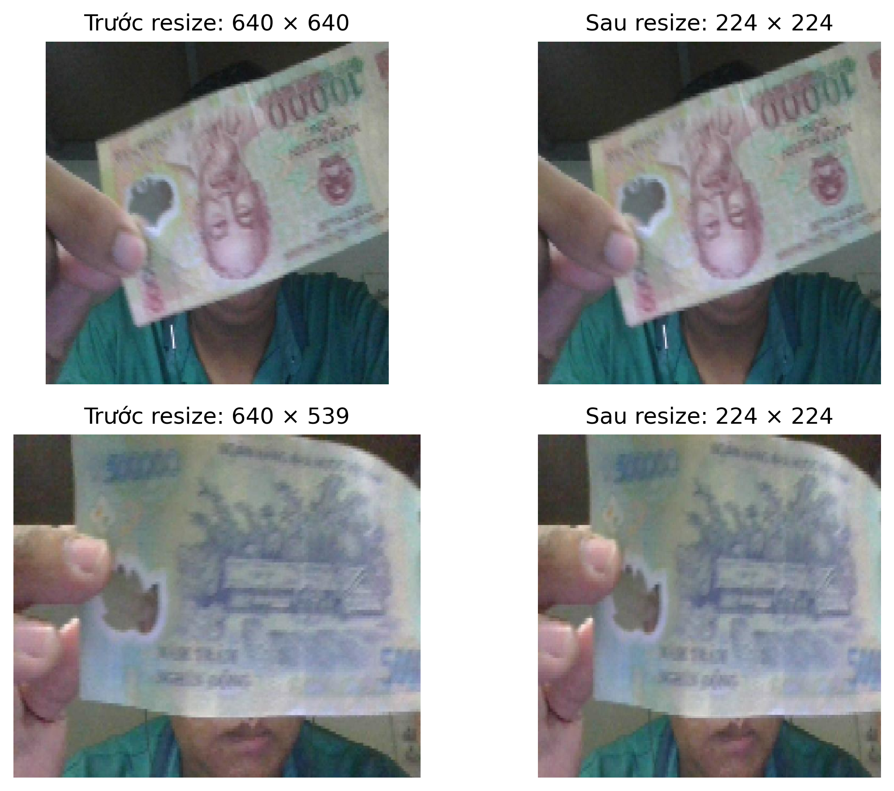
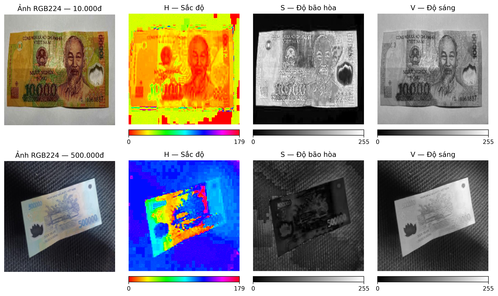
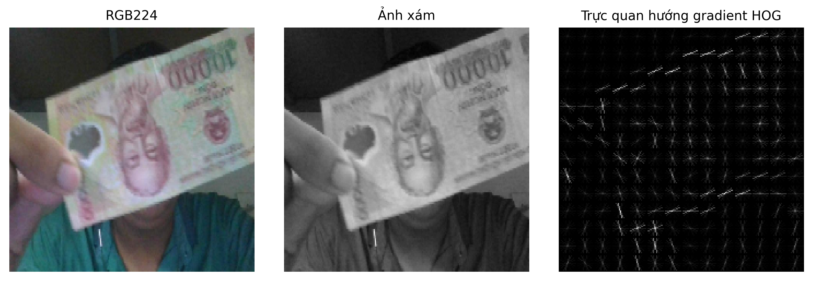
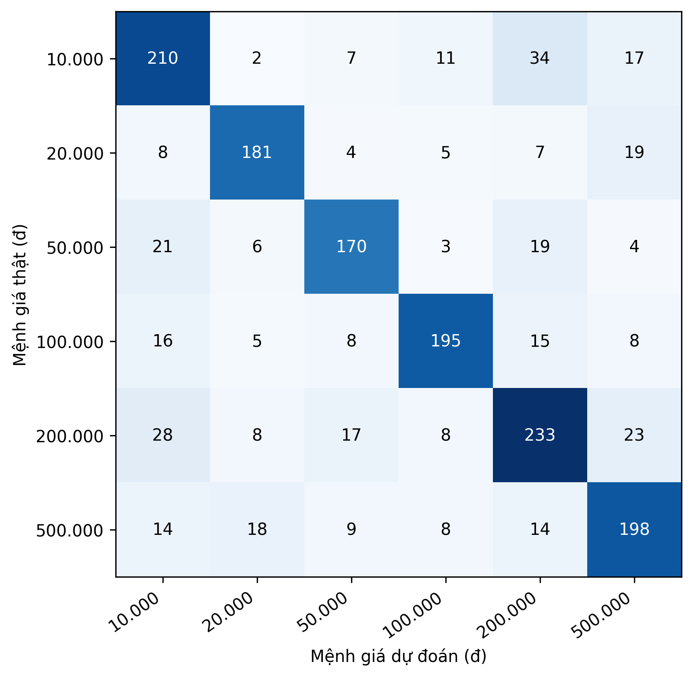
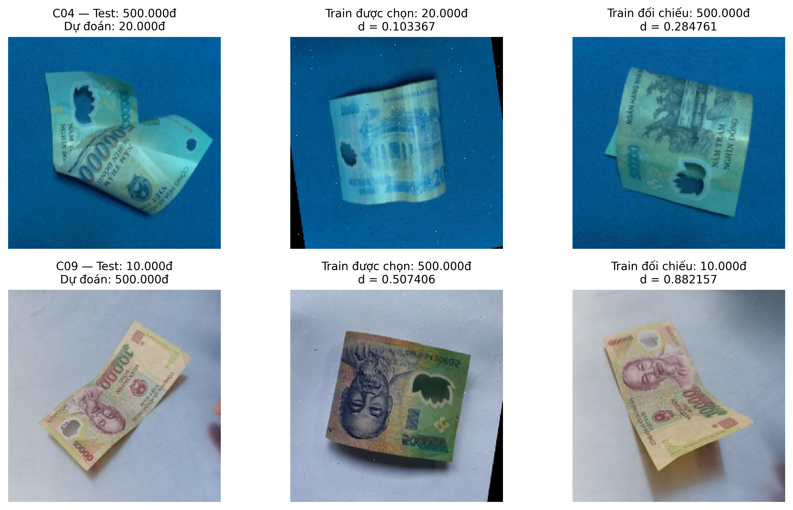
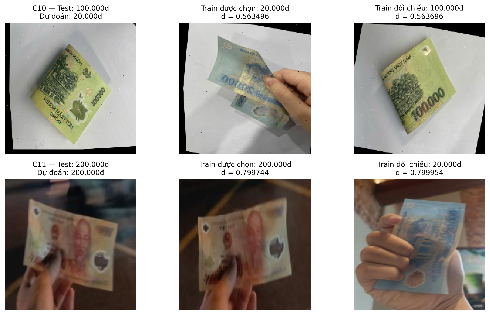

# Thực nghiệm phân loại tiền polymer Việt Nam bằng KNN

## 1. Mục tiêu và thiết lập thực nghiệm

Phần thực nghiệm này đánh giá ba hướng biểu diễn ảnh cho KNN: màu sắc bằng Histogram HSV12, đường nét bằng HOG, và kết hợp HSV12 với HOG. Trong nhánh HOG, nhóm khảo sát thêm PCA để xem việc giảm chiều có cải thiện kết quả hay không. Như vậy, có ba họ đặc trưng nhưng năm biến thể được đánh giá. Mục tiêu là chọn một phương án trong phạm vi khảo sát và giải thích được cả kết quả tốt lẫn các trường hợp dự đoán sai; không đặt trước giả thuyết ghép nhiều đặc trưng sẽ tốt hơn.

Bộ dữ liệu gồm sáu mệnh giá 10.000đ, 20.000đ, 50.000đ, 100.000đ, 200.000đ và 500.000đ, với **12.494 ảnh train, 1.564 ảnh dev và 1.553 ảnh test**. Mỗi ảnh đầu vào là một ảnh crop đã có nhãn mệnh giá. Nhóm giữ nguyên ảnh và cách chia tập trong toàn bộ các thí nghiệm được trình bày ở đây. Train cung cấp mẫu tham chiếu cho KNN và dữ liệu để fit PCA; dev dùng chọn đặc trưng và tham số. Sau khi khóa phương án, mô hình được fit trên train để đánh giá test, không gộp train với dev.

Tất cả biến thể sử dụng cùng ảnh RGB224, không augmentation. Đây là quy tắc đầu vào được đề xuất dùng chung cho KNN, SVM, CNN và ResNet; phần này chỉ xác nhận việc áp dụng trong nhánh KNN, không mặc định code của ba phương pháp còn lại đã tuân thủ. Với KNN và SVM, việc dùng cùng ma trận feature và chuẩn hóa còn cần được giữ khi so sánh riêng hai bộ phân loại.

Đây là lượt thực nghiệm **RGB224 và khoảng cách Euclidean**, khác các khảo sát trước trên kích thước ảnh gốc và các khoảng cách khác. Những kết quả cũ không được trộn vào bảng so sánh mới. Split test hiện tại từng được đánh giá và xem ảnh trong khảo sát trước, nên lần đánh giá này không được coi là kiểm chứng trên một tập hoàn toàn chưa xem. Trong lượt RGB224, tham số vẫn được chọn từ dev và giữ nguyên khi xem kết quả test.

Thực nghiệm được triển khai bằng Python 3.13.7, OpenCV 4.12.0, NumPy 2.2.6, scikit-learn 1.6.1 và scikit-image 0.26.0, chạy trên CPU. Các bảng sau báo cáo kết quả phân loại, không dùng để so sánh tốc độ phần cứng.

## 2. Tiền xử lý ảnh đầu vào

### 2.1. Đọc ảnh và đưa về cùng kích thước

Ảnh được đọc bằng OpenCV, đổi thứ tự kênh từ BGR sang RGB, sau đó resize trực tiếp về **224×224 pixel bằng nội suy song tuyến tính (`INTER_LINEAR`)**. Ảnh được giữ ở kiểu `uint8` trước khi trích đặc trưng. Các thao tác diễn ra trong bộ nhớ, không ghi đè ảnh trong DATA.

Resize đưa các ảnh có kích thước khác nhau về cùng đầu vào hình học. Điều này đặc biệt cần cho HOG vì số cell, số block và số chiều vector phụ thuộc kích thước ảnh. Histogram vẫn có số chiều cố định dù ảnh khác kích thước, nhưng nhóm áp dụng cùng bước resize để kiểm soát điều kiện đầu vào giữa các biểu diễn. Kích thước 224×224 là lựa chọn thiết kế, chưa được chứng minh là kích thước tối ưu cho KNN hoặc HOG.

Nội suy song tuyến tính tính giá trị pixel đầu ra từ các pixel lân cận khi thay đổi kích thước. Resize trực tiếp giữ toàn bộ vùng ảnh đầu vào và không thêm viền, nhưng có thể làm thay đổi tỷ lệ hình học của tờ tiền. Trong lượt này, nhóm không thêm căn chỉnh góc, tách nền, tăng sáng, làm nét hoặc cân bằng histogram; nhờ đó, ảnh đưa vào các nhánh feature có cùng nội dung hình học.

### 2.2. Chuẩn hóa vector đặc trưng

Sau khi trích đặc trưng, nhóm dùng chuẩn hóa L2 để đưa độ dài vector về 1:

\[
\widetilde{\mathbf{x}}=\frac{\mathbf{x}}{\|\mathbf{x}\|_2},
\qquad
\|\mathbf{x}\|_2=\sqrt{\sum_j x_j^2}.
\]

Trong các vector đã kiểm tra, chuẩn của vector đầu ra bằng 1 trong sai số số học. Với histogram, bước này giảm ảnh hưởng của độ lớn tổng số đếm; với HOG, nó chuẩn hóa độ dài toàn bộ descriptor trước khi tính khoảng cách. **L2 không làm ảnh bất biến với ánh sáng, nền hoặc che khuất**: khi phân bố màu hay gradient thay đổi, hướng vector vẫn có thể thay đổi.

Trong nhánh HOG-PCA, PCA được đặt trước L2 toàn vector; trong nhánh kết hợp, từng khối được L2 riêng rồi mới nối. Nhóm không thêm StandardScaler hoặc whitening. Thứ tự xử lý này được giữ thống nhất giữa train và dev/test; không fit phép biến đổi trên dữ liệu đánh giá.

## 3. Cách KNN phân loại và lựa chọn cấu hình

KNN lưu các vector train cùng nhãn. Khi có ảnh mới, mô hình tính khoảng cách đến các mẫu train, lấy k hàng xóm gần nhất rồi tổng hợp phiếu để dự đoán [1]. Vì vậy, kết quả phụ thuộc vào cả cách trích feature và cách đo khoảng cách; KNN không trực tiếp đọc giá trị tiền từ chữ số.

Nhóm dùng khoảng cách Euclidean cho tất cả năm biến thể:

\[
d(\mathbf{x},\mathbf{z})=\sqrt{\sum_{j=1}^{D}(x_j-z_j)^2}.
\]

D là số chiều của biểu diễn đang xét. Euclidean có cách hiểu trực tiếp là độ xa giữa hai vector, đồng thời dùng được cho cả histogram không âm và tọa độ PCA có thể âm. Việc giữ một khoảng cách giúp giảm số yếu tố thay đổi giữa các thí nghiệm; không có nghĩa đây là khoảng cách tốt nhất cho mọi loại feature.

**Bảng KNN-1. Phạm vi tham số của mỗi biến thể.**

| Thành phần | Giá trị |
|---|---|
| Số hàng xóm k | 1, 2, …, 10 |
| Bỏ phiếu | `uniform`, `distance` |
| Khoảng cách | Euclidean |
| Tìm hàng xóm | `brute`, tìm trực tiếp trên train |
| Chọn cấu hình | Macro-F1 dev cao nhất; hòa thì MAE thấp hơn |

Với `uniform`, các hàng xóm có phiếu bằng nhau. Với `distance`, hàng xóm gần hơn có trọng số lớn hơn; triển khai scikit-learn dùng trọng số nghịch đảo khoảng cách và xử lý riêng khi có khoảng cách bằng 0 [1]. Khi k=1, hai cách bỏ phiếu cho cùng nhãn vì chỉ có một hàng xóm được chọn.

Mỗi biến thể có 10×2=20 cấu hình, tổng cộng **100 cấu hình dev**. Đây là tìm kiếm trên một split dev cố định, không phải 100 lần lặp độc lập hoặc k-fold cross-validation. Mỗi tổ hợp được fit bằng train và chấm trên dev. Macro-F1 là tiêu chí chính vì lấy trung bình F1 của sáu lớp; Accuracy và MAE cung cấp thêm góc nhìn về số ảnh đúng và mức chênh lệch mệnh giá.

Việc chọn dùng số chưa làm tròn. Nếu Macro-F1 bằng nhau chính xác, chọn MAE thấp hơn; nếu vẫn hòa, giữ thứ tự HSV12 → HOG → HOG-PCA → HSV12+HOG → HSV12+HOG-PCA, sau đó k tăng dần và `uniform` trước `distance`. Nhóm đồng thời giữ kết quả tham chiếu **k=1, uniform, Euclidean** cho mọi biến thể để phân tích biểu diễn khi cố định bộ phân loại.

## 4. Thí nghiệm từng biểu diễn và nhận xét

### 4.1. Histogram HSV12: biểu diễn phân bố màu

Ảnh RGB224 được chuyển sang HSV. H biểu diễn sắc độ, S biểu diễn độ bão hòa màu và V biểu diễn độ sáng. Nhóm tính **histogram kết hợp ba kênh**, mỗi kênh có 12 bin, bằng `cv2.calcHist` [2]. Với ảnh HSV 8-bit của OpenCV, các miền được dùng là H trong [0,180), S và V trong [0,256).

Mỗi pixel đóng góp vào một ô được xác định đồng thời bởi bin H, S và V; đây không phải ba histogram riêng được nối lại. Histogram có 12×12×12=**1.728 chiều**, sau đó được trải phẳng và L2. Biểu diễn này giữ tần suất các nhóm màu nhưng không giữ vị trí của pixel, hình dạng chữ số hoặc bố cục tờ tiền.

Hai ví dụ train 10.000đ (hàng trên) và 500.000đ (hàng dưới) được chọn để các kênh khác nhau dễ quan sát, không đại diện cho toàn bộ ảnh mỗi lớp. H dùng thang màu tuần hoàn, S và V dùng thang xám cố định; khác biệt giữa hai cảnh gồm cả màu tờ tiền, nền và ánh sáng.

Ở một pixel, ba giá trị H, S, V cùng xác định một bin trong histogram 12×12×12. Chẳng hạn, một vùng có màu gần xám có thể sáng ở V nhưng thấp ở S; “sáng” và “bão hòa màu” vì vậy là hai thông tin khác nhau. Hình giúp phân biệt vai trò ba kênh; đầu vào KNN vẫn là histogram kết hợp đã L2, không phải ba ảnh kênh hay ảnh HSV được hiển thị trực tiếp như RGB.

Cấu hình tốt nhất là **k=1, uniform**, đạt Accuracy **79,60%**, Macro-F1 **0,798307** và MAE **46.585,68đ/ảnh** trên dev. Mô hình phân loại đúng 1.245/1.564 ảnh. Các cấu hình hòa điểm được xử lý theo thứ tự đã quy định, thay vì chọn theo kết quả test.

**Nhận xét.** HSV12 cho kết quả tốt nhất trong năm biến thể khảo sát. Kết quả phù hợp với vai trò phân biệt của màu sắc giữa các mệnh giá trong bộ ảnh hiện tại: mô hình vẫn nhận được thông tin màu dù ảnh có bố cục khác nhau. Tuy nhiên, thí nghiệm này chưa tách riêng mức đóng góp của màu tờ tiền, nền và ánh sáng. Vì vậy, nhóm chỉ kết luận biểu diễn HSV12 đang phù hợp hơn các biến thể HOG đã thử, không khẳng định mô hình đã học đúng các dấu hiệu mệnh giá hoặc mọi histogram HSV đều tốt hơn HOG.

### 4.2. HOG: biểu diễn đường nét

Nhóm chuyển RGB224 sang ảnh xám rồi trích Histogram of Oriented Gradients (HOG). HOG tổng hợp hướng biến thiên độ sáng trong các vùng nhỏ và chuẩn hóa theo block [3]. Cấu hình gồm 9 hướng, cell 16×16 pixel, block 2×2 cell, chuẩn hóa L2-Hys, `transform_sqrt=False`.

Ảnh 224×224 có 14×14 cell. Block trượt với bước một cell tạo 13×13 vị trí; số chiều là:

\[
13\times13\times2\times2\times9=\mathbf{6.084}.
\]

Sau chuẩn hóa L2-Hys cục bộ trong HOG, toàn bộ descriptor tiếp tục được L2 để đưa vào KNN. Hai lần chuẩn hóa có phạm vi khác nhau: một lần trên block và một lần trên vector toàn ảnh.

Ảnh trực quan HOG giúp quan sát hướng gradient; KNN nhận vector 6.084 chiều, không nhận ảnh trực quan này.

HOG tốt nhất tại **k=1, uniform**, đạt Accuracy **39,07%**, Macro-F1 **0,390748** và MAE **116.234,02đ/ảnh**. Số ảnh đúng là 611/1.564, thấp hơn nhiều so với HSV12 dù dùng cùng k, cách bỏ phiếu và khoảng cách.

**Nhận xét.** Trong cách triển khai này, HOG bỏ thông tin màu và phụ thuộc vào bố trí gradient trên một lưới cố định. Khi tờ tiền xoay, gấp, bị che hoặc thay đổi vị trí trong ảnh, cùng một họa tiết có thể tạo descriptor khác nhau. Đây là những khả năng giải thích hợp lý cho kết quả thấp, chưa phải các nguyên nhân đã được tách riêng bằng thí nghiệm. Số chiều lớn cũng không tự chứng minh là nguyên nhân gây lỗi. Kết quả chỉ phản ánh HOG xám với cấu hình đã nêu và KNN Euclidean, không đánh giá toàn bộ khả năng của HOG hay một hệ thống đọc chữ số chuyên biệt.

### 4.3. HOG-PCA: khảo sát giảm chiều

Để kiểm tra một biểu diễn HOG gọn hơn, nhóm fit PCA trên **HOG train trước chuẩn hóa L2 toàn vector**, chọn số thành phần giữ trên 95% phương sai, `svd_solver="full"`, `whiten=False`. Dev được transform bằng đúng PCA này, rồi L2 từng vector. PCA tìm các hướng biến thiên chính mà không sử dụng nhãn mệnh giá [4].

PCA giữ **1.418 chiều**, với phương sai tích lũy **95,0056%**, giảm khoảng **76,69% số chiều** so với HOG gốc. Ngưỡng 95% là quy tắc thiết kế đã chọn, không phải cam kết giữ 95% thông tin phân loại hoặc đạt Accuracy 95%.

Khi chọn lại KNN trong cùng lưới 20 cấu hình, HOG-PCA tốt nhất ở **k=5, distance**: Accuracy **44,37%**, Macro-F1 **0,437934**, MAE **106.898,98đ/ảnh**. Số ảnh đúng tăng từ 611 lên 694 so với HOG tốt nhất. Vì k và cách bỏ phiếu cũng thay đổi, nhóm kiểm tra thêm cấu hình tham chiếu k=1, uniform: Macro-F1 tăng từ **0,390748 lên 0,431541**, số ảnh đúng tăng từ 611 lên 680.

**Nhận xét.** Nhánh PCA+L2 cải thiện HOG trên dev ngay cả khi giữ cố định KNN tham chiếu, nhưng vẫn kém HSV12. Kết quả cho thấy phép biến đổi này có ích trong điều kiện đã thử; chưa thể quy toàn bộ cải thiện chỉ cho việc giảm số chiều, vì PCA còn thay đổi hệ tọa độ và L2 sau PCA thay đổi cách chuẩn hóa khoảng cách. PCA cũng có chi phí fit và transform; thí nghiệm không có phép đo thời gian HOG gốc tương đương để kết luận mức tăng tốc.

### 4.4. Kết hợp HSV12 và HOG

Nhóm nối hai khối để kiểm tra liệu thông tin màu và đường nét có bổ sung cho nhau không:

\[
\mathbf{f}_{\mathrm{fusion}}
=[\widetilde{\mathbf{h}}_{\mathrm{HSV12}};
  \widetilde{\mathbf{g}}_{\mathrm{HOG\ branch}}].
\]

Khối HOG có hai lựa chọn: HOG gốc hoặc HOG-PCA+L2 đã fit ở bước trước. Hai vector được ghép theo đúng đường dẫn ảnh, mỗi khối L2 riêng; không thêm trọng số và không chuẩn hóa lại sau ghép. Số chiều lần lượt là **7.812** và **3.146**. Khi mỗi khối có chuẩn 1, vector ghép có chuẩn xấp xỉ căn 2.

Với Euclidean, bình phương khoảng cách sau ghép bằng tổng bình phương khoảng cách của hai khối. L2 riêng giúp hai khối có cùng chuẩn, nhưng **không bảo đảm chúng có giá trị phân biệt hoặc ảnh hưởng thực tế ngang nhau**. Nếu khoảng cách HOG không phù hợp với nhãn ở một số ảnh, nó vẫn góp vào quyết định sau ghép.

HSV12+HOG tốt nhất ở **k=6, distance**, đạt Macro-F1 **0,731995**; HSV12+HOG-PCA cũng chọn k=6, distance nhưng chỉ đạt **0,713416**. Cả hai đều thấp hơn HSV12 đứng riêng. Ở cấu hình tham chiếu k=1, uniform, Macro-F1 vẫn giảm từ 0,798307 của HSV12 xuống **0,726608** và **0,701336**. Như vậy, xu hướng giảm không chỉ xuất hiện do hai nhánh chọn k khác nhau.

**Nhận xét.** Phép nối không trọng số chưa khai thác được lợi ích bổ sung của HOG trong khảo sát này. Một cách giải thích có thể là khoảng cách của nhánh đường nét làm thay đổi thứ tự hàng xóm theo hướng bất lợi; kết quả hiện tại chưa cô lập để chứng minh cơ chế đó. PCA giúp HOG khi đứng riêng nhưng không giúp biến thể ghép tương ứng, cho thấy hiệu quả độc lập của một khối không bảo đảm hiệu quả khi kết hợp. Nhóm giữ kết quả âm này và không tiếp tục tối ưu trọng số theo test.

## 5. Tổng hợp dev và khóa phương án cuối

**Bảng KNN-2. Cấu hình tốt nhất của từng biến thể trên cùng 1.564 ảnh dev.**

| Biến thể | Số chiều | k / bỏ phiếu | Accuracy (%) ↑ | Macro-F1 ↑ | MAE (đ/ảnh) ↓ |
|---|---:|---|---:|---:|---:|
| **HSV12** | **1.728** | **1 / uniform** | **79,60** | **0,798307** | **46.585,68** |
| HOG | 6.084 | 1 / uniform | 39,07 | 0,390748 | 116.234,02 |
| HOG-PCA | 1.418 | 5 / distance | 44,37 | 0,437934 | 106.898,98 |
| HSV12+HOG | 7.812 | 6 / distance | 72,95 | 0,731995 | 62.071,61 |
| HSV12+HOG-PCA | 3.146 | 6 / distance | 71,10 | 0,713416 | 66.086,96 |

*Các hàng đều dùng Euclidean, brute và cùng phạm vi 20 cấu hình. Mỗi hàng là tổ hợp biểu diễn và KNN được chọn riêng trên dev, không phải so sánh tác động thuần túy của feature khi toàn bộ tham số được giữ cố định.*

Nhóm chọn **RGB224 → HSV12 → L2 → KNN k=1, uniform, Euclidean** theo Macro-F1 dev cao nhất. Cấu hình, thứ tự nhãn, manifest, feature train/dev và mã SHA-256 của các file liên quan được lưu trước bước đánh giá test. SHA-256 dùng để phát hiện thay đổi file, không chứng minh dữ liệu độc lập hoặc không có leakage. Phương án này là lựa chọn tốt nhất trong phạm vi thực nghiệm đã trình bày, không phải cấu hình tối ưu tuyệt đối hoặc bằng chứng KNN hơn các mô hình khác của nhóm.

## 6. Đánh giá phương án đã khóa trên test

Nhóm dùng nguyên feature train và cấu hình đã khóa để dự đoán 1.553 ảnh test. Feature test được tạo cùng quy trình RGB224 → HSV12 → L2; không học thêm phép biến đổi, không đổi tham số và không bổ sung dev vào train.

**Bảng KNN-3. Kết quả phương án HSV12 + KNN đã chọn.**

| Tập | Số ảnh | Số đúng | Accuracy (%) ↑ | Macro-F1 ↑ | MAE (đ/ảnh) ↓ |
|---|---:|---:|---:|---:|---:|
| Dev | 1.564 | 1.245 | 79,60 | 0,798307 | 46.585,68 |
| Test | 1.553 | 1.187 | 76,43 | 0,768710 | 53.947,20 |

Test có **366 ảnh sai**. So với dev, Accuracy giảm **3,17 điểm phần trăm**, Macro-F1 giảm **0,029597** và MAE tăng **7.361,52đ/ảnh**. Đây là chênh lệch quan sát giữa hai tập; một split và một lượt đánh giá chưa đủ để xác định overfitting là nguyên nhân duy nhất hoặc đưa ra kết luận về ý nghĩa thống kê.

**Bảng KNN-4. Kết quả theo mệnh giá trên test.**

| Mệnh giá | Đúng / tổng | Precision | Recall | F1 |
|---|---:|---:|---:|---:|
| 10.000đ | 210 / 281 | 0,7071 | 0,7473 | 0,7266 |
| 20.000đ | 181 / 224 | 0,8227 | 0,8080 | 0,8153 |
| 50.000đ | 170 / 223 | 0,7907 | 0,7623 | 0,7763 |
| 100.000đ | 195 / 247 | 0,8478 | 0,7895 | 0,8176 |
| 200.000đ | 233 / 317 | 0,7236 | 0,7350 | 0,7293 |
| 500.000đ | 198 / 261 | 0,7361 | 0,7586 | 0,7472 |

Lớp 100.000đ có F1 cao nhất, tiếp theo là 20.000đ. Hai lớp thấp nhất là 10.000đ và 200.000đ. Lớp 20.000đ có Recall cao nhất nhưng Precision thấp hơn lớp 100.000đ; vì vậy, thứ hạng theo một độ đo riêng không thay thế đánh giá đồng thời khả năng nhận đủ và nhận đúng của từng lớp.

Trong ma trận, hàng là mệnh giá thật, cột là mệnh giá dự đoán; các ô ghi số ảnh. Cặp **10.000đ ↔ 200.000đ có 62 lỗi**, gồm 34 ảnh 10.000đ thành 200.000đ và 28 ảnh theo chiều ngược lại. Đây là cặp nhầm nhiều nhất khi gộp hai chiều. Tuy nhiên, mức chênh lệch mỗi lỗi của cặp này nhỏ hơn một số cặp khác; cần xem thêm góc nhìn VND ở phần sau.

## 7. Phân tích lỗi và chênh lệch mệnh giá

### 7.1. Lỗi xuất hiện nhiều và lỗi có chênh lệch lớn

**Bảng KNN-5. Năm cặp đóng góp tổng chênh lệch VND lớn nhất, gộp hai chiều.**

| Cặp mệnh giá | Số lỗi | Chênh lệch / lỗi (đ) | Tổng chênh lệch (đ) |
|---|---:|---:|---:|
| 20.000đ ↔ 500.000đ | 37 | 480.000 | 17.760.000 |
| 10.000đ ↔ 500.000đ | 31 | 490.000 | 15.190.000 |
| 10.000đ ↔ 200.000đ | 62 | 190.000 | 11.780.000 |
| 200.000đ ↔ 500.000đ | 37 | 300.000 | 11.100.000 |
| 100.000đ ↔ 500.000đ | 16 | 400.000 | 6.400.000 |

Cặp 20.000đ ↔ 500.000đ có ít lỗi hơn cặp 10.000đ ↔ 200.000đ, nhưng đóng góp tổng chênh lệch lớn hơn: **17.760.000đ**, tương đương **21,20%** toàn bộ chênh lệch test. Theo từng chiều, 20.000đ → 500.000đ có 19 lỗi, còn chiều ngược lại có 18 lỗi. Điều này giải thích vì sao Accuracy và Macro-F1 cần được bổ sung bằng MAE khi đánh giá mức sai lệch mệnh giá.

Tổng chênh lệch tuyệt đối trên toàn test là **83.780.000đ**. MAE được tính bằng 83.780.000 / 1.553 = **53.947,20đ/ảnh**, trong đó ảnh dự đoán đúng đóng góp 0. Đây là sai lệch mệnh giá danh nghĩa; thí nghiệm chưa mô phỏng giao dịch nên không gọi số này là thiệt hại tài chính thực tế.

### 7.2. Truy vết quyết định bằng ảnh train gần nhất

Vì mô hình cuối dùng k=1, nhóm kiểm tra ảnh train gần nhất quyết định từng dự đoán. Với ảnh test sai, nhóm tìm thêm ảnh train gần nhất **có nhãn đúng** để đối chiếu. Với ảnh test đúng, ảnh đối chiếu là train gần nhất **khác nhãn thật**. Tất cả khoảng cách đều tính trong đúng không gian HSV12 đã L2 và dùng Euclidean; việc lấy thêm ảnh đối chiếu không thay đổi dự đoán.

Phân tích định lượng bao phủ toàn bộ 1.553 ảnh test. Để xem ảnh, nhóm chọn 12 query theo quy tắc: ba cặp lỗi phổ biến xét hai chiều, ba chiều lỗi đóng góp tổng chênh lệch lớn nhất, một lỗi gần ranh giới và hai ảnh đúng để đối chiếu. Tránh chọn trùng đường dẫn; khi cần chọn trong cùng nhóm, dùng khoảng cách và thứ tự đường dẫn đã quy định. Đây là các ví dụ có chủ đích, không dùng để ước lượng tỷ lệ nguyên nhân lỗi trong toàn bộ dataset. Phần chính trình bày bốn ví dụ có thông điệp khác nhau.

### 7.3. Ảnh có dấu hiệu nhận dạng rõ vẫn có thể bị phân loại sai

**C04 — màu toàn ảnh gần nhau nhưng khác mệnh giá.** Query 500.000đ và ảnh train 20.000đ được chọn cùng có một vùng nền xanh lớn. Khoảng cách đến ảnh sai lớp là **0,103367**, nhỏ hơn khoảng cách **0,284761** đến ảnh train đúng lớp gần nhất. KNN vì vậy dự đoán 20.000đ theo đúng quy tắc. Trường hợp này cho thấy khoảng cách nhỏ không bảo đảm nhãn đúng. Nền xanh là một yếu tố có thể góp phần làm histogram gần nhau, nhưng chưa có thí nghiệm tách nền để xác minh tác động riêng.

**C09 — ảnh đọc được mệnh giá nhưng feature không đọc chữ số.** Query là tờ 10.000đ với số mệnh giá và bố cục còn nhận ra được. Tuy nhiên, ảnh train 500.000đ gần nhất có khoảng cách **0,507406**, trong khi ảnh train 10.000đ gần nhất cách **0,882157**. Quyết định sai không mâu thuẫn với cách KNN hoạt động: mô hình chọn theo sự gần nhau của vector màu, còn người quan sát nhận dạng thêm chữ số, họa tiết và bố cục. Histogram toàn ảnh không trực tiếp mã hóa các thông tin đó.

Hai ví dụ cho phép xác minh **vì sao KNN chọn nhãn cụ thể** bằng thứ tự khoảng cách. Chúng chưa đủ để khẳng định một yếu tố thị giác duy nhất là nguyên nhân gây lỗi. Cách diễn giải phù hợp là nền, ánh sáng và cách bố trí tờ tiền có thể làm thay đổi biểu diễn màu; cần thí nghiệm đối chứng nếu muốn định lượng riêng từng tác động.

### 7.4. Quyết định sát ranh giới và ảnh nhòe vẫn dự đoán đúng

Để mô tả mức tách biệt giữa hai nhóm lớp, nhóm dùng đại lượng phụ:

\[
m=d_{\mathrm{khác\ lớp\ thật}}-d_{\mathrm{đúng\ lớp\ thật}},
\]

trong đó mỗi khoảng cách là khoảng cách nhỏ nhất đến train thuộc nhóm tương ứng. m dương nghĩa là có ảnh đúng lớp gần hơn; m âm nghĩa là ảnh khác lớp gần hơn. Đây là đại lượng mô tả phục vụ phân tích sau khi biết nhãn thật, không phải độ đo chính, độ tin cậy đã hiệu chỉnh hoặc quy tắc từ chối dự đoán.

**C10** có khoảng cách đến train sai lớp là **0,56349629**, còn đến train đúng lớp là **0,56369638**, chênh khoảng **0,00020009**. Đây là lỗi có chênh lệch khoảng cách giữa hai nhóm lớp nhỏ nhất trong tập lỗi theo quy tắc chọn. Nó không phải hòa chính xác; kết quả chỉ cho thấy hai lựa chọn rất gần nhau theo feature, chưa chứng minh rằng một thay đổi nhỏ bất kỳ trên ảnh sẽ đảo dự đoán.

**C11** là ảnh 200.000đ khá nhòe nhưng vẫn được nhận đúng. Khoảng cách đến đúng lớp là **0,79974383**, đến lớp khác là **0,79995364**, với m ≈ **0,00020981**. Ví dụ đúng này giúp giới hạn cách giải thích lỗi: ảnh nhòe không nhất thiết sai, và không thể quy mọi lỗi cho chất lượng ảnh. Cần xét cả biểu diễn của query lẫn các mẫu train cạnh tranh.

Một số query trong 12 ví dụ có hình thức rất giống nhau, nên nhóm không trình bày chúng như các cơ chế lỗi độc lập. Ví dụ đúng có độ tách biệt lớn nhất cũng rất giống ảnh train được chọn về bố cục và màu; quan hệ nguồn gốc chưa được xác minh, nên không dùng riêng ví dụ đó để chứng minh khả năng nhận dạng trên cảnh mới.

## 8. Kết luận và giới hạn của nhánh KNN

Trong điều kiện RGB224, Euclidean và cùng phạm vi tìm tham số, **HSV12 + KNN k=1, uniform** cho Macro-F1 dev cao nhất. PCA cải thiện nhánh HOG, nhưng cả HOG-PCA lẫn hai biến thể ghép đều chưa vượt HSV12. Trên test hiện có, phương án được chọn đạt **Accuracy 76,43%, Macro-F1 0,768710 và MAE 53.947,20đ/ảnh**.

Phân tích ảnh cho thấy biểu diễn màu toàn ảnh chưa đủ phân biệt mọi mệnh giá, kể cả khi người quan sát đọc được số tiền. Kết luận được hỗ trợ trực tiếp là các ảnh khác lớp có thể gần query hơn ảnh đúng lớp trong không gian HSV12. Những giải thích sâu hơn về ảnh hưởng của nền, ánh sáng, góc chụp hoặc che khuất vẫn cần được xem là giả thuyết khi chưa có đối chứng.

Các kết quả giới hạn ở một cách chia dữ liệu, một kích thước ảnh, một khoảng cách và các cấu hình đã khai báo. Nhóm chưa đánh giá độ bất định qua nhiều split, chưa có tập test ngoài nguồn mới, và test hiện tại đã có lịch sử được xem. Kiểm tra feature/nhãn theo manifest không thay thế kiểm toán độc lập về nhãn hoặc quan hệ gần trùng giữa train và test. Các hạn chế này cần được giữ khi so sánh với SVM, CNN và ResNet; không mặc định mô hình phức tạp hơn sẽ tốt hơn.

## Tài liệu kỹ thuật tham khảo

[1] scikit-learn 1.6.1. [*Nearest Neighbors*](https://scikit-learn.org/1.6/modules/neighbors.html): phân loại bằng hàng xóm, khoảng cách và cách bỏ phiếu.

[2] OpenCV 4.12.0. [*Histograms*](https://docs.opencv.org/4.12.0/d6/dc7/group__imgproc__hist.html): API tính histogram bằng `calcHist`.

[3] scikit-image. [*skimage.feature.hog*](https://scikit-image.org/docs/stable/api/skimage.feature.html#skimage.feature.hog): mô tả HOG và các tham số.

[4] scikit-learn 1.6.1. [*PCA*](https://scikit-learn.org/1.6/modules/generated/sklearn.decomposition.PCA.html): fit phép chiếu, số thành phần theo phương sai và các tham số solver/whitening.

*Các tài liệu trên mô tả thuật toán/API, không phải nguồn của số liệu thực nghiệm. Kết quả trong phần này được tổng hợp từ các notebook RGB224 và các file evidence tương ứng của nhóm.*
