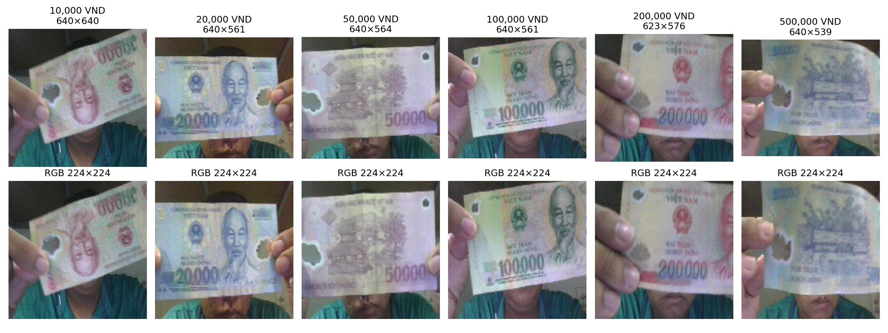
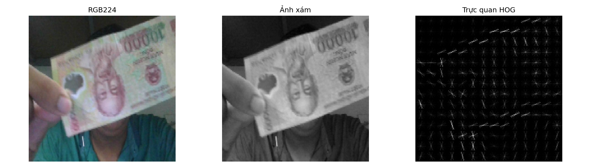
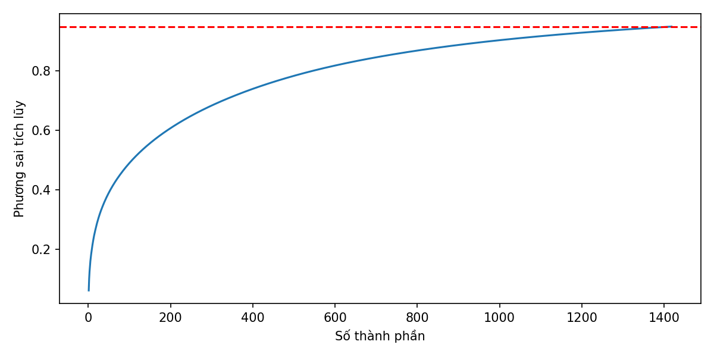
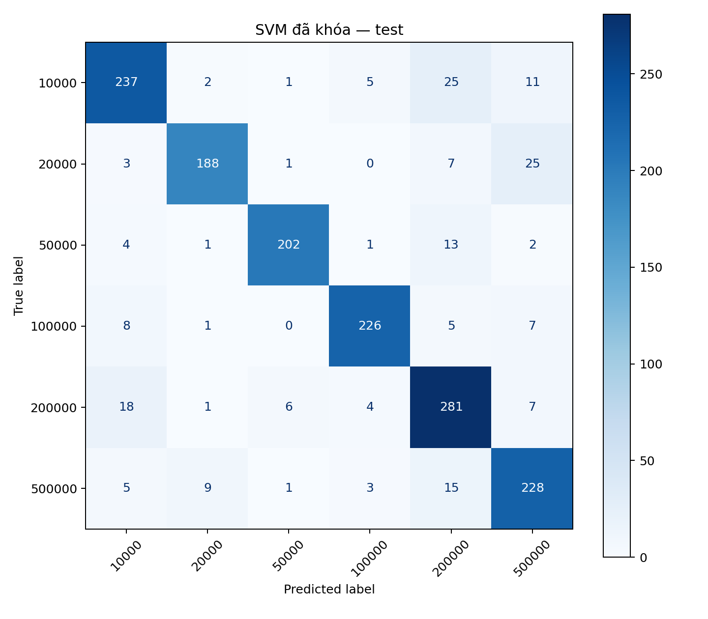
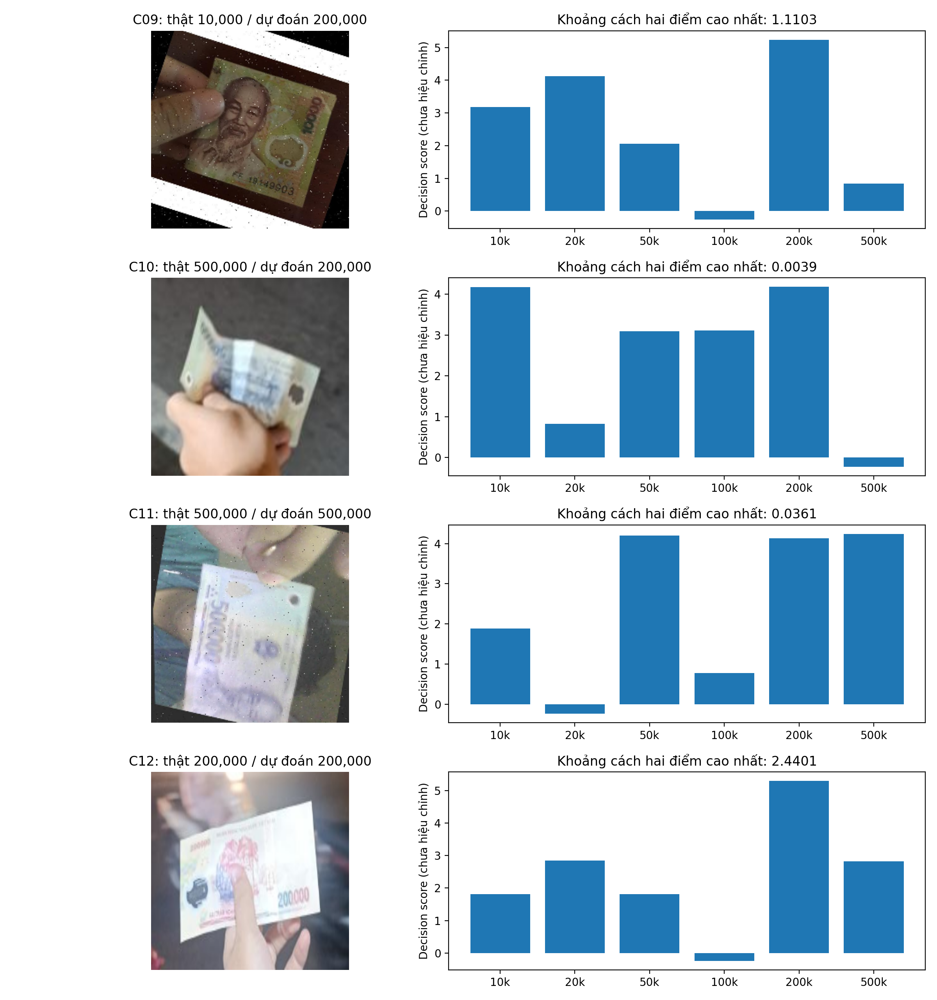
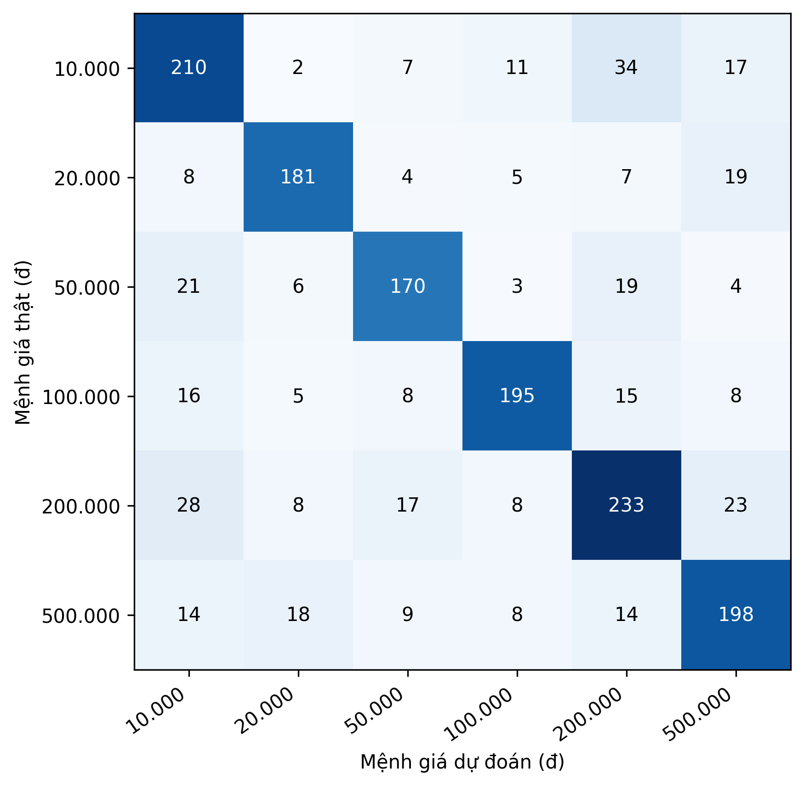

# Thực nghiệm phân loại tiền polymer Việt Nam bằng SVM

## 1. Mục tiêu và thiết lập thực nghiệm

Phần này đánh giá SVM trên cùng bộ ảnh RGB224 và năm biến thể đặc trưng đã dùng cho KNN: HSV12, HOG, HOG-PCA, HSV12+HOG và HSV12+HOG-PCA. Mục tiêu là chọn cấu hình theo Macro-F1 dev, khóa mô hình trước khi chấm test, rồi phân tích các lỗi còn lại. So sánh với KNN được thực hiện trên đúng cùng ảnh và nhãn, nhưng không dùng kết quả KNN để chọn lại SVM.

Trên dev, SVM dùng **HSV12+HOG với kernel RBF, `C=10`, `gamma='scale'`** đứng đầu 35 cấu hình đã khai báo: Accuracy **87,85%**, Macro-F1 **0,881213**, MAE **27.653,45đ/ảnh**. Sau khi khóa cấu hình và fit trên train, mô hình dự đoán đúng **1.362/1.553 ảnh test**, đạt Accuracy **87,70%**, Macro-F1 **0,881102**, MAE **32.891,18đ/ảnh**. Mô hình KNN RGB224 đã khóa trước đó dùng HSV12, `k=1`, bỏ phiếu đều, khoảng cách Euclidean; trên cùng test đạt **76,43%**, **0,768710**, **53.947,20đ/ảnh**. SVM đúng thêm **175 ảnh**, cao hơn **11,27 điểm phần trăm Accuracy** và giảm MAE **21.056,02đ/ảnh**. Đây là so sánh mô tả trên cùng split, không phải kết luận về mọi ảnh tiền trong thực tế.

Việc ghép HOG vào HSV12 chỉ tăng Macro-F1 dev của SVM từ **0,879544** lên **0,881213** (chênh **0,001669**, tương ứng thêm bảy dự đoán đúng trên dev). Vì chỉ phương án được khóa mới được chấm test, báo cáo không suy diễn rằng HSV12+HOG chắc chắn hơn HSV12 đơn lẻ trên test. Test từng được xem trong các khảo sát cũ của dự án, nên không coi là tập kiểm chứng hoàn toàn mới.

Bộ cuối gồm **15.611 ảnh PNG crop có nhãn**, được tổ chức theo `DATA/{train,dev,test}/{mệnh_giá}/*.png`. Bốn nguồn ảnh ban đầu được liệt kê trong README dự án: Banknotes Recognition v2, Money v1, Money_VN_Regconization v1 và Vietnamese Currency v6 trên Roboflow. Quy trình M0 crop theo nhãn, loại ảnh trùng pixel hoàn toàn trong cùng mệnh giá và chia tập theo nhóm ảnh gốc. Metadata lưu nguồn và nhóm ảnh tại `DATA/metadata/dataset.csv`. Phép loại trùng này không xác nhận đã loại hết ảnh gần trùng hoặc cùng tờ tiền vật lý qua các tập.

| Mệnh giá | Train | Dev | Test | Tổng |
|---:|---:|---:|---:|---:|
| 10.000đ | 2.299 | 315 | 281 | 2.895 |
| 20.000đ | 1.916 | 238 | 224 | 2.378 |
| 50.000đ | 1.646 | 195 | 223 | 2.064 |
| 100.000đ | 1.918 | 250 | 247 | 2.415 |
| 200.000đ | 2.525 | 309 | 317 | 3.151 |
| 500.000đ | 2.190 | 257 | 261 | 2.708 |
| **Tổng** | **12.494** | **1.564** | **1.553** | **15.611** |

Train dùng để tạo đặc trưng và fit SVC/PCA; dev dùng chọn biến thể và siêu tham số; test chỉ dùng để đánh giá cấu hình đã khóa. SVM không fit thêm trên dev. Đối chiếu trực tiếp ba manifest xác nhận SVM và KNN dùng **cùng đường dẫn và cùng thứ tự ảnh** ở cả train, dev và test. Hai nhánh cũng dùng cùng hàm đánh giá sáu nhãn VND. Điều này làm cho so sánh theo từng ảnh test có ý nghĩa trong phạm vi bộ dữ liệu hiện tại.

## 2. Tiền xử lý ảnh đầu vào và biểu diễn đặc trưng

### 2.1. Đọc ảnh và đưa về kích thước chung

Ảnh được đọc bằng OpenCV, đổi BGR thành RGB, resize trực tiếp về **224×224 bằng `INTER_LINEAR`**, giữ kiểu `uint8`. Không augmentation, cân bằng sáng, xoay/căn chỉnh bổ sung hoặc ghi đè ảnh nguồn. Resize trực tiếp có thể làm đổi tỷ lệ hình học khi ảnh gốc không vuông; báo cáo không kiểm định ảnh hưởng riêng của lựa chọn này.

### 2.2. Chuẩn hóa vector

Các nhánh dùng chuẩn hóa L2 toàn vector tại vị trí được quy định trong pipeline:

\[
\widetilde{\mathbf{x}}=\frac{\mathbf{x}}{\|\mathbf{x}\|_2}.
\]

HOG còn chuẩn hóa L2-Hys trong từng block. PCA của HOG được fit trên train trước lần L2 toàn vector; hai nhánh kết hợp nối các khối đã L2 riêng, không chuẩn hóa lại sau nối. L2 kiểm soát độ dài vector nhưng không làm ảnh bất biến với nền, ánh sáng hoặc che khuất.

### 2.3. HSV12: phân bố màu toàn ảnh

Ảnh RGB224 chuyển sang HSV; mỗi pixel đóng góp vào một ô của **histogram kết hợp H–S–V** với 12 bin trên mỗi kênh. Miền H là `[0,180)`, S và V là `[0,256)` theo biểu diễn 8-bit của OpenCV. Vector có **12×12×12 = 1.728 chiều** và được chuẩn hóa L2. Histogram giữ phân bố màu nhưng bỏ vị trí pixel, hình chữ số và cấu trúc không gian. [Tài liệu OpenCV về HSV và histogram](https://docs.opencv.org/4.13.0/d6/dc7/group__imgproc__hist.html).

### 2.4. HOG: hướng biên và bố cục cục bộ

Ảnh RGB224 chuyển xám rồi trích HOG với **9 hướng, cell 16×16, block 2×2, chuẩn hóa block L2-Hys, `transform_sqrt=False`**. Ảnh 224×224 có 14×14 cell và 13×13 vị trí block, tạo **13×13×2×2×9 = 6.084 chiều**. Sau chuẩn hóa cục bộ, toàn descriptor được chuẩn hóa L2. HOG mô tả gradient theo lưới, nhưng chuyển xám làm mất màu; kết quả có thể nhạy với góc, nền và vị trí crop. [Tài liệu `skimage.feature.hog`](https://scikit-image.org/docs/stable/api/skimage.feature.html).

### 2.5. HOG-PCA và hai biến thể ghép

PCA được fit **chỉ trên HOG raw của train**, dùng `n_components=0.95`, `svd_solver='full'`, không whitening. Kết quả thực tế giữ **1.418 thành phần** với **95,0056% phương sai train**. Cùng đối tượng PCA transform train, dev và nếu cần thì test; sau phép chiếu mới L2 toàn vector. Mức 95% là phương sai của đặc trưng, không bảo đảm giữ 95% thông tin phân loại. [Tài liệu PCA của scikit-learn](https://scikit-learn.org/stable/modules/generated/sklearn.decomposition.PCA.html).

Hai biến thể ghép nối `[L2(HSV12), L2(HOG)]` hoặc `[L2(HSV12), L2(HOG-PCA)]`, **không chuẩn hóa lại sau nối** và không đặt trọng số thủ công. Chúng có lần lượt **7.812** và **3.146 chiều**. Hai khối có cùng chuẩn L2 trước khi ghép, nhưng điều đó không chứng minh mức đóng góp của màu và biên là ngang nhau đối với dự đoán.

| Biến thể | Số chiều thực tế | Thông tin chính |
|---|---:|---|
| HSV12 | 1.728 | Phân bố màu H–S–V |
| HOG | 6.084 | Gradient và bố cục lưới |
| HOG-PCA | 1.418 | HOG giảm chiều theo phương sai train |
| HSV12+HOG | 7.812 | Màu và gradient, hai khối L2 riêng |
| HSV12+HOG-PCA | 3.146 | Màu và HOG đã PCA |

## 3. Cách SVM phân loại và lựa chọn cấu hình

Notebook dùng **`sklearn.svm.SVC`**, không dùng `LinearSVC`. Kernel linear tạo biên tuyến tính trong không gian đặc trưng; kernel RBF cho phép biên phi tuyến thông qua độ tương tự:

\[
K(\mathbf{x},\mathbf{z})=\exp\!\left(-\gamma\|\mathbf{x}-\mathbf{z}\|_2^2\right).
\]

`C` điều chỉnh mức phạt lỗi trên train; `γ` điều chỉnh độ cục bộ của RBF. Với `gamma='scale'`, scikit-learn tính `1/(số_chiều × phương_sai_của_X_train)`, nên **giá trị γ thực tế có thể khác giữa năm biến thể**. Với kernel linear, giá trị `gamma` trong bảng không tác động mô hình. [Tài liệu SVC của scikit-learn](https://scikit-learn.org/stable/modules/generated/sklearn.svm.SVC.html).

**Bảng SVM-1. Bảy cấu hình SVC thử trên mỗi biến thể.**

| Thứ tự | Kernel | C | Gamma |
|---:|---|---:|---|
| 1 | linear | 0,1 | không dùng |
| 2 | linear | 1 | không dùng |
| 3 | linear | 10 | không dùng |
| 4 | RBF | 1 | `scale` |
| 5 | RBF | 1 | 10 |
| 6 | RBF | 10 | `scale` |
| 7 | RBF | 10 | 10 |

Mỗi biến thể thử đúng bảy cấu hình trên: **5×7 = 35 lượt fit/chấm dev**; đây là tìm kiếm trên một dev cố định, không phải cross-validation. Các cấu hình dùng `class_weight=None`, `cache_size=512 MB`, `decision_function_shape='ovr'`, `break_ties=True`; không bật ước lượng xác suất. SVC huấn luyện đa lớp nội bộ theo one-vs-one; đầu ra `decision_function_shape='ovr'` chỉ đổi cách trình bày điểm quyết định. [Tài liệu SVC](https://scikit-learn.org/stable/modules/generated/sklearn.svm.SVC.html).

Quy tắc chọn đã khai báo trước: **Macro-F1 dev chưa làm tròn cao nhất**, hòa chính xác thì **MAE VND thấp hơn**, vẫn hòa thì giữ thứ tự biến thể và cấu hình. Accuracy là chỉ số bổ sung. Macro-F1 là trung bình F1 của sáu lớp; MAE = `Σ |mệnh_giá_thật − mệnh_giá_dự_đoán| / số_ảnh`. MAE thể hiện sai lệch danh nghĩa, không phải thiệt hại tiền thật trong giao dịch. Test không dùng để chọn lại cấu hình.

## 4. Thí nghiệm từng biểu diễn và nhận xét

Mọi kết quả dưới đây được fit bằng train và chấm trên cùng 1.564 ảnh dev. Mỗi biến thể thử bảy cấu hình SVC đã khai báo ở phần 3.

### 4.1. HSV12: phân bố màu

Cấu hình tốt nhất là RBF, C=10, gamma=scale: Accuracy **87,40%**, Macro-F1 **0,879544**, MAE **29.705,88đ/ảnh**. Đây là biến thể đơn lẻ mạnh nhất của SVM. Mốc linear C=1 trên cùng HSV12 chỉ đạt Macro-F1 **0,732909**; vì kernel và C cùng thay đổi, không quy toàn bộ chênh lệch cho riêng kernel. Histogram giữ phân bố màu nhưng bỏ vị trí, ký tự và bố cục; lượt này chưa tách được tác dụng của màu tờ tiền khỏi nền và ánh sáng.

### 4.2. HOG: đường nét

HOG 6.084 chiều đạt Accuracy **51,85%**, Macro-F1 **0,506556**, MAE **100.409,21đ/ảnh** với RBF C=10, gamma=scale. Kết quả thấp hơn HSV12 **0,372988 Macro-F1**. Chuyển xám bỏ thông tin màu, còn HOG dùng lưới vị trí cố định; đây là những cơ chế có thể liên quan, nhưng chưa có thí nghiệm tách riêng. Số chiều lớn tự nó không đủ giải thích chất lượng thấp.

### 4.3. HOG-PCA: giảm chiều

PCA giữ **1.418/6.084 chiều** và **95,0056% phương sai HOG train**. HOG-PCA đạt Accuracy **52,69%**, Macro-F1 **0,514872**, MAE **99.757,03đ/ảnh**. Macro-F1 cao hơn HOG gốc **0,008316**, một cải thiện nhỏ; PCA vẫn chưa giúp nhánh HOG vượt các nhánh có HSV. Phương sai được giữ không đồng nghĩa với mức thông tin nhãn được giữ.

### 4.4. Ghép HSV12 với HOG gốc

Vector ghép có 7.812 chiều. RBF C=10, gamma=scale đạt Accuracy **87,85%**, Macro-F1 **0,881213**, MAE **27.653,45đ/ảnh**, đứng đầu 35 cấu hình. So với SVM HSV12 riêng, Macro-F1 chỉ hơn **0,001669** và số ảnh đúng dev tăng từ **1.367 lên 1.374**. Cấu hình này được chọn đúng quy tắc đã khai báo, nhưng độ chênh nhỏ không chứng minh phép ghép luôn tốt hơn trên dữ liệu khác.

### 4.5. Ghép HSV12 với HOG-PCA

Vector ghép có 3.146 chiều, đạt Accuracy **84,40%**, Macro-F1 **0,846732**, MAE **36.809,46đ/ảnh**. Nó thấp hơn ghép HOG gốc **0,034481 Macro-F1** dù số chiều ít hơn. Có thể PCA bỏ bớt hướng HOG hữu ích khi ghép với màu, nhưng chưa có đối chứng để xác nhận; kết quả trực tiếp chỉ cho thấy phép ghép cụ thể này không thắng trong lưới đã thử.

## 5. Tổng hợp dev và khóa phương án cuối

Mọi hàng tốt nhất đều chọn RBF, `C=10`, `gamma='scale'` trong lưới đã thử. Cột F1 tham chiếu là linear, `C=1` trên cùng biến thể, giúp đọc một mốc cố định; chênh lệch với cấu hình tốt nhất còn chịu ảnh hưởng của nhiều tham số.

**Bảng SVM-2. Cấu hình tốt nhất của từng biến thể trên 1.564 ảnh dev.**

| Biến thể | Accuracy | Macro-F1 | MAE (đ/ảnh) | F1 tham chiếu linear C=1 |
|---|---:|---:|---:|---:|
| HSV12 | 87,40% | 0,879544 | 29.705,88 | 0,732909 |
| HOG | 51,85% | 0,506556 | 100.409,21 | 0,321436 |
| HOG-PCA | 52,69% | 0,514872 | 99.757,03 | 0,352159 |
| **HSV12+HOG** | **87,85%** | **0,881213** | **27.653,45** | 0,767146 |
| HSV12+HOG-PCA | 84,40% | 0,846732 | 36.809,46 | 0,750455 |

HSV12 đơn lẻ đã rất mạnh trong bộ ảnh này; HOG đơn lẻ thấp hơn nhiều. Một cách giải thích phù hợp với đặc trưng là HOG bỏ màu, trong khi màu có ích để phân biệt các mệnh giá ở tập hiện tại. Tuy nhiên, kết quả không cô lập màu tờ tiền khỏi màu nền, ánh sáng hay góc chụp. PCA giúp HOG-SVM tăng Macro-F1 **0,008316**, nhưng ghép HSV12 với HOG-PCA thấp hơn ghép HSV12 với HOG raw **0,034481**. Việc giữ phương sai lớn của HOG không đồng nghĩa giữ mọi tín hiệu hữu ích cho nhãn.

Trên cả năm biến thể, `gamma='scale'` với RBF thắng `gamma=10` ở cùng `C`. Với cấu hình thắng của HSV12+HOG, `C=10, gamma='scale'` đạt **0,881213**, còn `C=10, gamma=10` chỉ **0,194779**. Đây là kết quả của đúng lưới và dữ liệu này; không chứng minh `gamma=10` luôn kém. `C=10` là giá trị lớn nhất được thử, nên không thể gọi đây là tối ưu toàn cục. Phụ lục cuối báo cáo chứa đủ 35 hàng; [CSV gốc 35 cấu hình](PHU_LUC_35_CAU_HINH_SVM.csv) đi kèm để kiểm tra số chưa làm tròn.

Notebook 06 khóa **HSV12+HOG → SVC RBF, `C=10`, `gamma='scale'`**, vector `float32` 7.812 chiều. Cấu hình cùng manifest, các bảng dev, ma trận đặc trưng được chọn và ba file mã xử lý được ghi SHA-256; notebook 07 kiểm tra các file đã khóa trước khi chấm test. Mô hình chỉ fit trên 12.494 ảnh train, không gộp dev. Notebook 07 trích feature cho 1.553 ảnh test và chấm đúng một cấu hình này.

## 6. Đánh giá phương án đã khóa trên test

**Bảng SVM-3. Dev và test của cấu hình SVM đã khóa.**

| Tập | Số ảnh | Số đúng | Accuracy | Macro-F1 | MAE (đ/ảnh) |
|---|---:|---:|---:|---:|---:|
| Dev | 1.564 | 1.374 | 87,85% | 0,881213 | 27.653,45 |
| Test | 1.553 | 1.362 | 87,70% | 0,881102 | 32.891,18 |

Test có **191 ảnh sai**. So với dev, Accuracy giảm **0,15 điểm phần trăm**, Macro-F1 giảm **0,000111**, trong khi MAE tăng **5.237,73đ/ảnh**. Điều này cho thấy số lượng lỗi gần tương đương theo tỷ lệ nhưng mức chênh lệch mệnh giá trung bình lớn hơn trên test; không đủ dữ liệu để gán riêng nguyên nhân cho overfitting hay thay đổi phân bố. Tổng chênh lệch danh nghĩa trên test là **51.080.000đ**. Riêng lần đánh giá test, file `run_info.json` ghi khoảng **219 giây trích feature**, **1.033 giây fit**, **129 giây predict** trên môi trường Kaggle đó; đây là log một lần chạy, không phải benchmark so sánh tốc độ với KNN. SVC có **10.332 support vectors**, tương đương **82,70%** số ảnh train.

**Bảng SVM-4. Precision, Recall và F1 của SVM theo mệnh giá trên test.**

| Mệnh giá | Đúng / tổng | Precision | Recall | F1 |
|---|---:|---:|---:|---:|
| 10.000đ | 237 / 281 | 0,8618 | 0,8434 | 0,8525 |
| 20.000đ | 188 / 224 | 0,9307 | 0,8393 | 0,8826 |
| 50.000đ | 202 / 223 | 0,9573 | 0,9058 | 0,9309 |
| 100.000đ | 226 / 247 | 0,9456 | 0,9150 | 0,9300 |
| 200.000đ | 281 / 317 | 0,8121 | 0,8864 | 0,8477 |
| 500.000đ | 228 / 261 | 0,8143 | 0,8736 | 0,8429 |

Lớp 50.000đ và 100.000đ có F1 cao nhất, khoảng **0,93**; lớp 200.000đ có Precision thấp nhất (**0,8121**) vì nhiều ảnh lớp khác bị dự đoán thành 200.000đ. Với lớp 20.000đ, Precision cao nhưng Recall thấp hơn, nghĩa là dự đoán 20.000đ thường đúng nhưng còn bỏ sót nhiều ảnh 20.000đ thật. Bảng này bổ sung cho Macro-F1; không nên chỉ đọc Accuracy tổng thể vì số ảnh mỗi lớp không đều.

**Bảng SVM-5. Ma trận nhầm lẫn SVM trên test; hàng là nhãn thật, cột là dự đoán.**

| Thật \ Dự đoán | 10k | 20k | 50k | 100k | 200k | 500k |
|---|---:|---:|---:|---:|---:|---:|
| 10k | **237** | 2 | 1 | 5 | 25 | 11 |
| 20k | 3 | **188** | 1 | 0 | 7 | 25 |
| 50k | 4 | 1 | **202** | 1 | 13 | 2 |
| 100k | 8 | 1 | 0 | **226** | 5 | 7 |
| 200k | 18 | 1 | 6 | 4 | **281** | 7 |
| 500k | 5 | 9 | 1 | 3 | 15 | **228** |

## 7. Phân tích lỗi và chênh lệch mệnh giá

**Bảng SVM-6. Năm cặp nhầm thường gặp nhất, gộp hai chiều.**

| Cặp mệnh giá | Hai chiều | Tổng lỗi | Tổng chênh lệch danh nghĩa |
|---|---:|---:|---:|
| 10.000đ ↔ 200.000đ | 25 + 18 | 43 | 8.170.000đ |
| 20.000đ ↔ 500.000đ | 25 + 9 | 34 | 16.320.000đ |
| 200.000đ ↔ 500.000đ | 7 + 15 | 22 | 6.600.000đ |
| 50.000đ ↔ 200.000đ | 13 + 6 | 19 | 2.850.000đ |
| 10.000đ ↔ 500.000đ | 11 + 5 | 16 | 7.840.000đ |

Cặp **10.000đ ↔ 200.000đ** có nhiều lỗi nhất (**43**). Theo tổng chênh lệch danh nghĩa, **20.000đ ↔ 500.000đ** lớn nhất: **34 lỗi × 480.000đ = 16.320.000đ**, chiếm **31,95%** tổng chênh lệch của SVM. Chỉ số này không đo thiệt hại tài chính thực tế; nó làm rõ vì sao đánh giá một hệ thống mệnh giá cần xem cả số lỗi lẫn độ lớn lỗi.

Notebook 08 chọn 12 ví dụ theo các cặp lỗi phổ biến, các chiều lỗi gây chênh lệch lớn, một lỗi có hai điểm quyết định cao nhất sát nhau và hai ảnh đúng đối chứng. Trong **C09**, ảnh thật 10.000đ bị dự đoán 200.000đ; trên hình có thể thấy con số mệnh giá nhưng SVM không đọc chữ số trực tiếp như người quan sát. **C10** là ảnh 500.000đ bị dự đoán 200.000đ, khoảng cách giữa hai điểm cao nhất chỉ **0,003890**; hai lớp cạnh tranh là 200.000đ và 10.000đ, trong khi điểm của lớp thật 500.000đ rất thấp. Do đó, “hai điểm đầu gần nhau” không có nghĩa mô hình gần chọn đúng lớp thật. **C11** lại là ảnh 500.000đ được dự đoán đúng dù khoảng cách hai điểm đầu chỉ **0,036052**. Các điểm `decision_function` chưa được hiệu chỉnh thành xác suất và không phải khoảng cách vật lý đến ảnh train. [Tài liệu SVC về `decision_function`](https://scikit-learn.org/stable/modules/generated/sklearn.svm.SVC.html).

Để tạo điểm quyết định, notebook 08 fit lại cùng cấu hình SVC trên đúng cache train đã khóa và xác nhận dự đoán của toàn test trùng CSV ở notebook 07. Đây là đối chiếu cùng phương án, không chọn mô hình hoặc siêu tham số mới từ test.

Các trường `observation`, `hypothesis`, `not_verified` trong `visual_review_notes.csv` của SVM hiện để trống. Vì vậy, báo cáo chỉ mô tả ảnh và quyết định có thể kiểm tra trực tiếp; chưa khẳng định nền, ánh sáng, độ nhòe hoặc góc chụp là nguyên nhân nhân quả. Muốn kết luận về các yếu tố này cần đánh dấu ảnh có hệ thống hoặc làm thí nghiệm đối chứng.

## 8. So sánh với KNN trên cùng dữ liệu

KNN dùng cùng bộ ảnh, cùng quy tắc RGB224 và năm biến thể đặc trưng. Mỗi biến thể thử **k=1…10 × hai cách bỏ phiếu (`uniform`, `distance`) = 20 cấu hình**, tổng **100 cấu hình dev**, với khoảng cách Euclidean và tìm kiếm `brute`. Phương án KNN được khóa là **HSV12, k=1, uniform**. Trong KNN, nhãn phụ thuộc mẫu train gần nhất theo khoảng cách; trong SVM RBF, nhãn đến từ biên quyết định học từ train và các support vectors. Hai họ mô hình thay đổi cả bộ phân loại lẫn cấu hình được chọn, nên bảng cuối không cô lập “hiệu quả thuần túy” của thuật toán SVM.

**Bảng SVM-7. Macro-F1 dev tốt nhất theo từng biểu diễn; mỗi phương pháp chọn tham số riêng.**

| Biến thể | KNN | SVM | SVM − KNN |
|---|---:|---:|---:|
| HSV12 | 0,798307 | 0,879544 | +0,081237 |
| HOG | 0,390748 | 0,506556 | +0,115808 |
| HOG-PCA | 0,437934 | 0,514872 | +0,076938 |
| HSV12+HOG | 0,731995 | 0,881213 | +0,149218 |
| HSV12+HOG-PCA | 0,713416 | 0,846732 | +0,133315 |

SVM cao hơn KNN ở cả năm biểu diễn trên cùng dev. Đặc biệt, ghép HSV12+HOG làm KNN thấp hơn HSV12 đơn lẻ, trong khi SVM ghép nhỉnh hơn HSV12 đơn lẻ một lượng nhỏ. Điều này phù hợp với việc hai bộ phân loại sử dụng hình học đặc trưng theo cách khác nhau; báo cáo chưa có thí nghiệm kiểm soát riêng từng yếu tố để xác định cơ chế. HOG đơn lẻ vẫn kém nhóm có HSV ở cả hai phương pháp.

**Bảng SVM-8. Hai phương án đã khóa trên cùng 1.553 ảnh test.**

| Mô hình | Biểu diễn và cấu hình | Số đúng | Accuracy | Macro-F1 | MAE (đ/ảnh) |
|---|---|---:|---:|---:|---:|
| KNN | HSV12; k=1; uniform; Euclidean | 1.187 | 76,43% | 0,768710 | 53.947,20 |
| **SVM** | **HSV12+HOG; RBF; C=10; γ=scale** | **1.362** | **87,70%** | **0,881102** | **32.891,18** |

SVM hơn **11,27 điểm phần trăm Accuracy**, **0,112392 Macro-F1** và giảm MAE **21.056,02đ/ảnh** (**39,03%** so với KNN). Tổng chênh lệch danh nghĩa giảm từ **83.780.000đ** xuống **51.080.000đ**, tức **32.700.000đ**. Đây là phép so sánh chính trên hai mô hình đã chọn bằng dev; không có kết quả test của 35 cấu hình SVM hoặc 100 cấu hình KNN khác để chọn lại.

**Bảng SVM-9. So sánh ghép cặp từng ảnh test, sau khi xác nhận đường dẫn và nhãn thật trùng nhau.**

| Trạng thái | Số ảnh |
|---|---:|
| Cả SVM và KNN đúng | 1.124 |
| Chỉ SVM đúng | 238 |
| Chỉ KNN đúng | 63 |
| Cả hai sai | 128 |
| **Tổng** | **1.553** |

SVM sửa đúng **238** ảnh KNN sai nhưng cũng làm sai **63** ảnh KNN đúng; chênh ròng là **175** ảnh. Vì vậy, SVM không thay thế KNN theo nghĩa luôn đúng trên từng trường hợp. Trong 128 ảnh cả hai sai, có thể vẫn có khác biệt về nhãn dự đoán và độ chênh mệnh giá; bảng đúng/sai không thể hiện hết điều đó.

**Bảng SVM-10. F1 test theo lớp của hai phương án đã khóa.**

| Mệnh giá | KNN | SVM | SVM − KNN |
|---|---:|---:|---:|
| 10.000đ | 0,7266 | 0,8525 | +0,1259 |
| 20.000đ | 0,8153 | 0,8826 | +0,0673 |
| 50.000đ | 0,7763 | 0,9309 | +0,1546 |
| 100.000đ | 0,8176 | 0,9300 | +0,1124 |
| 200.000đ | 0,7293 | 0,8477 | +0,1184 |
| 500.000đ | 0,7472 | 0,8429 | +0,0957 |

SVM cao hơn KNN ở cả sáu F1 lớp trên test này; lớp 50.000đ tăng nhiều nhất. KNN có **62** lỗi giữa 10.000đ và 200.000đ, SVM còn **43**; cặp 20.000đ và 500.000đ giảm từ **37** xuống **34** lỗi nhưng vẫn là nguồn chênh lệch danh nghĩa lớn nhất của SVM. Vì lỗi đắt còn tập trung ở vài cặp, kết quả tổng tốt hơn chưa giải quyết trọn bài toán nhầm mệnh giá cách xa nhau.

## 9. Kết luận, kiểm tra và giới hạn

Trong phạm vi RGB224 và 35 cấu hình khảo sát, **HSV12+HOG với SVC RBF, C=10, gamma=scale** được chọn theo Macro-F1 dev và đạt trên test **Accuracy 87,70%, Macro-F1 0,881102, MAE 32.891,18đ/ảnh**. Trên cùng test, phương án SVM này cao hơn KNN RGB224 đã khóa về Accuracy và Macro-F1, đồng thời thấp hơn về MAE. Hai bộ phân loại vẫn cùng sai 128 ảnh; cặp 20.000đ ↔ 500.000đ còn đóng góp chênh lệch VND lớn nhất cho SVM. Kết luận chỉ áp dụng cho dữ liệu, cách chia tập, biểu diễn và lưới tham số trong báo cáo.

**Kiểm tra đã thực hiện cho báo cáo.** Ba cặp manifest train/dev/test của SVM và KNN trùng hoàn toàn theo từng hàng. Hai file dự đoán test trùng đường dẫn và nhãn thật ở đủ 1.553 hàng. Tính lại từ CSV cho SVM cho **1.362 ảnh đúng** và tổng chênh **51.080.000đ**; KNN cho **1.187 ảnh đúng** và **83.780.000đ**, khớp JSON. Cả **15 SHA-256** trong khóa SVM khớp file kết quả/mã hiện có tại bản local; bản khóa dùng trong notebook 07 trùng byte với khóa notebook 06. Kiểm tra hash giúp phát hiện file thay đổi, không chứng minh tập dữ liệu độc lập hoặc mô hình tổng quát hóa.

**Giới hạn.** Chỉ có một cách chia tập và một lượt chọn dev; chưa có độ bất định từ nhiều split hoặc test ngoài nguồn. Test đã được xem trong thực nghiệm trước của dự án. Dữ liệu là ảnh crop sáu mệnh giá, không kiểm tra phát hiện tờ tiền trong ảnh toàn cảnh, tiền giả, mệnh giá ngoài tập, ảnh quá xấu hoặc cơ chế từ chối dự đoán. Các phép resize, histogram toàn ảnh và HOG cố định có thể nhạy với điều kiện chụp; chưa có ablation để định lượng từng yếu tố. KNN và SVM dùng phiên bản Python/OpenCV/NumPy khác nhau trong hai lượt chạy, dù manifest, quy trình và hàm metric được đối chiếu; kết quả không phải benchmark tốc độ phần cứng. Không suy ý nghĩa thống kê từ chênh lệch trên một split có thể chứa các ảnh liên quan cùng nguồn.

**Hướng tiếp theo hợp lý.** Giữ nguyên bản kết quả này; nếu mở rộng, tạo tập kiểm tra mới theo nguồn/phiên chụp độc lập, kiểm tra ảnh gần trùng xuyên split và đánh dấu nền/ánh sáng/góc/che khuất để làm ablation. Có thể đánh giá thêm chi phí dự đoán và bộ nhớ trong cùng môi trường, vì SVC RBF của lượt này có nhiều support vectors. Nếu cần từ chối ảnh không chắc chắn, chọn ngưỡng trên dev và báo cáo coverage riêng; không dùng điểm quyết định SVM như xác suất khi chưa hiệu chỉnh. Những thí nghiệm mới cần lưu cấu hình và test riêng, không sửa kết quả đã khóa trong báo cáo này.

## Tài liệu kỹ thuật tham khảo

1. Dữ liệu, danh sách nguồn và quy trình M0: `README.md`, `DATA/metadata/dataset.csv`, các notebook `src/M0/` trong repository CS231.
2. Mã xử lý và metric: `src/preprocessing.py`, `src/SVM/pipeline.py`, `src/evaluation/value_metrics.py`.
3. Output SVM: `src/SVM/results_224/inputs/experiment_config.json`, `selection/all_35_configurations_dev.csv`, `selection/locked_svm_config.json`, `test_final/metrics_test.json`, `test_final/predictions_test.csv`, `error_analysis/analysis_record.json`.
4. Output KNN: `src/KNN/results_224/selection/best_by_feature_dev.csv`, `selection/locked_knn_config.json`, `test_final/metrics_test.json`, `test_final/predictions_test.csv`; báo cáo `docs/KNN_REPORT/BAO_CAO_THUC_NGHIEM_KNN.md`.
5. Tài liệu thư viện: [OpenCV histogram](https://docs.opencv.org/4.13.0/d6/dc7/group__imgproc__hist.html), [scikit-image HOG](https://scikit-image.org/docs/stable/api/skimage.feature.html), [scikit-learn PCA](https://scikit-learn.org/stable/modules/generated/sklearn.decomposition.PCA.html), [scikit-learn SVC](https://scikit-learn.org/stable/modules/generated/sklearn.svm.SVC.html).

**Môi trường được ghi khi khóa:** SVM chạy với Python 3.13.18, scikit-learn 1.6.1, OpenCV 4.14.0, NumPy 2.1.3, pandas 2.3.3; KNN với Python 3.13.7, scikit-learn 1.6.1, OpenCV 4.12.0, NumPy 2.2.6, pandas 2.3.2. Các số trong bảng được làm tròn để đọc; CSV/JSON đi kèm giữ độ chính xác gốc.

## Phụ lục A. Toàn bộ 35 kết quả SVM trên dev

Bảng SVM-A1 giữ thứ tự năm biến thể và bảy cấu hình khai báo trước. Accuracy và Macro-F1 hiển thị sáu chữ số thập phân; MAE hiển thị hai chữ số. CSV đi kèm giữ số gốc và cột số support vectors.

| Biến thể | # | Kernel | C | Gamma | Accuracy | Macro-F1 | MAE (đ/ảnh) | SV |
|---|---:|---|---:|---|---:|---:|---:|---:|
| HSV12 | 1 | linear | 0,1 | — | 0,576087 | 0,586565 | 104.533,25 | 11287 |
| HSV12 | 2 | linear | 1,0 | — | 0,725064 | 0,732909 | 65.920,72 | 9246 |
| HSV12 | 3 | linear | 10,0 | — | 0,762148 | 0,770896 | 54.245,52 | 7460 |
| HSV12 | 4 | RBF | 1,0 | scale | 0,834399 | 0,841176 | 41.080,56 | 8986 |
| HSV12 | 5 | RBF | 1,0 | 10,0 | 0,512148 | 0,533356 | 90.709,72 | 10681 |
| HSV12 | 6 | RBF | 10,0 | scale | 0,874041 | 0,879544 | 29.705,88 | 7869 |
| HSV12 | 7 | RBF | 10,0 | 10,0 | 0,536445 | 0,560700 | 86.240,41 | 10419 |
| HOG | 1 | linear | 0,1 | — | 0,242967 | 0,133128 | 146.138,11 | 12437 |
| HOG | 2 | linear | 1,0 | — | 0,355499 | 0,321436 | 147.627,88 | 12272 |
| HOG | 3 | linear | 10,0 | — | 0,381714 | 0,371010 | 135.274,94 | 11825 |
| HOG | 4 | RBF | 1,0 | scale | 0,469949 | 0,450438 | 113.241,69 | 12387 |
| HOG | 5 | RBF | 1,0 | 10,0 | 0,368286 | 0,327080 | 123.484,65 | 12492 |
| HOG | 6 | RBF | 10,0 | scale | 0,518542 | 0,506556 | 100.409,21 | 12404 |
| HOG | 7 | RBF | 10,0 | 10,0 | 0,393223 | 0,362421 | 118.523,02 | 12492 |
| HOG-PCA | 1 | linear | 0,1 | — | 0,302430 | 0,224047 | 160.255,75 | 12392 |
| HOG-PCA | 2 | linear | 1,0 | — | 0,364450 | 0,352159 | 138.503,84 | 12042 |
| HOG-PCA | 3 | linear | 10,0 | — | 0,351023 | 0,343997 | 142.218,67 | 11482 |
| HOG-PCA | 4 | RBF | 1,0 | scale | 0,482097 | 0,465760 | 110.959,08 | 12379 |
| HOG-PCA | 5 | RBF | 1,0 | 10,0 | 0,210997 | 0,078583 | 146.867,01 | 12493 |
| HOG-PCA | 6 | RBF | 10,0 | scale | 0,526854 | 0,514872 | 99.757,03 | 12408 |
| HOG-PCA | 7 | RBF | 10,0 | 10,0 | 0,217391 | 0,091095 | 145.639,39 | 12493 |
| HSV12+HOG | 1 | linear | 0,1 | — | 0,617008 | 0,624490 | 92.493,61 | 11298 |
| HSV12+HOG | 2 | linear | 1,0 | — | 0,761509 | 0,767146 | 54.641,94 | 9275 |
| HSV12+HOG | 3 | linear | 10,0 | — | 0,753197 | 0,757757 | 56.803,07 | 8076 |
| HSV12+HOG | 4 | RBF | 1,0 | scale | 0,840153 | 0,844329 | 37.787,72 | 10367 |
| HSV12+HOG | 5 | RBF | 1,0 | 10,0 | 0,252558 | 0,158348 | 137.595,91 | 12491 |
| HSV12+HOG | 6 | RBF | 10,0 | scale | 0,878517 | 0,881213 | 27.653,45 | 10332 |
| HSV12+HOG | 7 | RBF | 10,0 | 10,0 | 0,273018 | 0,194779 | 133.829,92 | 12491 |
| HSV12+HOG-PCA | 1 | linear | 0,1 | — | 0,655371 | 0,662258 | 83.772,38 | 11248 |
| HSV12+HOG-PCA | 2 | linear | 1,0 | — | 0,746164 | 0,750455 | 58.510,23 | 9276 |
| HSV12+HOG-PCA | 3 | linear | 10,0 | — | 0,713555 | 0,716965 | 69.136,83 | 8099 |
| HSV12+HOG-PCA | 4 | RBF | 1,0 | scale | 0,811381 | 0,815398 | 46.751,92 | 11315 |
| HSV12+HOG-PCA | 5 | RBF | 1,0 | 10,0 | 0,208440 | 0,074297 | 147.429,67 | 12494 |
| HSV12+HOG-PCA | 6 | RBF | 10,0 | scale | 0,843990 | 0,846732 | 36.809,46 | 11391 |
| HSV12+HOG-PCA | 7 | RBF | 10,0 | 10,0 | 0,210358 | 0,077656 | 147.122,76 | 12494 |
