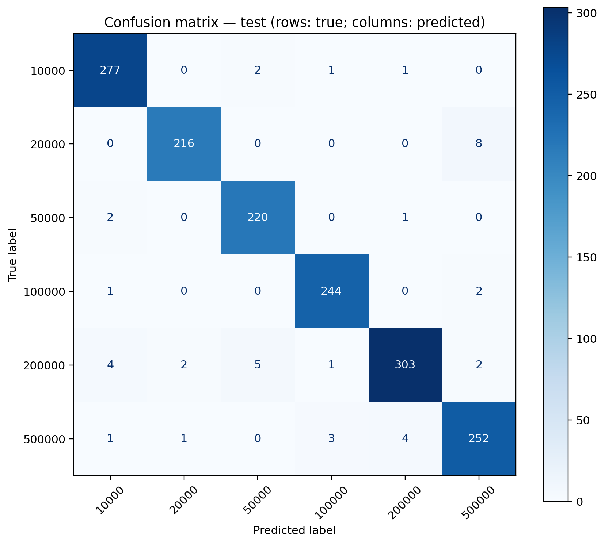
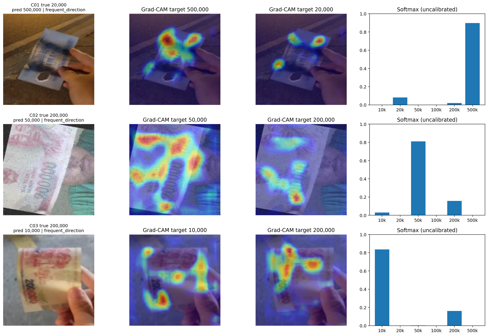

# CNN — Kết quả cuối của nhóm

Cấu hình chọn trên dev: **C04_DEEP_AUG, RGB bốn khối32–64–128–256, augmentation, checkpoint epoch25.**

## Chọn cấu hình trên dev

| Cấu hình | Epoch | Accuracy | Macro-F1 | MAE (đ/ảnh) |
|---|---|---|---|---|
| C04_DEEP_AUG | 25 | 96.36% | 0.963952 | 9,296.68 |
| C01_RGB | 25 | 93.09% | 0.932439 | 18,177.75 |
| C03_RGB_AUG | 25 | 92.01% | 0.921336 | 21,643.22 |
| C02_GRAY | 25 | 37.34% | 0.324916 | 150,645.78 |

## Đánh giá test

| Mô hình | Đúng | Sai | Accuracy | Macro-F1 | MAE (đ/ảnh) |
|---|---|---|---|---|---|
| CNN | 1512 | 41 | 97.36% | 0.973945 | 7,250.48 |

## Xem ảnh lỗi

Các hình là kết quả thực nghiệm thật. Ảnh train gần của SVM chỉ dùng đối chiếu; heatmap CNN chưa chứng minh nguyên nhân lỗi.

Các CSV/JSON lưu số liệu gốc. `SOURCE.json` ghi nguồn; cấu hình đầy đủ nằm trong `inputs/experiment_config.json` và `selection/`. Đây là bộ kết quả đã dùng trong slide, không tự thay đổi khi chạy code mới. Model/checkpoint và ma trận lớn được Git bỏ qua; sau khi clone cần chạy lại notebook để tạo chúng hoặc dùng Output đã lưu của nhóm.
