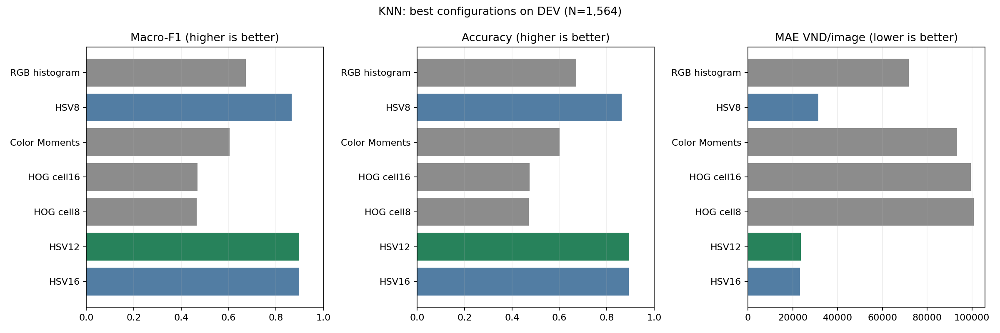

# Nhật ký và phân tích thực nghiệm KNN

Ngày tổng hợp: 04/11/2026. Tài liệu này ghi nhận giai đoạn khảo sát **trên dev**. Kết quả test đã được bổ sung riêng tại [TEST_RESULTS.md](TEST_RESULTS.md); các câu mô tả “chưa đánh giá test” bên dưới chỉ trạng thái tại thời điểm khảo sát dev. Các bảng được tạo từ CSV đã lưu bằng `audit_results.py`; không chạy lại training hay dự đoán khi tổng hợp.

## 1. Câu hỏi và phạm vi

Nhóm khảo sát các biểu diễn màu và đường nét cho bài toán phân loại một ảnh crop vào sáu mệnh giá polymer Việt Nam: 10.000, 20.000, 50.000, 100.000, 200.000 và 500.000đ. Mỗi biểu diễn được chọn cấu hình KNN riêng trên cùng tập dev. Không phát hiện tiền giả, không cộng tổng tiền, không OCR và chưa triển khai từ chối dự đoán.

Đây là quá trình khảo sát tuần tự: thử RGB, HSV8, Color Moments, hai cấu hình HOG, rồi tăng bin HSV sau khi quan sát kết quả trước. Vì dev được dùng nhiều lần để điều chỉnh hướng thử nghiệm, kết quả dev có thể lạc quan so với dữ liệu chưa xem. Không coi đây là một thiết kế đã đăng ký toàn bộ từ trước.

## 2. Dữ liệu và quy trình chung

| Tập | Số ảnh | Vai trò trong các bảng này |
| --- | ---: | --- |
| Train | 12.494 | Fit KNN |
| Dev | 1.564 | Chọn feature/tham số và phân tích lỗi |
| Test | 1.553 | Chưa đánh giá; chỉ dùng sau khi khóa cấu hình |

Thứ tự lớp cố định: 10000, 20000, 50000, 100000, 200000, 500000. Support trên dev tương ứng là 315, 238, 195, 250, 309, 257. Ảnh và nhãn được đọc theo cùng thứ tự thư mục lớp và tên file; nhãn là giá trị VND, không phải chỉ số 0–5. OpenCV đọc BGR rồi chuyển sang RGB.

Dữ liệu đầu vào là PNG crop có padding từ M0. Trong thực nghiệm này không sửa DATA, không chia lại split, không augment, không PCA, không fit scaler, không gộp train+dev. M0 nhóm ảnh theo tên nguồn khi chia; điều đó không chứng minh mọi ảnh đều độc lập theo phiên chụp hoặc tờ tiền vật lý. Các kết quả ở đây không thay thế một cuộc kiểm toán leakage mới.

Notebook RGB có đọc và trích xuất feature test nhưng không dùng chúng trong các bảng kết quả/chọn cấu hình đang lưu. Các notebook sau chỉ đọc train/dev. Việc đã tạo feature test khác với đã đánh giá dự đoán test.

### 2.1. Lưới KNN

- `n_neighbors`: 1 đến 10.
- `weights`: `uniform`, `distance`.
- `metric`: `braycurtis`, `canberra`, `correlation`, `cosine`, `euclidean`, `minkowski`.
- `algorithm='brute'`; Minkowski mặc định `p=2`.

Mỗi biểu diễn có 10 × 2 × 6 = **120 cấu hình**, tổng cộng **840 dòng cấu hình** trong bảy bảng. Đây không phải 840 mô hình độc lập về hành vi: Euclidean và Minkowski p=2 tương đương; với k=1, hai cách bỏ phiếu thường cho cùng dự đoán. Không dùng các dòng lặp hành vi như bằng chứng lặp thí nghiệm hay ước lượng độ bất định.

Với `uniform`, hàng xóm bỏ phiếu như nhau; với `distance`, hàng xóm gần có ảnh hưởng lớn hơn. Bray–Curtis so tổng chênh lệch tuyệt đối với tổng độ lớn; Canberra cộng chênh lệch tương đối theo từng chiều; correlation so hình dạng vector sau trừ trung bình; cosine so góc; Euclidean đo khoảng cách thẳng. Color Moments có skewness âm, nên cách hiểu Bray–Curtis như so sánh histogram không âm không áp dụng trực tiếp cho feature đó.

Chọn bằng **Macro-F1 chưa làm tròn cao nhất**; nếu bằng nhau chọn **MAE_VND thấp nhất**; nếu vẫn bằng nhau chọn thứ tự `k → weights → metric` theo lưới trên. Các điểm hiển thị trong tài liệu được làm tròn, CSV giữ độ chính xác gốc. Đây là tìm kiếm tham số bằng vòng lặp train/dev, không phải k-fold cross-validation.

### 2.2. Độ đo

Dùng hàm chung `src/evaluation/value_metrics.py`: Accuracy là số đúng/N; Macro-F1 là trung bình F1 của đúng sáu lớp; MAE_VND = tổng |mệnh giá thật − dự đoán| / N, gồm cả ảnh đúng với sai lệch 0. Precision/Recall/F1 từng lớp dùng quy tắc chia cho 0 trả 0. Ma trận nhầm lẫn có hàng là nhãn thật, cột là dự đoán.

MAE đo chênh lệch mệnh giá danh nghĩa, **không phải thiệt hại tài chính thực tế**. Một độ đo tốt hơn không tự động làm mọi độ đo còn lại tốt hơn. Quy tắc chọn đã cố định ưu tiên Macro-F1, không đổi sang MAE sau khi nhìn thấy kết quả.

## 3. Các biểu diễn đã thử

| Biểu diễn | Cách tính | Số chiều |
| --- | --- | ---: |
| RGB histogram | 256 bin riêng mỗi kênh R/G/B; chuẩn hóa L2 riêng từng kênh rồi nối | 768 |
| HSV8 | Histogram kết hợp H/S/V, 8 bin mỗi trục; chuẩn hóa L2 cả vector | 512 |
| Color Moments | Nối mean R/G/B, std R/G/B và skewness R/G/B | 9 |
| HOG cell16 | Xám, resize 128×128, cell16×16, block2×2, 9 hướng, L2-Hys | 1.764 |
| HOG cell8 | Giữ HOG trên, chỉ đổi cell8×8 | 8.100 |
| HSV12 | Như HSV8, đổi 12 bin mỗi trục | 1.728 |
| HSV16 | Như HSV8, đổi 16 bin mỗi trục | 4.096 |

HSV dùng miền OpenCV H=[0,180), S/V=[0,256), số chiều bằng số bin H × S × V. Không resize các feature màu. Color Moments tính skewness bằng `mean(((image-mean)/(std+1e-6))**3)` theo từng kênh, không chuẩn hóa L2 hoặc standardize sau đó. Mean/std và skewness có thang đo khác nhau; kết quả của cấu hình này chưa đại diện cho Color Moments đã chuẩn hóa.

HOG dùng `transform_sqrt=False`, không dùng màu, không đọc chữ số như OCR. Resize vuông có thể làm đổi tỷ lệ ảnh; chưa căn thẳng tờ tiền hay chuẩn hóa góc quay. Cell16 tạo 7×7 block, cell8 tạo 15×15 block; mỗi block đóng góp 2×2×9 phần tử. Chuẩn hóa theo block khác với chuẩn hóa L2 toàn vector histogram.

## 4. Kết quả tổng hợp

| feature | feature_dim | k | weights | metric | macro_f1 | accuracy | mae_vnd | correct | errors | total_gap_vnd |
| --- | --- | --- | --- | --- | --- | --- | --- | --- | --- | --- |
| RGB histogram | 768 | 7 | distance | canberra | 0.673358 | 0.671995 | 71815.856777 | 1051 | 513 | 112320000 |
| HSV8 | 512 | 5 | distance | braycurtis | 0.866711 | 0.863171 | 31496.163683 | 1350 | 214 | 49260000 |
| Color Moments | 9 | 8 | distance | cosine | 0.603584 | 0.601023 | 93331.202046 | 940 | 624 | 145970000 |
| HOG cell16 | 1764 | 1 | uniform | braycurtis | 0.467904 | 0.473785 | 99578.005115 | 741 | 823 | 155740000 |
| HOG cell8 | 8100 | 1 | uniform | correlation | 0.464662 | 0.469949 | 100754.475703 | 735 | 829 | 157580000 |
| HSV12 | 1728 | 1 | uniform | braycurtis | 0.898057 | 0.893862 | 23554.987212 | 1398 | 166 | 36840000 |
| HSV16 | 4096 | 3 | distance | braycurtis | 0.897362 | 0.892583 | 23305.626598 | 1396 | 168 | 36450000 |

Từng feature được chọn KNN riêng, nên bảng so sánh các tổ hợp feature + cấu hình KNN tốt nhất trong phạm vi khảo sát; không phải tác động thuần của feature khi giữ cố định mọi tham số KNN. Những số liệu này thuộc đúng một split hiện tại, chưa có khoảng tin cậy hay kiểm định ý nghĩa thống kê.

## 5. Phân tích từng thí nghiệm

## 5.1. RGB histogram

Notebook: [02_FEATURE_RGB_HISTOGRAM.ipynb](02_FEATURE_RGB_HISTOGRAM.ipynb). Evidence: [grid](results/rgb_knn_grid_dev.csv), [confusion matrix](results/rgb_confusion_matrix_dev.csv), [chi phí từng cặp lỗi](results/rgb_error_costs_dev.csv).

Cấu hình được chọn: **k=7, weights=distance, metric=canberra**. Đúng **1051/1.564**, sai **513**. Macro-F1 **0.673358**, Accuracy **67.1995%**, MAE **71815.86 VND/ảnh**. Tổng chênh lệch tuyệt đối là **112,320,000 VND**; đây là tổng trên toàn dev, không phải khoản tiền tổn thất.

### Cấu hình tốt nhất theo từng khoảng cách

| metric | k | weights | macro_f1 | mae_vnd | accuracy |
| --- | --- | --- | --- | --- | --- |
| canberra | 7 | distance | 0.673358 | 71815.856777 | 0.671995 |
| braycurtis | 8 | distance | 0.634552 | 79661.125320 | 0.634910 |
| cosine | 8 | distance | 0.597757 | 85971.867008 | 0.597187 |
| euclidean | 8 | distance | 0.592152 | 87186.700767 | 0.591432 |
| minkowski | 8 | distance | 0.592152 | 87186.700767 | 0.591432 |
| correlation | 3 | distance | 0.591510 | 87966.751918 | 0.590793 |

### Kết quả từng lớp

| denomination_vnd | support | precision | recall | f1 |
| --- | --- | --- | --- | --- |
| 10000 | 315 | 0.669841 | 0.669841 | 0.669841 |
| 20000 | 238 | 0.809756 | 0.697479 | 0.749436 |
| 50000 | 195 | 0.629442 | 0.635897 | 0.632653 |
| 100000 | 250 | 0.675889 | 0.684000 | 0.679920 |
| 200000 | 309 | 0.644951 | 0.640777 | 0.642857 |
| 500000 | 257 | 0.630662 | 0.704280 | 0.665441 |

Lớp có F1 cao nhất là **20,000đ (0.749436)**; thấp nhất là **50,000đ (0.632653)**. Đây là xếp hạng theo F1, không đồng nhất với xếp hạng Recall.

### Ma trận nhầm lẫn

| true / predicted | 10000 | 20000 | 50000 | 100000 | 200000 | 500000 |
| --- | --- | --- | --- | --- | --- | --- |
| 10000 | 211 | 8 | 20 | 17 | 42 | 17 |
| 20000 | 5 | 166 | 12 | 12 | 13 | 30 |
| 50000 | 25 | 5 | 124 | 17 | 11 | 13 |
| 100000 | 15 | 3 | 17 | 171 | 21 | 23 |
| 200000 | 37 | 10 | 16 | 25 | 198 | 23 |
| 500000 | 22 | 13 | 8 | 11 | 22 | 181 |

### Năm cặp lỗi có tổng chênh lệch lớn nhất

| true_vnd | predicted_vnd | count | gap_vnd | total_gap_vnd |
| --- | --- | --- | --- | --- |
| 20000 | 500000 | 30 | 480000 | 14400000 |
| 500000 | 10000 | 22 | 490000 | 10780000 |
| 100000 | 500000 | 23 | 400000 | 9200000 |
| 10000 | 500000 | 17 | 490000 | 8330000 |
| 10000 | 200000 | 42 | 190000 | 7980000 |

Cặp có nhiều lỗi nhất (một chiều) là 10,000 → 200,000đ: **42 ảnh**. Cặp đóng góp tổng chênh lệch lớn nhất là 20,000 → 500,000đ: **30 ảnh**, tương ứng **14,400,000 VND**. Tần suất sai và mức đóng góp MAE là hai góc nhìn khác nhau.

RGB đạt kết quả thấp hơn HSV8 trong thiết lập này. RGB dùng ba histogram biên riêng, còn HSV dùng histogram kết hợp; thí nghiệm đồng thời đổi không gian màu và kiểu histogram, vì vậy chưa thể quy toàn bộ cải thiện cho riêng việc chuyển RGB sang HSV. Histogram không giữ vị trí của màu. Chưa thử RGB histogram kết hợp hoặc các số bin RGB khác.

## 5.2. HSV8

Notebook: [03_FEATURE_HSV_HISTOGRAM.ipynb](03_FEATURE_HSV_HISTOGRAM.ipynb). Evidence: [grid](results/hsv_knn_grid_dev.csv), [confusion matrix](results/hsv_confusion_matrix_dev.csv), [chi phí từng cặp lỗi](results/hsv_error_costs_dev.csv).

Cấu hình được chọn: **k=5, weights=distance, metric=braycurtis**. Đúng **1350/1.564**, sai **214**. Macro-F1 **0.866711**, Accuracy **86.3171%**, MAE **31496.16 VND/ảnh**. Tổng chênh lệch tuyệt đối là **49,260,000 VND**; đây là tổng trên toàn dev, không phải khoản tiền tổn thất.

### Cấu hình tốt nhất theo từng khoảng cách

| metric | k | weights | macro_f1 | mae_vnd | accuracy |
| --- | --- | --- | --- | --- | --- |
| braycurtis | 5 | distance | 0.866711 | 31496.163683 | 0.863171 |
| canberra | 3 | distance | 0.849722 | 32992.327366 | 0.847187 |
| cosine | 8 | distance | 0.777638 | 52890.025575 | 0.775575 |
| euclidean | 1 | uniform | 0.773474 | 52391.304348 | 0.769821 |
| minkowski | 1 | uniform | 0.773474 | 52391.304348 | 0.769821 |
| correlation | 8 | distance | 0.770506 | 54661.125320 | 0.767903 |

### Kết quả từng lớp

| denomination_vnd | support | precision | recall | f1 |
| --- | --- | --- | --- | --- |
| 10000 | 315 | 0.827273 | 0.866667 | 0.846512 |
| 20000 | 238 | 0.903766 | 0.907563 | 0.905660 |
| 50000 | 195 | 0.878947 | 0.856410 | 0.867532 |
| 100000 | 250 | 0.940171 | 0.880000 | 0.909091 |
| 200000 | 309 | 0.806962 | 0.825243 | 0.816000 |
| 500000 | 257 | 0.858824 | 0.852140 | 0.855469 |

Lớp có F1 cao nhất là **100,000đ (0.909091)**; thấp nhất là **200,000đ (0.816000)**. Đây là xếp hạng theo F1, không đồng nhất với xếp hạng Recall.

### Ma trận nhầm lẫn

| true / predicted | 10000 | 20000 | 50000 | 100000 | 200000 | 500000 |
| --- | --- | --- | --- | --- | --- | --- |
| 10000 | 273 | 2 | 7 | 5 | 24 | 4 |
| 20000 | 3 | 216 | 1 | 0 | 4 | 14 |
| 50000 | 8 | 1 | 167 | 3 | 13 | 3 |
| 100000 | 12 | 3 | 2 | 220 | 7 | 6 |
| 200000 | 28 | 2 | 11 | 4 | 255 | 9 |
| 500000 | 6 | 15 | 2 | 2 | 13 | 219 |

### Năm cặp lỗi có tổng chênh lệch lớn nhất

| true_vnd | predicted_vnd | count | gap_vnd | total_gap_vnd |
| --- | --- | --- | --- | --- |
| 500000 | 20000 | 15 | 480000 | 7200000 |
| 20000 | 500000 | 14 | 480000 | 6720000 |
| 200000 | 10000 | 28 | 190000 | 5320000 |
| 10000 | 200000 | 24 | 190000 | 4560000 |
| 500000 | 200000 | 13 | 300000 | 3900000 |

Cặp có nhiều lỗi nhất (một chiều) là 200,000 → 10,000đ: **28 ảnh**. Cặp đóng góp tổng chênh lệch lớn nhất là 500,000 → 20,000đ: **15 ảnh**, tương ứng **7,200,000 VND**. Tần suất sai và mức đóng góp MAE là hai góc nhìn khác nhau.

HSV8 tốt hơn RGB và Color Moments ở cả ba độ đo tổng hợp. Điều này cho thấy biểu diễn màu kết hợp này hữu ích trên dev hiện tại; không chứng minh màu là tín hiệu duy nhất hay mô hình đã hiểu chữ số. Số chiều 512 thấp hơn RGB 768 nhưng điểm tốt hơn: số chiều không quyết định chất lượng.

## 5.3. Color Moments

Notebook: [04_FEATURE_COLOR_MOMENTS.ipynb](04_FEATURE_COLOR_MOMENTS.ipynb). Evidence: [grid](results/moments_knn_grid_dev.csv), [confusion matrix](results/moments_confusion_matrix_dev.csv), [chi phí từng cặp lỗi](results/moments_error_costs_dev.csv).

Cấu hình được chọn: **k=8, weights=distance, metric=cosine**. Đúng **940/1.564**, sai **624**. Macro-F1 **0.603584**, Accuracy **60.1023%**, MAE **93331.20 VND/ảnh**. Tổng chênh lệch tuyệt đối là **145,970,000 VND**; đây là tổng trên toàn dev, không phải khoản tiền tổn thất.

### Cấu hình tốt nhất theo từng khoảng cách

| metric | k | weights | macro_f1 | mae_vnd | accuracy |
| --- | --- | --- | --- | --- | --- |
| cosine | 8 | distance | 0.603584 | 93331.202046 | 0.601023 |
| correlation | 10 | distance | 0.592231 | 93439.897698 | 0.591432 |
| euclidean | 5 | distance | 0.575237 | 98113.810742 | 0.572251 |
| minkowski | 5 | distance | 0.575237 | 98113.810742 | 0.572251 |
| braycurtis | 3 | distance | 0.571871 | 95217.391304 | 0.569693 |
| canberra | 3 | distance | 0.468780 | 117742.966752 | 0.468031 |

### Kết quả từng lớp

| denomination_vnd | support | precision | recall | f1 |
| --- | --- | --- | --- | --- |
| 10000 | 315 | 0.605960 | 0.580952 | 0.593193 |
| 20000 | 238 | 0.622951 | 0.638655 | 0.630705 |
| 50000 | 195 | 0.609626 | 0.584615 | 0.596859 |
| 100000 | 250 | 0.705357 | 0.632000 | 0.666667 |
| 200000 | 309 | 0.545190 | 0.605178 | 0.573620 |
| 500000 | 257 | 0.553030 | 0.568093 | 0.560461 |

Lớp có F1 cao nhất là **100,000đ (0.666667)**; thấp nhất là **500,000đ (0.560461)**. Đây là xếp hạng theo F1, không đồng nhất với xếp hạng Recall.

### Ma trận nhầm lẫn

| true / predicted | 10000 | 20000 | 50000 | 100000 | 200000 | 500000 |
| --- | --- | --- | --- | --- | --- | --- |
| 10000 | 183 | 11 | 16 | 26 | 59 | 20 |
| 20000 | 10 | 152 | 10 | 8 | 16 | 42 |
| 50000 | 17 | 9 | 114 | 8 | 38 | 9 |
| 100000 | 29 | 15 | 5 | 158 | 16 | 27 |
| 200000 | 48 | 18 | 30 | 6 | 187 | 20 |
| 500000 | 15 | 39 | 12 | 18 | 27 | 146 |

### Năm cặp lỗi có tổng chênh lệch lớn nhất

| true_vnd | predicted_vnd | count | gap_vnd | total_gap_vnd |
| --- | --- | --- | --- | --- |
| 20000 | 500000 | 42 | 480000 | 20160000 |
| 500000 | 20000 | 39 | 480000 | 18720000 |
| 10000 | 200000 | 59 | 190000 | 11210000 |
| 100000 | 500000 | 27 | 400000 | 10800000 |
| 10000 | 500000 | 20 | 490000 | 9800000 |

Cặp có nhiều lỗi nhất (một chiều) là 10,000 → 200,000đ: **59 ảnh**. Cặp đóng góp tổng chênh lệch lớn nhất là 20,000 → 500,000đ: **42 ảnh**, tương ứng **20,160,000 VND**. Tần suất sai và mức đóng góp MAE là hai góc nhìn khác nhau.

Color Moments nén ảnh thành 9 thống kê và cho điểm thấp hơn RGB/HSV. Các thống kê này không giữ đầy đủ hình dạng phân bố màu và vị trí họa tiết. Đây là các giới hạn có thể giải thích kết quả, chưa được tách riêng bằng thí nghiệm nhân quả. Chưa thử scaler train-only nên không kết luận mọi biến thể Color Moments đều kém.

## 5.4. HOG cell16

Notebook: [05_FEATURE_HOG.ipynb](05_FEATURE_HOG.ipynb). Evidence: [grid](results/hog_knn_grid_dev.csv), [confusion matrix](results/hog_confusion_matrix_dev.csv), [chi phí từng cặp lỗi](results/hog_error_costs_dev.csv).

Cấu hình được chọn: **k=1, weights=uniform, metric=braycurtis**. Đúng **741/1.564**, sai **823**. Macro-F1 **0.467904**, Accuracy **47.3785%**, MAE **99578.01 VND/ảnh**. Tổng chênh lệch tuyệt đối là **155,740,000 VND**; đây là tổng trên toàn dev, không phải khoản tiền tổn thất.

### Cấu hình tốt nhất theo từng khoảng cách

| metric | k | weights | macro_f1 | mae_vnd | accuracy |
| --- | --- | --- | --- | --- | --- |
| braycurtis | 1 | uniform | 0.467904 | 99578.005115 | 0.473785 |
| canberra | 1 | uniform | 0.456813 | 105306.905371 | 0.463555 |
| correlation | 1 | uniform | 0.453922 | 103292.838875 | 0.460997 |
| euclidean | 1 | uniform | 0.428277 | 106457.800512 | 0.432864 |
| minkowski | 1 | uniform | 0.428277 | 106457.800512 | 0.432864 |
| cosine | 1 | uniform | 0.428250 | 106361.892583 | 0.432864 |

### Kết quả từng lớp

| denomination_vnd | support | precision | recall | f1 |
| --- | --- | --- | --- | --- |
| 10000 | 315 | 0.484932 | 0.561905 | 0.520588 |
| 20000 | 238 | 0.431818 | 0.399160 | 0.414847 |
| 50000 | 195 | 0.418848 | 0.410256 | 0.414508 |
| 100000 | 250 | 0.412371 | 0.480000 | 0.443623 |
| 200000 | 309 | 0.550420 | 0.423948 | 0.478976 |
| 500000 | 257 | 0.532819 | 0.536965 | 0.534884 |

Lớp có F1 cao nhất là **500,000đ (0.534884)**; thấp nhất là **50,000đ (0.414508)**. Đây là xếp hạng theo F1, không đồng nhất với xếp hạng Recall.

### Ma trận nhầm lẫn

| true / predicted | 10000 | 20000 | 50000 | 100000 | 200000 | 500000 |
| --- | --- | --- | --- | --- | --- | --- |
| 10000 | 177 | 30 | 20 | 44 | 22 | 22 |
| 20000 | 34 | 95 | 21 | 35 | 23 | 30 |
| 50000 | 30 | 19 | 80 | 33 | 13 | 20 |
| 100000 | 34 | 31 | 25 | 120 | 23 | 17 |
| 200000 | 49 | 31 | 27 | 39 | 131 | 32 |
| 500000 | 41 | 14 | 18 | 20 | 26 | 138 |

### Năm cặp lỗi có tổng chênh lệch lớn nhất

| true_vnd | predicted_vnd | count | gap_vnd | total_gap_vnd |
| --- | --- | --- | --- | --- |
| 500000 | 10000 | 41 | 490000 | 20090000 |
| 20000 | 500000 | 30 | 480000 | 14400000 |
| 10000 | 500000 | 22 | 490000 | 10780000 |
| 200000 | 500000 | 32 | 300000 | 9600000 |
| 200000 | 10000 | 49 | 190000 | 9310000 |

Cặp có nhiều lỗi nhất (một chiều) là 200,000 → 10,000đ: **49 ảnh**. Cặp đóng góp tổng chênh lệch lớn nhất là 500,000 → 10,000đ: **41 ảnh**, tương ứng **20,090,000 VND**. Tần suất sai và mức đóng góp MAE là hai góc nhìn khác nhau.

HOG cell16 thấp hơn các feature màu đã thử. Việc bỏ màu, mất chi tiết sau resize và thay đổi vị trí/hướng của họa tiết là các giả thuyết giải thích hợp lý; chưa có thí nghiệm đủ để xác định nguyên nhân nào chi phối. Không được nói HOG không nhận diện được tiền nói chung.

## 5.5. HOG cell8

Notebook: [06_FEATURE_HOG_CELL8.ipynb](06_FEATURE_HOG_CELL8.ipynb). Evidence: [grid](results/hog_cell8_knn_grid_dev.csv), [confusion matrix](results/hog_cell8_confusion_matrix_dev.csv), [chi phí từng cặp lỗi](results/hog_cell8_error_costs_dev.csv).

Cấu hình được chọn: **k=1, weights=uniform, metric=correlation**. Đúng **735/1.564**, sai **829**. Macro-F1 **0.464662**, Accuracy **46.9949%**, MAE **100754.48 VND/ảnh**. Tổng chênh lệch tuyệt đối là **157,580,000 VND**; đây là tổng trên toàn dev, không phải khoản tiền tổn thất.

### Cấu hình tốt nhất theo từng khoảng cách

| metric | k | weights | macro_f1 | mae_vnd | accuracy |
| --- | --- | --- | --- | --- | --- |
| correlation | 1 | uniform | 0.464662 | 100754.475703 | 0.469949 |
| braycurtis | 1 | uniform | 0.437482 | 103561.381074 | 0.439898 |
| cosine | 1 | uniform | 0.408791 | 110549.872123 | 0.410486 |
| euclidean | 1 | uniform | 0.405642 | 112436.061381 | 0.407289 |
| minkowski | 1 | uniform | 0.405642 | 112436.061381 | 0.407289 |
| canberra | 1 | uniform | 0.398655 | 119098.465473 | 0.400895 |

### Kết quả từng lớp

| denomination_vnd | support | precision | recall | f1 |
| --- | --- | --- | --- | --- |
| 10000 | 315 | 0.485981 | 0.495238 | 0.490566 |
| 20000 | 238 | 0.467890 | 0.428571 | 0.447368 |
| 50000 | 195 | 0.403941 | 0.420513 | 0.412060 |
| 100000 | 250 | 0.426230 | 0.416000 | 0.421053 |
| 200000 | 309 | 0.498462 | 0.524272 | 0.511041 |
| 500000 | 257 | 0.509881 | 0.501946 | 0.505882 |

Lớp có F1 cao nhất là **200,000đ (0.511041)**; thấp nhất là **50,000đ (0.412060)**. Đây là xếp hạng theo F1, không đồng nhất với xếp hạng Recall.

### Ma trận nhầm lẫn

| true / predicted | 10000 | 20000 | 50000 | 100000 | 200000 | 500000 |
| --- | --- | --- | --- | --- | --- | --- |
| 10000 | 156 | 33 | 27 | 36 | 36 | 27 |
| 20000 | 36 | 102 | 22 | 28 | 29 | 21 |
| 50000 | 28 | 17 | 82 | 29 | 23 | 16 |
| 100000 | 29 | 28 | 28 | 104 | 34 | 27 |
| 200000 | 42 | 22 | 26 | 24 | 162 | 33 |
| 500000 | 30 | 16 | 18 | 23 | 41 | 129 |

### Năm cặp lỗi có tổng chênh lệch lớn nhất

| true_vnd | predicted_vnd | count | gap_vnd | total_gap_vnd |
| --- | --- | --- | --- | --- |
| 500000 | 10000 | 30 | 490000 | 14700000 |
| 10000 | 500000 | 27 | 490000 | 13230000 |
| 500000 | 200000 | 41 | 300000 | 12300000 |
| 100000 | 500000 | 27 | 400000 | 10800000 |
| 20000 | 500000 | 21 | 480000 | 10080000 |

Cặp có nhiều lỗi nhất (một chiều) là 200,000 → 10,000đ: **42 ảnh**. Cặp đóng góp tổng chênh lệch lớn nhất là 500,000 → 10,000đ: **30 ảnh**, tương ứng **14,700,000 VND**. Tần suất sai và mức đóng góp MAE là hai góc nhìn khác nhau.

Giảm cell từ 16 xuống 8 tăng số chiều từ 1.764 lên 8.100 (khoảng 4,59 lần), nhưng không cải thiện ba độ đo trên dev. Cấu hình thắng đổi khoảng cách, nên đây là so sánh hai cấu hình feature đã được chọn KNN riêng. Chưa thử ảnh 256×256, giữ tỷ lệ thêm viền hay căn góc; không suy kết quả sang các phương án đó.

## 5.6. HSV12

Notebook: [08_FEATURE_HSV_HISTOGRAM_12BINS.ipynb](08_FEATURE_HSV_HISTOGRAM_12BINS.ipynb). Evidence: [grid](results/hsv12_knn_grid_dev.csv), [confusion matrix](results/hsv12_confusion_matrix_dev.csv), [chi phí từng cặp lỗi](results/hsv12_error_costs_dev.csv).

Cấu hình được chọn: **k=1, weights=uniform, metric=braycurtis**. Đúng **1398/1.564**, sai **166**. Macro-F1 **0.898057**, Accuracy **89.3862%**, MAE **23554.99 VND/ảnh**. Tổng chênh lệch tuyệt đối là **36,840,000 VND**; đây là tổng trên toàn dev, không phải khoản tiền tổn thất.

### Cấu hình tốt nhất theo từng khoảng cách

| metric | k | weights | macro_f1 | mae_vnd | accuracy |
| --- | --- | --- | --- | --- | --- |
| braycurtis | 1 | uniform | 0.898057 | 23554.987212 | 0.893862 |
| canberra | 4 | distance | 0.857106 | 32806.905371 | 0.854220 |
| cosine | 1 | uniform | 0.798920 | 45492.327366 | 0.796675 |
| euclidean | 1 | uniform | 0.798920 | 45492.327366 | 0.796675 |
| minkowski | 1 | uniform | 0.798920 | 45492.327366 | 0.796675 |
| correlation | 1 | uniform | 0.792669 | 47557.544757 | 0.790921 |

### Kết quả từng lớp

| denomination_vnd | support | precision | recall | f1 |
| --- | --- | --- | --- | --- |
| 10000 | 315 | 0.852761 | 0.882540 | 0.867395 |
| 20000 | 238 | 0.908730 | 0.962185 | 0.934694 |
| 50000 | 195 | 0.907216 | 0.902564 | 0.904884 |
| 100000 | 250 | 0.974468 | 0.916000 | 0.944330 |
| 200000 | 309 | 0.844371 | 0.825243 | 0.834697 |
| 500000 | 257 | 0.905882 | 0.898833 | 0.902344 |

Lớp có F1 cao nhất là **100,000đ (0.944330)**; thấp nhất là **200,000đ (0.834697)**. Đây là xếp hạng theo F1, không đồng nhất với xếp hạng Recall.

### Ma trận nhầm lẫn

| true / predicted | 10000 | 20000 | 50000 | 100000 | 200000 | 500000 |
| --- | --- | --- | --- | --- | --- | --- |
| 10000 | 278 | 2 | 6 | 1 | 25 | 3 |
| 20000 | 0 | 229 | 0 | 0 | 4 | 5 |
| 50000 | 5 | 1 | 176 | 4 | 7 | 2 |
| 100000 | 9 | 3 | 3 | 229 | 3 | 3 |
| 200000 | 32 | 5 | 6 | 0 | 255 | 11 |
| 500000 | 2 | 12 | 3 | 1 | 8 | 231 |

### Năm cặp lỗi có tổng chênh lệch lớn nhất

| true_vnd | predicted_vnd | count | gap_vnd | total_gap_vnd |
| --- | --- | --- | --- | --- |
| 200000 | 10000 | 32 | 190000 | 6080000 |
| 500000 | 20000 | 12 | 480000 | 5760000 |
| 10000 | 200000 | 25 | 190000 | 4750000 |
| 200000 | 500000 | 11 | 300000 | 3300000 |
| 20000 | 500000 | 5 | 480000 | 2400000 |

Cặp có nhiều lỗi nhất (một chiều) là 200,000 → 10,000đ: **32 ảnh**. Cặp đóng góp tổng chênh lệch lớn nhất là 200,000 → 10,000đ: **32 ảnh**, tương ứng **6,080,000 VND**. Tần suất sai và mức đóng góp MAE là hai góc nhìn khác nhau.

HSV12 tăng độ phân giải histogram so với HSV8 và cải thiện cả Macro-F1, Accuracy lẫn MAE. Kết quả phù hợp với giả thuyết các bin chi tiết hơn giúp phân biệt màu trong dữ liệu này, nhưng chưa chứng minh cơ chế đó hoặc khả năng tổng quát hóa sang dữ liệu mới. HSV12 là ứng viên được chọn theo quy tắc dev hiện tại.

## 5.7. HSV16

Notebook: [09_FEATURE_HSV_HISTOGRAM_16BINS.ipynb](09_FEATURE_HSV_HISTOGRAM_16BINS.ipynb). Evidence: [grid](results/hsv16_knn_grid_dev.csv), [confusion matrix](results/hsv16_confusion_matrix_dev.csv), [chi phí từng cặp lỗi](results/hsv16_error_costs_dev.csv).

Cấu hình được chọn: **k=3, weights=distance, metric=braycurtis**. Đúng **1396/1.564**, sai **168**. Macro-F1 **0.897362**, Accuracy **89.2583%**, MAE **23305.63 VND/ảnh**. Tổng chênh lệch tuyệt đối là **36,450,000 VND**; đây là tổng trên toàn dev, không phải khoản tiền tổn thất.

### Cấu hình tốt nhất theo từng khoảng cách

| metric | k | weights | macro_f1 | mae_vnd | accuracy |
| --- | --- | --- | --- | --- | --- |
| braycurtis | 3 | distance | 0.897362 | 23305.626598 | 0.892583 |
| canberra | 4 | distance | 0.849348 | 32576.726343 | 0.845908 |
| cosine | 6 | distance | 0.767521 | 53842.710997 | 0.764066 |
| euclidean | 6 | distance | 0.762364 | 54942.455243 | 0.758312 |
| minkowski | 6 | distance | 0.762364 | 54942.455243 | 0.758312 |
| correlation | 5 | distance | 0.761000 | 53574.168798 | 0.757033 |

### Kết quả từng lớp

| denomination_vnd | support | precision | recall | f1 |
| --- | --- | --- | --- | --- |
| 10000 | 315 | 0.845921 | 0.888889 | 0.866873 |
| 20000 | 238 | 0.893701 | 0.953782 | 0.922764 |
| 50000 | 195 | 0.917526 | 0.912821 | 0.915167 |
| 100000 | 250 | 0.974359 | 0.912000 | 0.942149 |
| 200000 | 309 | 0.832258 | 0.834951 | 0.833603 |
| 500000 | 257 | 0.933610 | 0.875486 | 0.903614 |

Lớp có F1 cao nhất là **100,000đ (0.942149)**; thấp nhất là **200,000đ (0.833603)**. Đây là xếp hạng theo F1, không đồng nhất với xếp hạng Recall.

### Ma trận nhầm lẫn

| true / predicted | 10000 | 20000 | 50000 | 100000 | 200000 | 500000 |
| --- | --- | --- | --- | --- | --- | --- |
| 10000 | 280 | 3 | 5 | 3 | 22 | 2 |
| 20000 | 0 | 227 | 0 | 0 | 5 | 6 |
| 50000 | 8 | 1 | 178 | 1 | 7 | 0 |
| 100000 | 10 | 0 | 4 | 228 | 5 | 3 |
| 200000 | 29 | 10 | 6 | 1 | 258 | 5 |
| 500000 | 4 | 13 | 1 | 1 | 13 | 225 |

### Năm cặp lỗi có tổng chênh lệch lớn nhất

| true_vnd | predicted_vnd | count | gap_vnd | total_gap_vnd |
| --- | --- | --- | --- | --- |
| 500000 | 20000 | 13 | 480000 | 6240000 |
| 200000 | 10000 | 29 | 190000 | 5510000 |
| 10000 | 200000 | 22 | 190000 | 4180000 |
| 500000 | 200000 | 13 | 300000 | 3900000 |
| 20000 | 500000 | 6 | 480000 | 2880000 |

Cặp có nhiều lỗi nhất (một chiều) là 200,000 → 10,000đ: **29 ảnh**. Cặp đóng góp tổng chênh lệch lớn nhất là 500,000 → 20,000đ: **13 ảnh**, tương ứng **6,240,000 VND**. Tần suất sai và mức đóng góp MAE là hai góc nhìn khác nhau.

HSV16 không tiếp tục tăng Macro-F1 so với HSV12 dù vector dài hơn. MAE lại thấp hơn: đây là đánh đổi giữa chất lượng phân loại và chênh lệch mệnh giá, không phải lỗi tính điểm. Không có dự đoán từng ảnh được lưu để đối chiếu trực tiếp các trường hợp chuyển đúng/sai giữa hai mô hình. Không nói hai mô hình chỉ khác nhau đúng hai ảnh; chỉ biết tổng số ảnh đúng chênh hai.

## 6. Đối chiếu các thay đổi có chủ đích

### 6.1. Tăng bin HSV

HSV8 → HSV12: Macro-F1 tăng **0.031347**, Accuracy tăng **3.0691 điểm phần trăm**, số ảnh đúng tăng **48**, MAE giảm **7941.18 VND/ảnh**. Số chiều tăng 3,375 lần.

HSV12 → HSV16: Macro-F1 giảm **0.000696**, Accuracy giảm **0.1279 điểm phần trăm**, số ảnh đúng giảm **2**, nhưng MAE giảm **249.36 VND/ảnh**. Số chiều tăng khoảng 2,37 lần. Chênh lệch điểm nhỏ; chưa có bằng chứng thống kê rằng HSV12 vượt trội trong tổng thể.

Theo quy tắc chính, **chọn HSV12 + KNN k=1, uniform, Bray–Curtis**, vì Macro-F1 cao nhất trong bảy tổ hợp đã khảo sát. MAE chỉ dùng phá hòa khi Macro-F1 bằng nhau, không thay thế tiêu chí chính ở bước này. HSV16 được giữ như một phương án có MAE thấp hơn, không giấu kết quả này.

### 6.2. Giảm cell HOG

Cell16 → cell8: Macro-F1 giảm **0.003243**, số đúng giảm **6**, MAE tăng **1176.47 VND/ảnh**. Kết quả chưa cho thấy lợi ích từ lưới chi tiết hơn ở resize 128×128. Nhóm dừng mở rộng HOG ở đây, không tuyên bố đã tìm tối ưu HOG.

### 6.3. Bộ nhớ và thời gian

Không có log thời gian/RAM đỉnh đồng bộ cho bảy thí nghiệm, nên không báo cáo tốc độ đo được hoặc khẳng định cấu hình nào nhanh hơn bao nhiêu. Có thể tính riêng dung lượng một ma trận feature float32 của 12.494 ảnh train (chưa gồm ảnh, bản sao, ma trận khoảng cách và overhead):

| feature | train_float32_MiB |
| --- | --- |
| RGB histogram | 36.603516 |
| HSV8 | 24.402344 |
| HOG cell16 | 84.073700 |
| HOG cell8 | 386.052704 |
| HSV12 | 82.357910 |
| HSV16 | 195.218750 |

Color Moments thực tế lưu float64: ma trận train 12.494×9 chiếm khoảng 0,858 MiB. Các con số trên là dung lượng lý thuyết của ma trận, không phải tổng RAM tiến trình.

Lần đầu HOG hết RAM ở bước giữ toàn bộ ảnh gốc. Notebook 05/06 đã chuyển sang giữ đường dẫn, đọc từng ảnh và ghi vector vào ma trận float32. Cấu hình HOG và kết quả feature không đổi theo cách đọc này; đã kiểm tra trên mẫu ảnh. RGB/HSV/Color Moments hiện vẫn giữ toàn bộ ảnh trong RAM. Restart kernel các notebook khác trước khi chạy; nếu vẫn thiếu RAM cần đổi cách đọc hoặc chạy máy có RAM phù hợp, không tự resize các feature màu vì sẽ đổi thí nghiệm.

## 7. Kiểm tra bằng chứng và khả năng chạy lại

`audit_results.py` kiểm tra 120 cấu hình duy nhất cho từng bảng, thứ tự chọn theo lưới, support dev, rồi dựng cặp nhãn từ confusion matrix và tính lại bằng hàm đánh giá chung. Các độ đo phải khớp dòng thắng trong grid, summary và bảng từng lớp (nếu đã có). CSV cặp lỗi theo hướng được tạo lại trực tiếp từ ma trận; `total_gap_vnd=count×gap_vnd`. Đây là kiểm tra tính nhất quán số học của file đã lưu, **không chứng minh từng dự đoán đã được tái tạo từ model**. Trong giai đoạn dev chưa lưu vector dự đoán gắn với tên ảnh hay model đã fit; không suy ra lỗi cụ thể của một ảnh từ bảng tổng hợp.

Các cell code của các notebook hiện có được kiểm tra cú pháp; giai đoạn dev gồm tám notebook, notebook test được bổ sung sau. Khi chuẩn bị chia sẻ, notebook RGB được sửa tối thiểu: thêm dấu đóng ngoặc trong cell lưu CSV và ghép `df_cosine` vào `df_results` trước khi chọn cấu hình, loại cấu hình lặp. Hai cell này đã xóa output cũ; không chạy lại thí nghiệm và không thay CSV kết quả gốc. CSV RGB hiện có đủ 120 cấu hình và kiểm tra nhất quán với confusion matrix. Các output khác trong notebook là lịch sử chạy trước sửa; nên dùng CSV đã kiểm tra làm evidence chính. Notebook RGB còn hard-code cấu hình thắng đã biết cho confusion matrix; nếu đổi grid thì phải cập nhật hoặc lấy trực tiếp dòng thắng.

Dữ liệu train/dev đã chốt được dùng một lần chia. Không có thí nghiệm nhiều split/seed, khoảng tin cậy, đánh giá theo nguồn/điều kiện chụp, hoặc kiểm tra ngoài miền trong đợt KNN này. Không có log đủ để gán chính xác phiên bản thư viện tại thời điểm từng notebook được chạy. `audit_results_verification.json` ghi phiên bản môi trường **lúc kiểm tra**, không coi đó là môi trường đã chứng thực cho mọi lượt chạy trước.

Chưa chạy lại toàn bộ notebook trong đợt tổng hợp này vì sẽ lặp lại 840 cấu hình đã có kết quả. Không có kết quả test, SVM/CNN/ResNet hoặc số liệu thời gian giả định trong tài liệu.

## 8. Bước tiếp theo

1. Dừng khảo sát bin ở ba cấu hình đã thử; không gọi HSV12 là tối ưu tuyệt đối.
2. Khóa HSV12, chuẩn hóa L2, k=1, uniform, Bray–Curtis và thứ tự lớp, trước khi dùng test.
3. Fit chỉ train và đánh giá test một lần theo bộ độ đo chung. Lưu `filename, y_true, y_pred` để truy vết ảnh lỗi; không chỉnh cấu hình theo test.
4. Phân tích ảnh sai thực tế cùng các cặp lỗi có tần suất cao và tổng chênh lệch lớn. Sau đó so sánh với thành viên làm SVM/CNN/ResNet trên cùng giao thức.

Việc đánh giá test là công việc kế tiếp, chưa được thực hiện trong lần viết tài liệu và push này.
