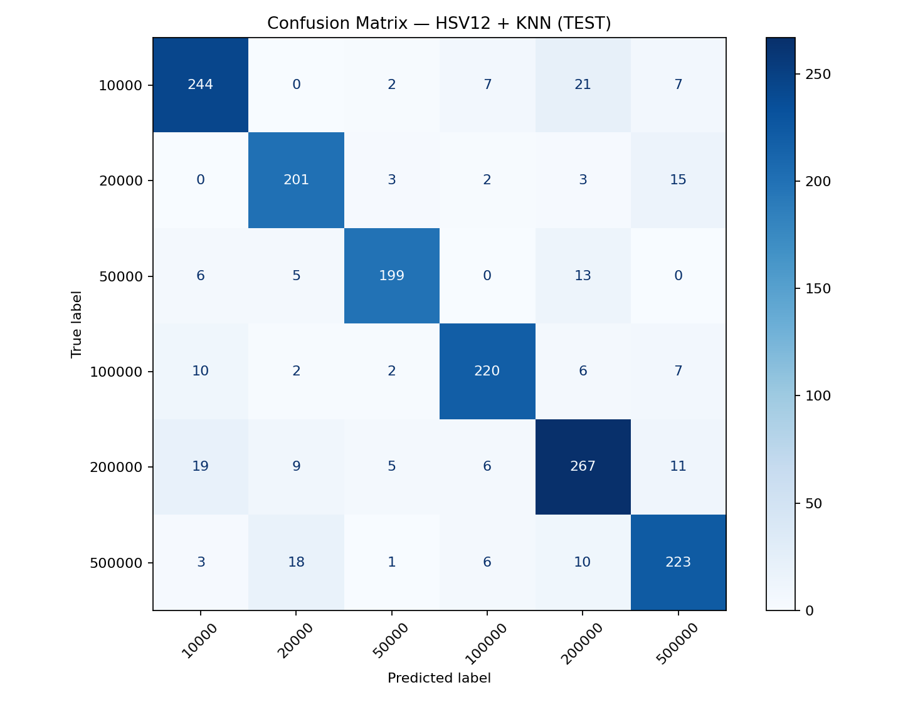
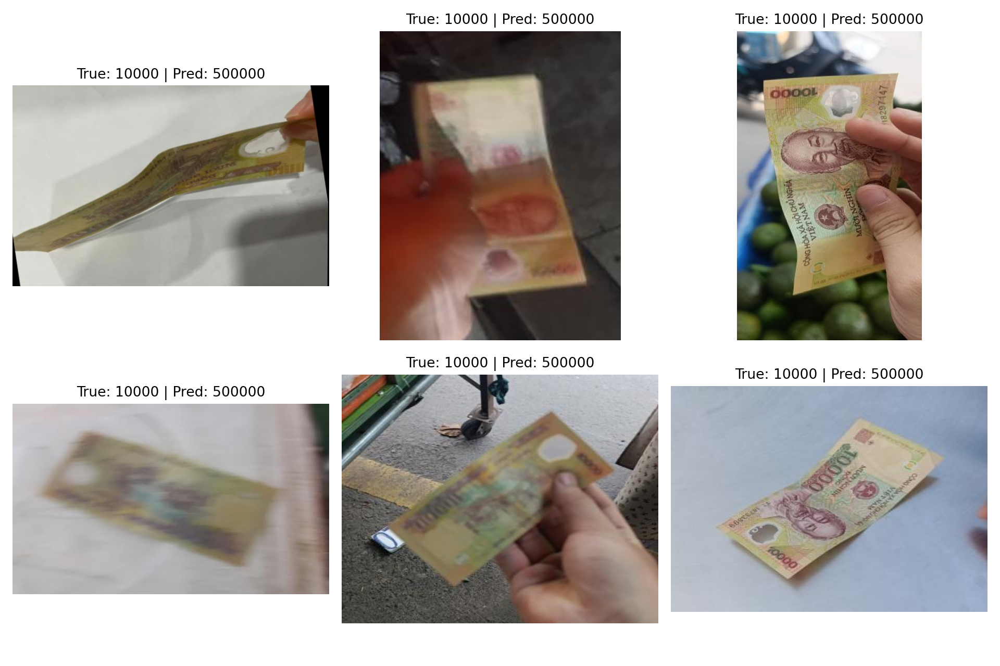

# Đánh giá cuối KNN HSV12 trên test

Ngày tổng hợp: 04/11/2026. Nối tiếp [khảo sát dev](EXPERIMENTS.md), báo cáo này phân tích kết quả notebook [10_EVALUATE_HSV12_TEST.ipynb](10_EVALUATE_HSV12_TEST.ipynb). Mọi con số được tính lại từ [1.553 dự đoán theo tên ảnh](results/hsv12_test/hsv12_predictions_test.csv), không phải số liệu minh họa. Không chạy lại suy luận trong lần kiểm tra và không thay đổi cấu hình theo test.

## 1. Giao thức đã dùng

- Fit trên đúng 12.494 ảnh train, không gộp dev. Test gồm 1.553 ảnh, đánh giá toàn bộ, không lọc hay từ chối ảnh.
- Histogram HSV kết hợp 12×12×12, 1.728 chiều; miền H=[0,180), S/V=[0,256), chuẩn hóa L2. Không resize, PCA, augment hoặc standardize.
- KNN: k=1, uniform, Bray–Curtis, brute. Các giá trị khớp CSV cấu hình thắng đã chọn trên dev và [file cấu hình khóa](results/hsv12_test/hsv12_locked_config.json).
- Đọc ảnh lần lượt để tiết kiệm RAM; thứ tự tạo feature khớp đường dẫn khi lưu nhãn thật và dự đoán. Hàm chấm điểm chung giữ đúng sáu lớp.
- Dev được dùng khảo sát tuần tự feature/tham số trước đó. Không chọn lại theo kết quả test này. Không có log đủ để xác minh số lần người dùng thực thi notebook; đây là bộ kết quả test đã lưu hiện tại, không tuyên bố đã kiểm toán toàn bộ lịch sử chạy.

## 2. Kết quả tổng thể và đối chiếu dev

| split | n | accuracy | macro_f1 | mae_vnd |
| --- | --- | --- | --- | --- |
| dev | 1564 | 0.893862 | 0.898057 | 23554.987212 |
| test | 1553 | 0.871861 | 0.874772 | 31461.687057 |

Test đúng **1354/1.553 ảnh**, sai **199 ảnh** (12.8139%). Macro-F1 là **0.874772**, Accuracy **87.1861%**, MAE **31461.69 VND/ảnh**.

So với dev, Macro-F1 giảm **0.023285**, Accuracy giảm **2.2001 điểm phần trăm**, MAE tăng **7906.70 VND/ảnh** (khoảng **33.57%**). Test có chất lượng thấp hơn dev ở cả ba độ đo. Tuy nhiên, không thể chỉ từ chênh lệch này kết luận overfitting là nguyên nhân duy nhất: tập ảnh và support từng lớp khác nhau, còn dev đã dùng chọn cấu hình qua nhiều thí nghiệm. Chưa có khoảng tin cậy hoặc kiểm định nên không gán ý nghĩa thống kê cho mức chênh lệch.

MAE trên mọi ảnh là 31461.69 VND; nếu chỉ xét 199 ảnh sai, chênh lệch tuyệt đối trung bình là **245527.64 VND/ảnh sai**. Hai mẫu số khác nhau. Kiểm tra: tỷ lệ sai × chênh lệch trung bình trên ảnh sai = MAE toàn test. Tổng chênh lệch là **48,860,000 VND**, không phải khoản tiền đã bị mất trong giao dịch.

## 3. Kết quả từng mệnh giá

| denomination_vnd | support | tp | fp | fn | precision | recall | f1 |
| --- | --- | --- | --- | --- | --- | --- | --- |
| 10000 | 281 | 244 | 38 | 37 | 0.865248 | 0.868327 | 0.866785 |
| 20000 | 224 | 201 | 34 | 23 | 0.855319 | 0.897321 | 0.875817 |
| 50000 | 223 | 199 | 13 | 24 | 0.938679 | 0.892377 | 0.914943 |
| 100000 | 247 | 220 | 21 | 27 | 0.912863 | 0.890688 | 0.901639 |
| 200000 | 317 | 267 | 53 | 50 | 0.834375 | 0.842271 | 0.838305 |
| 500000 | 261 | 223 | 40 | 38 | 0.847909 | 0.854406 | 0.851145 |

- **50.000đ** có F1 cao nhất: **0,914943** và Precision **0,938679**. Trong 212 lần dự đoán 50.000đ, có 199 lần đúng; còn 24/223 ảnh 50.000đ thật bị bỏ sót.
- **200.000đ** có F1 thấp nhất: **0,838305**, với 50 ảnh thật bị dự đoán thành lớp khác và 53 ảnh lớp khác bị dự đoán thành 200.000đ. Đây là lớp có số ảnh sai nhiều nhất (50), đồng thời có support cao nhất (317); không dùng số lỗi tuyệt đối thay cho tỷ lệ.
- **20.000đ** có Recall cao nhất **0,897321**, nhưng Precision **0,855319**. Mô hình nhận đúng 201/224 ảnh 20.000đ; trong 235 lần dự đoán lớp này, có 34 lần sai.
- **500.000đ** đạt Recall **0,854406**, bỏ sót 38/261 ảnh. Trong đó 18 ảnh bị dự đoán thành 20.000đ; lỗi này quan trọng về chênh lệch dù không phải cặp có nhiều lỗi một chiều nhất.

### Chênh lệch F1 từng lớp so với dev

| denomination_vnd | f1_test | f1_dev | test_minus_dev |
| --- | --- | --- | --- |
| 10000 | 0.866785 | 0.867395 | -0.000610 |
| 20000 | 0.875817 | 0.934694 | -0.058877 |
| 50000 | 0.914943 | 0.904884 | 0.010058 |
| 100000 | 0.901639 | 0.944330 | -0.042691 |
| 200000 | 0.838305 | 0.834697 | 0.003607 |
| 500000 | 0.851145 | 0.902344 | -0.051199 |

Các lớp không suy giảm giống nhau: F1 của 20.000đ và 500.000đ giảm rõ hơn trong bảng, trong khi 200.000đ tăng nhẹ. Đây là mô tả số liệu trên hai tập khác nhau, chưa xác minh nguyên nhân theo nguồn hay điều kiện chụp. Không nói mọi lớp đều giảm hoặc dataset test đồng đều khó hơn ở mọi mệnh giá.

## 4. Ma trận nhầm lẫn

Hàng là nhãn thật, cột là dự đoán:

| true / predicted | 10000 | 20000 | 50000 | 100000 | 200000 | 500000 |
| --- | --- | --- | --- | --- | --- | --- |
| 10000 | 244 | 0 | 2 | 7 | 21 | 7 |
| 20000 | 0 | 201 | 3 | 2 | 3 | 15 |
| 50000 | 6 | 5 | 199 | 0 | 13 | 0 |
| 100000 | 10 | 2 | 2 | 220 | 6 | 7 |
| 200000 | 19 | 9 | 5 | 6 | 267 | 11 |
| 500000 | 3 | 18 | 1 | 6 | 10 | 223 |

## 5. Mức độ sai lệch mệnh giá

### 5.1. Các cặp có tổng chênh lệch lớn nhất, giữ riêng hướng

| true_vnd | predicted_vnd | count | gap_vnd | total_gap_vnd |
| --- | --- | --- | --- | --- |
| 500000 | 20000 | 18 | 480000 | 8640000 |
| 20000 | 500000 | 15 | 480000 | 7200000 |
| 10000 | 200000 | 21 | 190000 | 3990000 |
| 200000 | 10000 | 19 | 190000 | 3610000 |
| 10000 | 500000 | 7 | 490000 | 3430000 |
| 200000 | 500000 | 11 | 300000 | 3300000 |
| 500000 | 200000 | 10 | 300000 | 3000000 |
| 100000 | 500000 | 7 | 400000 | 2800000 |
| 500000 | 100000 | 6 | 400000 | 2400000 |
| 50000 | 200000 | 13 | 150000 | 1950000 |

Cặp nhiều lỗi một chiều nhất là **10.000 → 200.000đ: 21 ảnh**, đóng góp **3.990.000 VND**. Nhưng cặp đóng góp tổng chênh lệch lớn nhất là **500.000 → 20.000đ: 18 ảnh × 480.000 = 8.640.000 VND**. Điều này minh họa lý do không chỉ xem Accuracy hoặc số lỗi: số lỗi ít hơn vẫn có thể gây sai lệch mệnh giá lớn hơn.

### 5.2. Gộp hai hướng để xác định các cặp cần chú ý

| a | b | count | total_gap_vnd | share_of_total_gap |
| --- | --- | --- | --- | --- |
| 20000 | 500000 | 33 | 15840000 | 0.324192 |
| 10000 | 200000 | 40 | 7600000 | 0.155546 |
| 200000 | 500000 | 21 | 6300000 | 0.128940 |
| 100000 | 500000 | 13 | 5200000 | 0.106427 |
| 10000 | 500000 | 10 | 4900000 | 0.100287 |
| 50000 | 200000 | 18 | 2700000 | 0.055260 |

Cặp **20.000 ↔ 500.000đ** có **33 lỗi** (18 và 15 theo hai hướng), chiếm **16.58% số lỗi** nhưng **32.42% tổng chênh lệch**. Cặp **10.000 ↔ 200.000đ** có nhiều lỗi hơn (**40**) nhưng tổng chênh lệch nhỏ hơn (**7.600.000 VND**). Đây là hai ưu tiên phân tích khác nhau: tần suất nhầm và mức sai lệch.

Lỗi có khoảng cách lớn nhất là **490.000 VND/ảnh**: 10.000 → 500.000 có 7 ảnh; chiều ngược lại có 3 ảnh. Hai hướng chịu cùng chênh lệch tuyệt đối theo MAE. MAE không mô hình hóa ai nhận/thối tiền hoặc trách nhiệm giao dịch, nên không diễn giải thành thiệt hại thực tế.

## 6. Quan sát ảnh lỗi thật

Các ảnh trên được notebook chọn theo `gap_vnd` giảm dần, giữ thứ tự ổn định nếu hòa. Vì thứ tự đường dẫn bắt đầu từ lớp 10.000đ, sáu ảnh đều là 10.000 → 500.000đ. Đây là cách lấy ví dụ xác định trước trong code, không phải sáu ảnh đại diện ngẫu nhiên hay toàn bộ lỗi nghiêm trọng.

| Ảnh | Quan sát trực tiếp từ hình |
| --- | --- |
| `10000_001077.png` | Tờ tiền cong và chụp nghiêng, thấy nhiều nền sáng |
| `10000_001717.png` | Ảnh mờ, bàn tay che một phần, nền tối |
| `10000_001838.png` | Tiền cầm tay tương đối rõ, ngón tay che một phần và nền nhiều vật thể |
| `10000_002183.png` | Nhòe rõ, đường nét trên tờ tiền khó quan sát |
| `10000_002326.png` | Cầm tiền ngoài trời, có nền và một phần bàn tay trong crop |
| `10000_002541.png` | Tờ 10.000đ trên nền sáng, chữ và họa tiết vẫn khá rõ nhưng dự đoán thành 500.000đ |

Không thể quy mọi lỗi cho ảnh mờ: ví dụ cuối vẫn nhìn tương đối rõ. Histogram chỉ đếm phân bố màu và không đọc chữ số hoặc giữ vị trí họa tiết. Phần nền, bàn tay, ánh sáng hoặc cách chia bin có thể làm các ảnh khác mệnh giá có vector gần nhau. Đây là các giả thuyết phù hợp với cách biểu diễn, chưa được kiểm chứng bằng cách phân vùng tiền/nền hay xem hàng xóm gần nhất. Với k=1, dự đoán lấy nhãn của một hàng xóm gần nhất; chưa có khoảng cách/hàng xóm được lưu để nêu cụ thể ảnh train nào gây từng lỗi.

Không đo tỷ lệ mờ, che khuất hoặc nền trên toàn test vì chưa có nhãn điều kiện. Không dùng sáu ảnh này để sửa DATA, đổi cấu hình hoặc báo lại một điểm test mới như chưa từng xem test.

## 7. Kiểm tra đã thực hiện và giới hạn

`audit_test_results.py` kiểm tra:

1. Đủ 1.553 đường dẫn duy nhất, khớp toàn bộ PNG trong `DATA/test` theo đúng thứ tự sáu lớp; nhãn thật khớp thư mục, tên file khớp đường dẫn.
2. Dự đoán thuộc sáu lớp, `is_correct` và `gap_vnd` khớp từng dòng.
3. Tính lại độ đo từ dự đoán bằng hàm chung; khớp summary, JSON, confusion matrix, support, từng lớp, bảng cặp lỗi và danh sách ảnh sai.
4. Cấu hình JSON/summary khớp cấu hình đã chọn trên dev; notebook không lưu lỗi thực thi và code hợp lệ về cú pháp.

Đây là xác minh file dự đoán và code đã lưu, không chạy lại suy luận và không chứng minh toàn bộ quá trình thực thi qua lịch sử độc lập. Không fit lại, không sửa ảnh, nhãn hay split. [JSON kiểm tra](results/hsv12_test/hsv12_test_verification.json) ghi hash evidence. Không suy ra mức an toàn tài chính hoặc khả năng nhận diện tiền ngoài thực tế chỉ từ điểm test này. Chưa đánh giá nhiều split/seed, ảnh ngoài miền hay các mô hình của thành viên khác.

## 8. Kết luận và bước tiếp theo

HSV12 + KNN đã cho một kết quả cuối truy vết được trên test: **Accuracy 87,19%, Macro-F1 0,874772, MAE 31.461,69 VND/ảnh**. Chất lượng thấp hơn dev và vẫn có lỗi chênh lệch lớn. Macro-F1 mô tả khả năng phân loại cân bằng giữa lớp; MAE và bảng cặp lỗi cho thấy mức chênh lệch mệnh giá mà tỷ lệ đúng đơn lẻ không thể hiện.

Giữ cấu hình này làm kết quả KNN đã khóa. Bước tiếp theo là ghép vào bảng so sánh với SVM/CNN/ResNet khi các thành viên có kết quả cùng test và cùng hàm chấm điểm. Nếu phát triển thêm phương án sau khi đã xem test, cần ghi rõ đó là thử nghiệm tiếp nối, không dùng test hiện tại làm dev rồi vẫn tuyên bố là đánh giá chưa xem.
