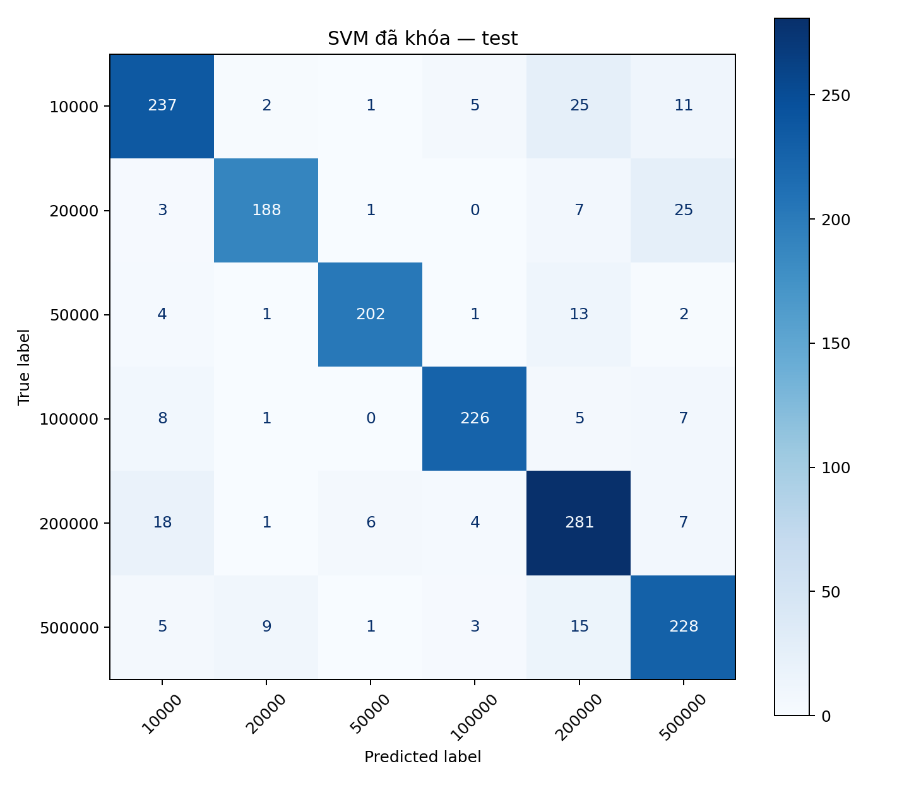
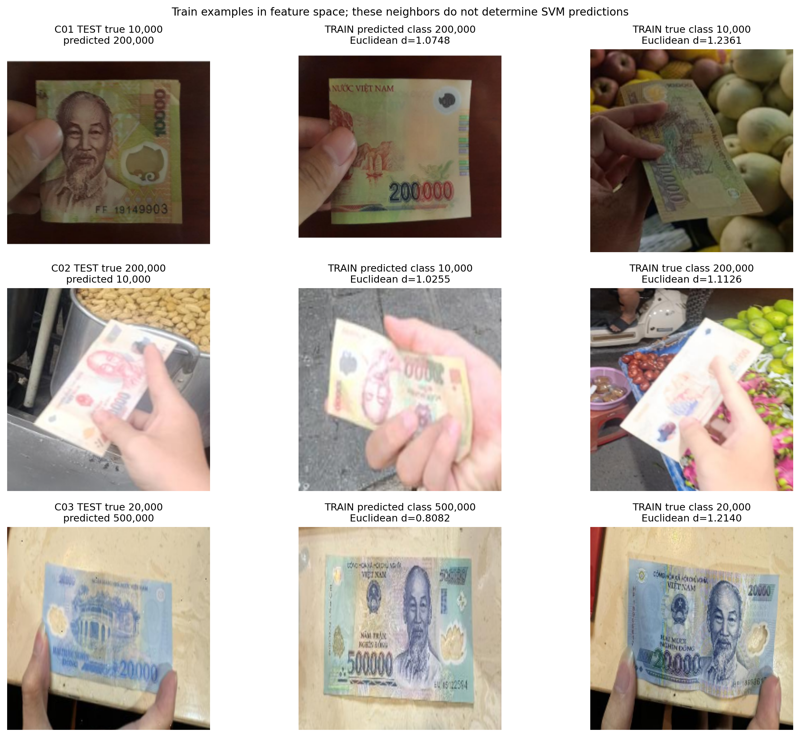

# SVM — Kết quả cuối của nhóm

Cấu hình chọn trên dev: **HSV12 + HOG, SVC RBF, C=10, gamma=scale.**

## Chọn cấu hình trên dev

| Biểu diễn | Kernel | C | Gamma | Accuracy | Macro-F1 | MAE (đ/ảnh) |
|---|---|---|---|---|---|---|
| HSV12_HOG | rbf | 10.0 | scale | 87.85% | 0.881213 | 27,653.45 |
| HSV12 | rbf | 10.0 | scale | 87.40% | 0.879544 | 29,705.88 |
| HSV12_HOG_PCA | rbf | 10.0 | scale | 84.40% | 0.846732 | 36,809.46 |
| HOG_PCA | rbf | 10.0 | scale | 52.69% | 0.514872 | 99,757.03 |
| HOG | rbf | 10.0 | scale | 51.85% | 0.506556 | 100,409.21 |

## Đánh giá test

| Mô hình | Đúng | Sai | Accuracy | Macro-F1 | MAE (đ/ảnh) |
|---|---|---|---|---|---|
| SVM | 1362 | 191 | 87.70% | 0.881102 | 32,891.18 |

## Xem ảnh lỗi

Các hình là kết quả thực nghiệm thật. Ảnh train gần của SVM chỉ dùng đối chiếu; heatmap CNN chưa chứng minh nguyên nhân lỗi.

Các CSV/JSON lưu số liệu gốc. `SOURCE.json` ghi nguồn; cấu hình đầy đủ nằm trong `inputs/experiment_config.json` và `selection/`. Đây là bộ kết quả đã dùng trong slide, không tự thay đổi khi chạy code mới. Model/checkpoint và ma trận lớn được Git bỏ qua; sau khi clone cần chạy lại notebook để tạo chúng hoặc dùng Output đã lưu của nhóm.
